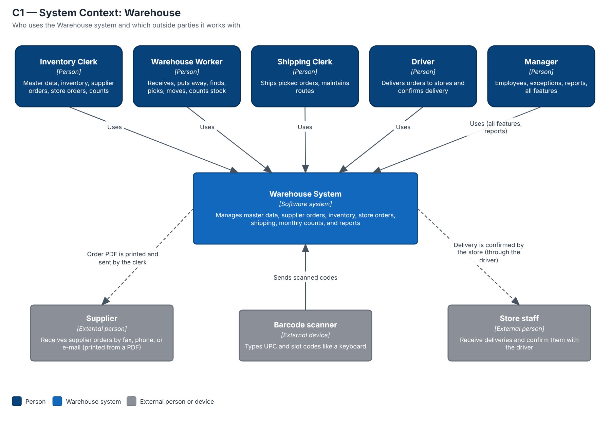
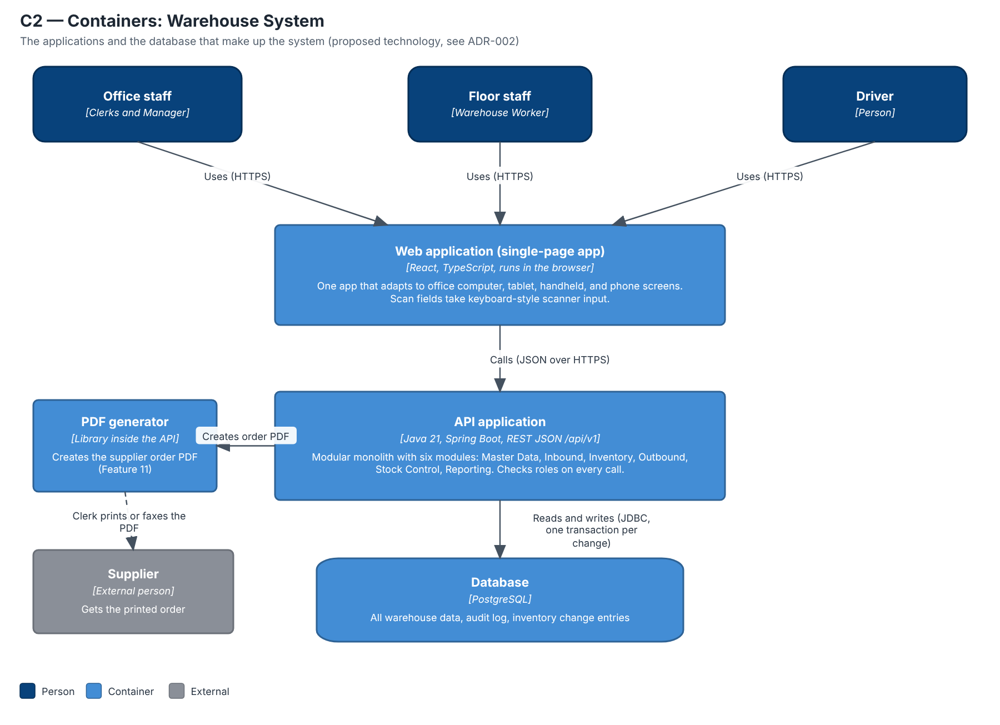
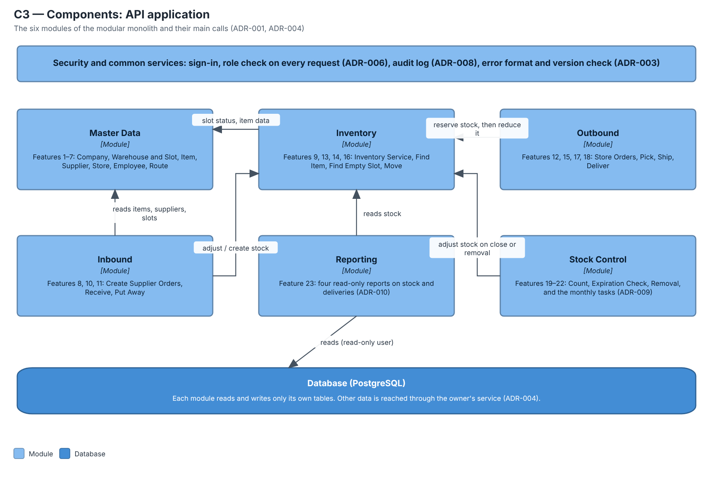
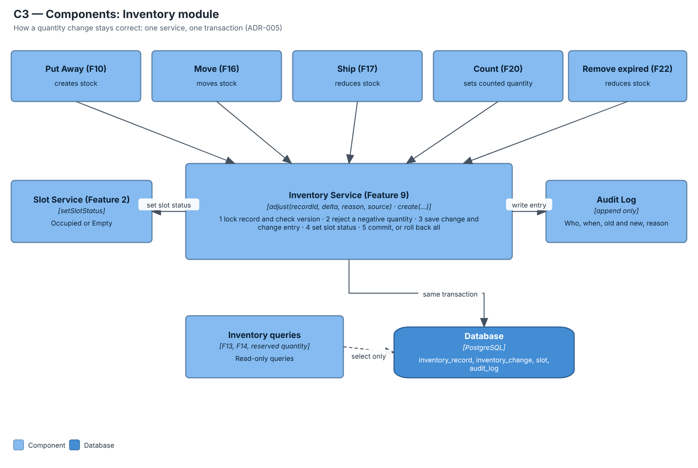
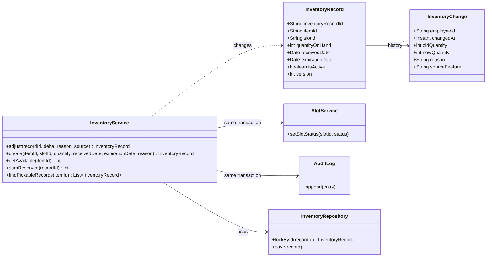
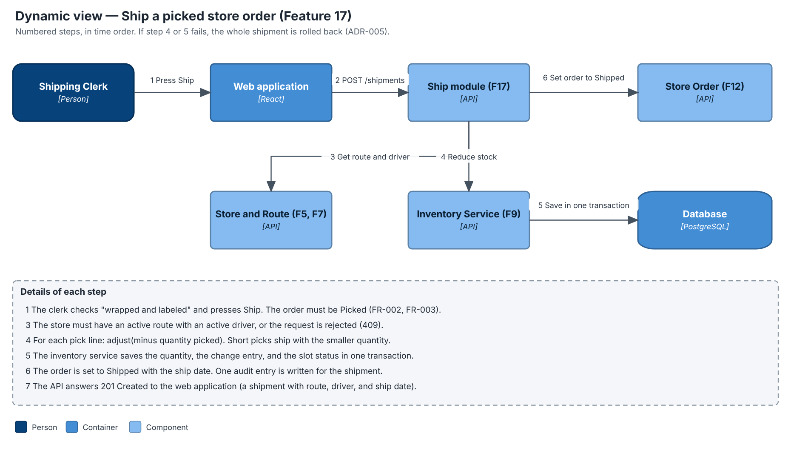
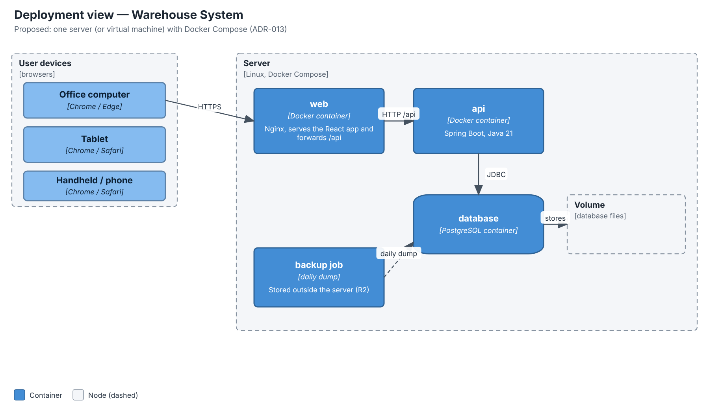

# Architecture diagrams 

These diagrams use the C4 model: each level zooms in one step. They are a **draft proposal** and follow the decisions in the [ADRs](../ADRs/README.md). The technology (Java, Spring Boot, React, PostgreSQL) is proposed in [ADR-002](../ADRs/ADR-002-technology-stack.md) and can change.

| Level | Diagram | Question it answers |
|---|---|---|
| 1 | [C1 System Context](#c1--system-context) | Who uses the system, and what is outside it? |
| 2 | [C2 Containers](#c2--containers) | Which applications and databases make up the system? |
| 3 | [C3 Components](#c3--components-api-application-the-six-modules) and [Inventory module](#c3--components-inventory-module) | What are the parts inside the API application? |
| 4 | [C4 Code](#c4--code-inventory-service) | How is the most important part built in code? |
| Extra | [Dynamic view](#dynamic-view--ship-a-picked-store-order) and [Deployment](#deployment-view) | How does a request flow, and where does it run? |

## C1 — System Context

The Warehouse system is used by five roles. It talks to no other software: the supplier order is printed or faxed by a clerk (ADR-011), stores confirm delivery through the driver, and barcode scanners act like keyboards (ADR-012).

## C2 — Containers

Three kinds of people use one web app. The web app calls one API application, which is the only part that reads and writes the PostgreSQL database (ADR-001, ADR-002, ADR-003).

## C3 — Components: API application (the six modules)

Modules call each other only through public services. Feature 9's inventory service is the only code that changes quantity (ADR-005): Inbound, Outbound, and Stock Control all call it.

## C3 — Components: Inventory module

Five features need to change stock. They all call the same inventory service, which updates the quantity, the slot status, and the audit log in one transaction. Find Item and Find Empty Slot only read.

## C4 — Code: Inventory service

The classes of the inventory service (Feature 9). The source is in [C4-code-inventory-service.mmd](C4-code-inventory-service.mmd) (Mermaid), so it can be edited. `InventoryService` is the only class that changes `quantityOnHand` (ADR-005).

## Dynamic view — Ship a picked store order

The numbered arrows show one successful shipment from the click to the answer.

## Deployment view

All parts run on one server for this course project. Users reach it with a browser through HTTPS. A daily backup is kept outside the server.

## Module and feature map

| Module | Features |
|---|---|
| Master Data | [1](../../features/feature-1-maintain-company.md), [2](../../features/feature-2-maintain-warehouse.md), [3](../../features/feature-3-maintain-items.md), [4](../../features/feature-4-maintain-suppliers.md), [5](../../features/feature-5-maintain-stores.md), [6](../../features/feature-6-maintain-employess.md), [7](../../features/feature-7-maintain-routes.md) |
| Inbound | [8](../../features/feature-8-receive-supplier-orders.md), [10](../../features/feature-10-put-away-supplier-orders.md), [11](../../features/feature-11-create-supplier-orders.md) |
| Inventory | [9](../../features/feature-9-maintain-inventory.md), [13](../../features/feature-13-find-item.md), [14](../../features/feature-14-find-empty-slot.md), [16](../../features/feature-16-move-inventory.md) |
| Outbound | [12](../../features/feature-12-enter-store-order.md), [15](../../features/feature-15-pick-store-orders.md), [17](../../features/feature-17-ship-store-orders.md), [18](../../features/feature-18-receive-store-orders.md) |
| Stock Control | [19](../../features/feature-19-initiate-inventory-count.md), [20](../../features/feature-20-count-inventory.md), [21](../../features/feature-21-initial-check-for-exp-inventory.md), [22](../../features/feature-22-remove-expired-inventory.md) |
| Reporting | [23](../../features/feature-23-view-reports.md) |

SVG versions of the diagrams are in this folder too (same file names, `.svg`).
