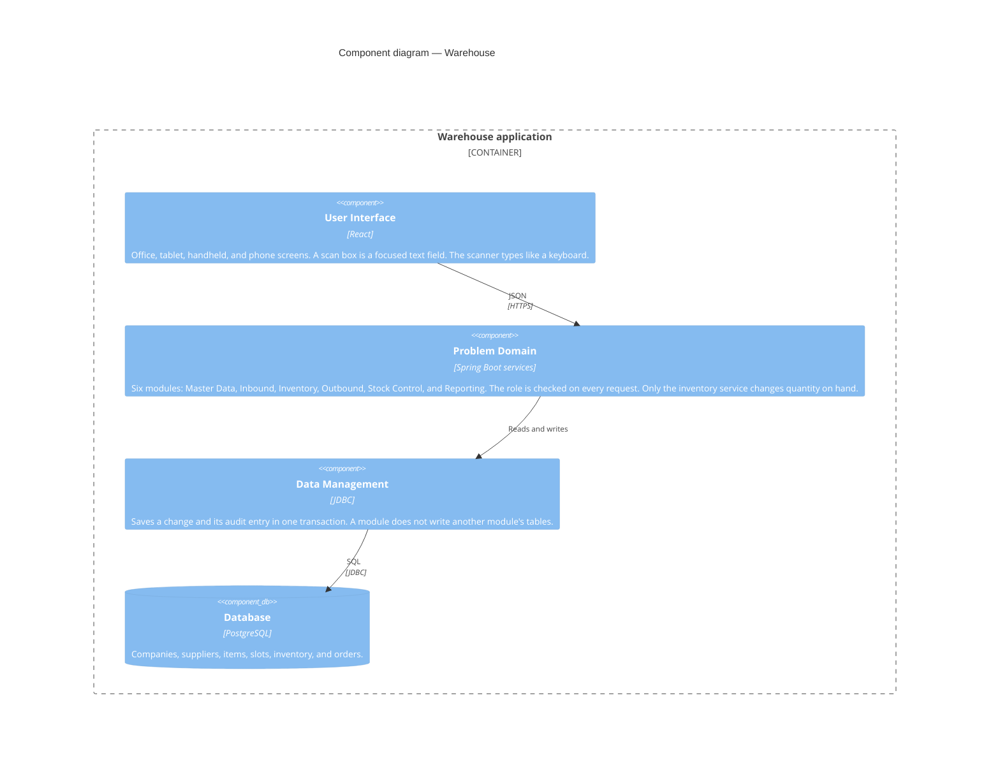

# C4 — Components

Major parts of the Warehouse application. The names follow the same split as the POS example: **User Interface**, **Problem Domain**, **Data Management**, and **Database**.

## Notes

- Master Data is Features 1–7. Inbound is 8, 10, and 11. Inventory is 9, 13, 14, and 16. Outbound is 12, 15, 17, and 18. Stock Control is 19–22. Reporting is 23 and is read-only.
- Hiding a button on the screen does not replace the role check. The API rejects a wrong role.

**Related:** [ADR-001](../adr/0001-modular-monolith.md) · [ADR-005](../adr/0005-inventory-service.md) · [ADR-006](../adr/0006-role-based-access-control.md)
