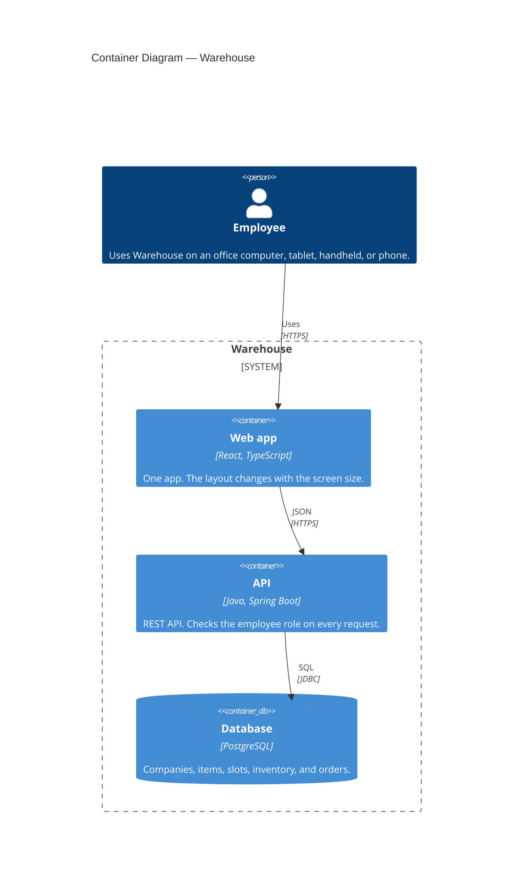

# C4 Level 2 — Containers

One web app in the browser calls one API. The API is the only program that reads and writes the database.

## Notes

- There is one application and one database (a modular monolith).
- The browser never decides the role. The API reads the employee record.

**Related:** [ADR-001](../adr/0001-modular-monolith.md) · [ADR-002](../adr/0002-technology-stack.md) · [ADR-003](../adr/0003-rest-api-conventions.md)
