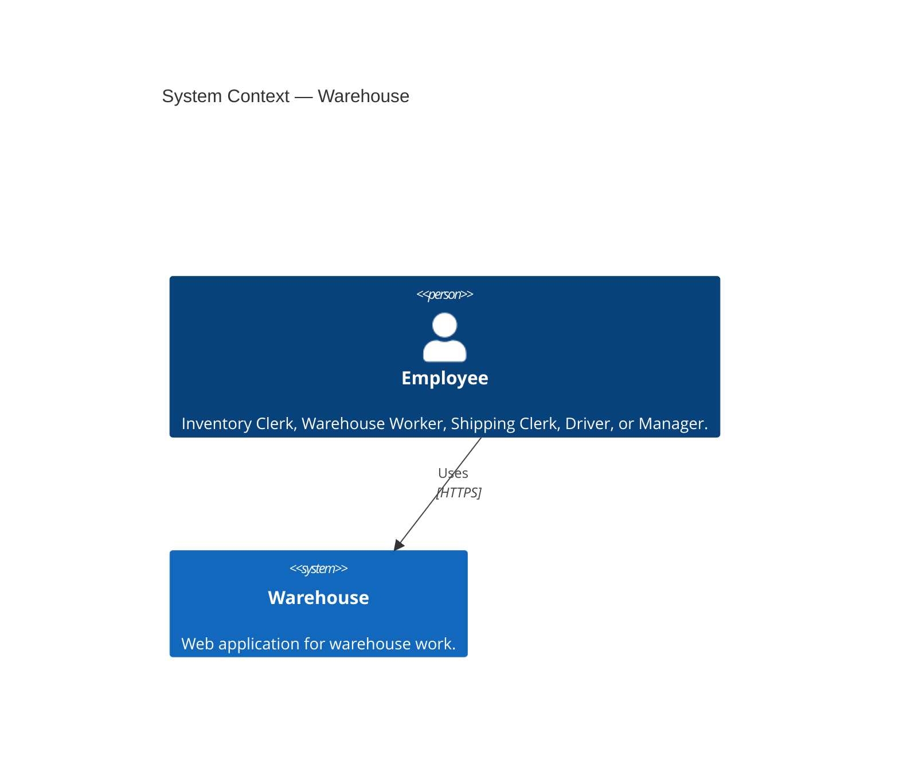

# C4 Level 1 — System context

Employees use one Warehouse web application. It does not call any other software. A supplier order is printed or faxed by a clerk, and a barcode scanner types into the page like a keyboard.

## Notes

- The five roles share this one system. The server checks the role on every request.
- The [container diagram](./c4-container.md) shows the web app, the API, and the database inside this system.

**Related:** [ADR-001](../adr/0001-modular-monolith.md) · [ADR-006](../adr/0006-role-based-access-control.md) · [ADR-011](../adr/0011-supplier-order-document.md) · [ADR-012](../adr/0012-barcode-scanner-input.md)
