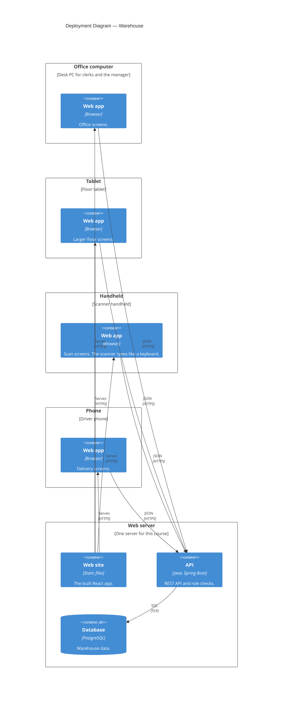

# C4 — Deployment

Each person uses a separate device. Those devices are separate hardware, so each one is its own box. The office computer, tablet, handheld, and phone only run the web app in a browser. One server runs the site, the API, and the database.

## Notes

- The four devices are not one shared computer. Each employee device is drawn separately because it is its own hardware.
- The same web app is loaded on every device. The screen layout changes with the device.
- A daily backup is kept off this server. It is an operations copy, not another application.

**Related:** [ADR-002](../adr/0002-technology-stack.md) · [ADR-012](../adr/0012-barcode-scanner-input.md) · [ADR-013](../adr/0013-docker-and-ci.md)
