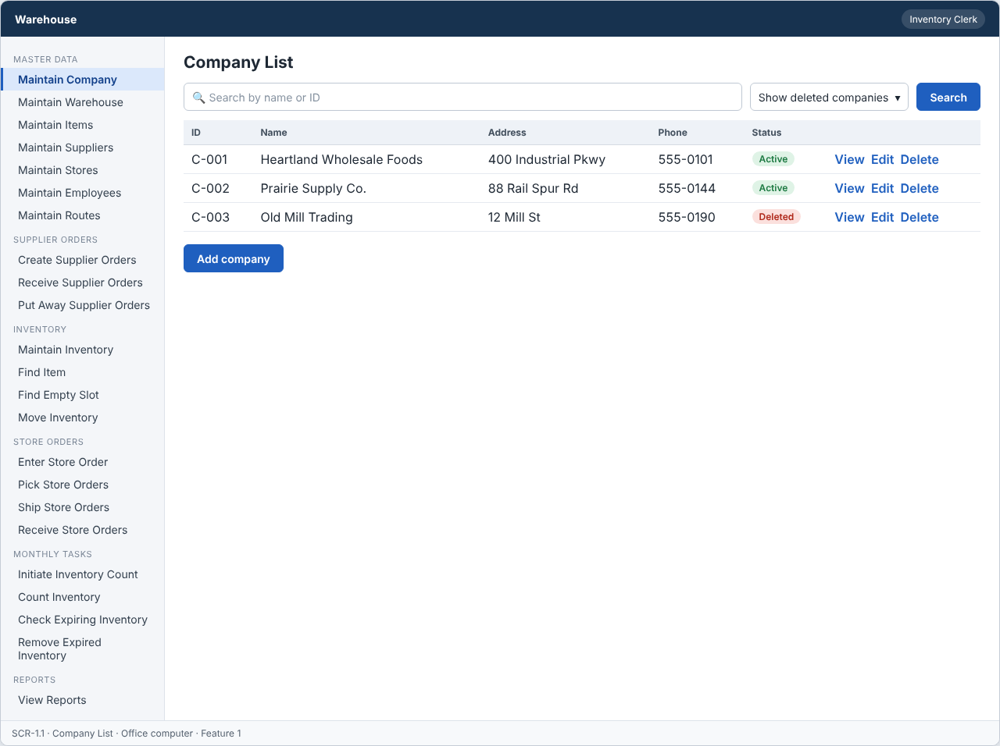
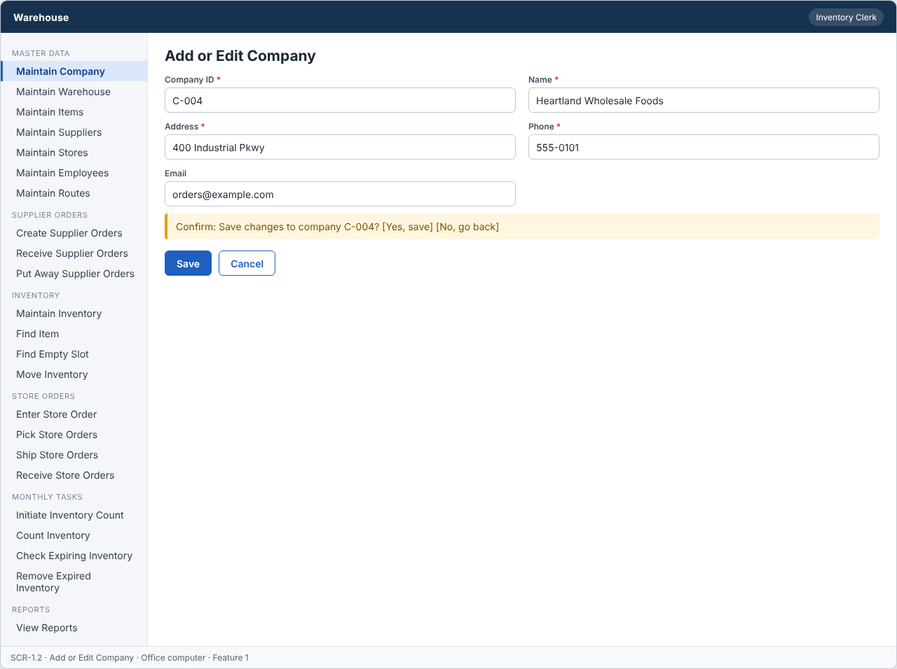
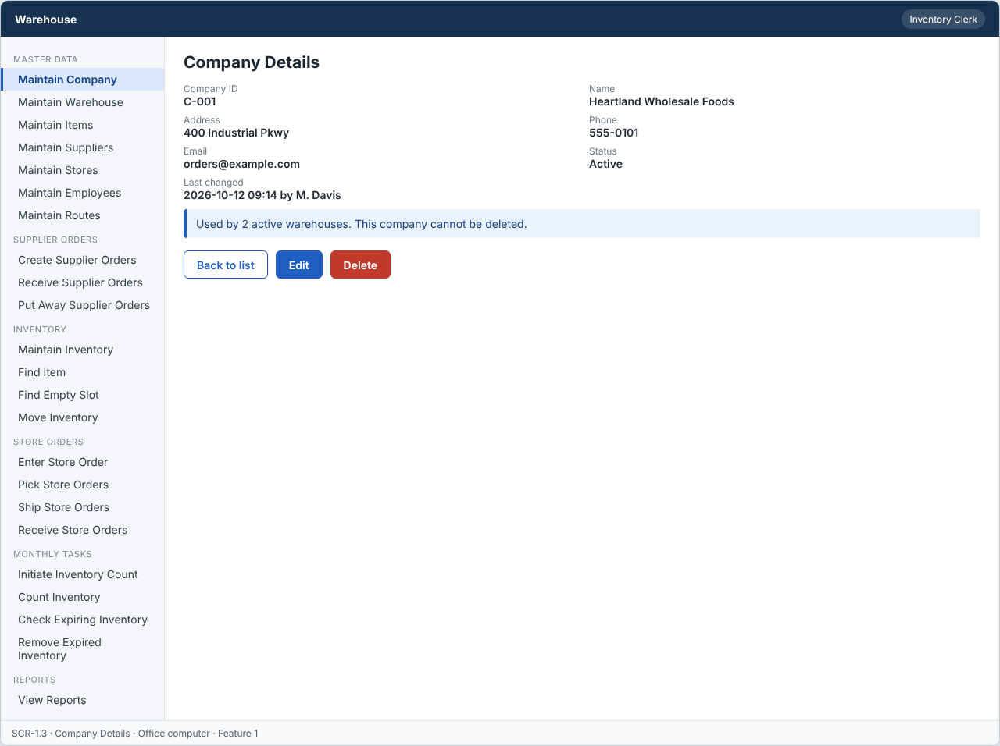

# Feature: Maintain Company

**Feature ID:** 1
**Branch pattern:** `feature/1-maintain-company`
**Status:** Draft
**Created:** 2026-09-26
**Input:** Maintain company information for the Warehouse system.
**Depends on:** None

---

## User Stories

### US-1.1: Add company

**As an** inventory clerk
**I want to** add a company
**So that** the system can maintain companies.
**Priority:** P1
**Independent test:** Add a company and verify that it is saved. 
**Acceptance Scenarios:** see ### US-1.1 under Gherkin AC

### US-1.2: Edit company

**As an** inventory clerk
**I want to** edit a company
**So that** company information stays accurate.
**Priority:** P1
**Independent test:** Edit a company and verify that the change is saved. 
**Acceptance Scenarios:** see ### US-1.2 under Gherkin AC

### US-1.3: Delete company

**As an** inventory clerk
**I want to** delete a company
**So that** incorrect or unused companies can be removed.
**Priority:** P1
**Independent test:** Delete a company and verify that it is no longer active. 
**Acceptance Scenarios:** see ### US-1.3 under Gherkin AC

### US-1.4: View company

**As an** inventory clerk
**I want to** view company information
**So that** I can see the current company information.
**Priority:** P1
**Independent test:** Open a company and verify the current information is displayed. 
**Acceptance Scenarios:** see ### US-1.4 under Gherkin AC

---

## Functional Requirements

- **FR-001:** The system MUST maintain companies.
- **FR-002:** Each company MUST have a unique identifier.
- **FR-003:** The system MUST allow authorized users to add companies.
- **FR-004:** The system MUST allow authorized users to edit companies.
- **FR-005:** The system MUST allow authorized users to delete companies.
- **FR-006:** The system MUST allow authorized users to view companies.
- **FR-007:** Required company information MUST be provided before the company can be saved (name, address, phone).
- **FR-008:** The system MUST reject duplicate company identifiers.
- **FR-009:** The system MUST NOT delete a company that is used by a warehouse.
- **FR-010:** Deleting a company MUST only remove it from active records, so other features keep the original company information.
- **FR-011:** The system MUST let an inventory clerk and a manager use this feature (main user: inventory clerk), and MUST NOT let other roles change its information.
- **FR-012:** The system MUST work on an office computer.
- **FR-013:** This feature is not used very often, so the system MUST ask the user to confirm before saving a change.

---

## Assumptions

- **A-1:** The warehouse belongs to one company, so the list is short (usually 1 to 5 companies). The screens still work for more.
- **A-2:** The inventory clerk types the company ID (for example C-001), or accepts the next free number the screen suggests. The ID never changes after the company is saved.
- **A-3:** A company is "used" when at least one active warehouse refers to it. A company that only has deleted warehouses can be deleted.
- **A-4:** Field limits: name 100 characters, address 200, phone 20, email 254. Phone may contain digits, spaces, +, -, and brackets, with at least 7 digits.
- **A-5:** Inventory clerks and managers add, edit, delete, and view companies. Other roles cannot open this feature (assumption: least privilege).
- **A-6:** "Delete" means the company is set to inactive (`is_active = false`). Nothing is removed from the database (ADR-007). Restoring a deleted company is not offered.
- **A-7:** Everyone signs in before using the system, and the role comes from the employee record (ADR-006).

---

## Edge Cases

| ID | Situation | Expected behavior | Related |
|---|---|---|---|
| EC-1 | The name, address, or phone contains only spaces. | The system trims spaces and treats the field as missing. The company is not saved. | FR-007 |
| EC-2 | A new ID differs from an existing ID only by letter case ("c-001" and "C-001"). | The system treats them as the same ID and rejects the duplicate. | FR-002, FR-008 |
| EC-3 | The phone number contains letters, or the email address has no "@". | The system rejects the value and shows a message next to the field. | FR-007 |
| EC-4 | A field is longer than its limit (for example, a name with 150 characters). | The system rejects the value and shows the limit in the message. | FR-007 |
| EC-5 | Two clerks open the same company, and both save a change. | The first save works. The second save is rejected with VERSION_CONFLICT, and the screen offers to reload the newest data. | FR-004 |
| EC-6 | A clerk deletes a company at the same moment another clerk adds a warehouse to it. | The delete checks usage and sets the company inactive in one transaction, so either the delete or the new warehouse is accepted, never both. | FR-009 |
| EC-7 | A company that is already deleted is deleted again or edited. | The system answers NOT_FOUND, because only active companies can be changed. Nothing changes. | FR-005, FR-010 |
| EC-8 | The clerk clicks Save, the confirmation appears, and the network drops before the save finishes. | Nothing is saved, the clerk sees an error with a reference code, and the entered values stay on the screen. | FR-013 |
| EC-9 | A driver sends a request to the API directly (not through the screen). | The server answers FORBIDDEN_ROLE and changes nothing. The attempt is written to the audit log. | FR-011 |

---

## Success Criteria

- **SC-1:** An inventory clerk adds a new company in less than 1 minute, using the keyboard only.
- **SC-2:** 100% of attempts to save a company with a missing required field or a duplicate ID are rejected, and the message names the problem.
- **SC-3:** A company used by an active warehouse is never deleted (0 cases in testing, including the two-clerk race test).
- **SC-4:** After a company is deleted, 100% of past records still show the original company name and address.
- **SC-5:** All 12 Gherkin scenarios in this file pass as automated tests, and each user story's independent test is shown to work in a demo.

---

## Key Entities

- **Company** — The company operating the warehouses.

---

## Initial Data Model

### Company

- company_id: String — Required, unique
- name: String — Required
- address: String — Required
- phone: String — Required
- email: String — Optional
- is_active: Boolean — Required, false after delete

---

## Gherkin AC

### US-1.1 — Add company

#### Scenario: Company is saved

- **Given** a company does not already exist
- **When** the inventory clerk enters the required company information and saves
- **Then** the system saves the company

#### Scenario: Company is not saved due to missing information

- **Given** a company is being added
- **When** required company information is missing
- **Then** the system does not save the company

#### Scenario: Duplicate company ID is rejected

- **Given** a company with the same identifier already exists
- **When** the inventory clerk tries to add a company with that identifier
- **Then** the system rejects the duplicate company

#### Scenario: Wrong role cannot change information

- **Given** a driver is signed in
- **When** the driver tries to change information in this feature
- **Then** the system rejects the change

#### Scenario: Confirm before saving

- **Given** the user changes information
- **When** the user clicks save
- **Then** the system asks the user to confirm

### US-1.2 — Edit company

#### Scenario: Company is edited successfully

- **Given** a company exists
- **When** the inventory clerk changes company information and saves
- **Then** the system saves the updated company

#### Scenario: Company edit fails

- **Given** a company exists
- **When** required information is removed during edit
- **Then** the system does not save the update

### US-1.3 — Delete company

#### Scenario: Company is deleted successfully

- **Given** a company exists and is not in use
- **When** the inventory clerk deletes the company
- **Then** the system removes the company from active records

#### Scenario: Company used by a warehouse cannot be deleted

- **Given** a company is used by a warehouse
- **When** the inventory clerk tries to delete it
- **Then** the system rejects the delete operation
- **And** the company and the other records stay unchanged

#### Scenario: Deleted company does not change past records

- **Given** a company was deleted and past records refer to it
- **When** someone views those past records
- **Then** the system still shows the original company information

#### Scenario: Delete unknown company fails

- **Given** the company does not exist
- **When** the inventory clerk tries to delete it
- **Then** the system rejects the delete operation

### US-1.4 — View company

#### Scenario: Company information is displayed

- **Given** a company exists
- **When** the inventory clerk views the company
- **Then** the system displays the company information

---

## Data Ownership

| Data | Owner | This feature | Notes |
|---|---|---|---|
| Company | This feature (Feature 1) | Owns | Creates, edits, and sets companies inactive. |
| Warehouse | [Feature 2 — Maintain Warehouse](feature-2-maintain-warehouse.md) | Reads | Usage check only: is an active warehouse using this company? Used before a delete. |
| Audit Log Entry | Platform (cross-cutting) | Updates (via owner) | Writes one entry for each add, edit, delete, and denied attempt. |

**Rule:** each piece of data has one owning feature. A feature that needs to change data it does not own must call the owner's service, and must never write the owner's tables directly (ADR-004).

---

## API Requirements

Base path: `/api/v1`. All endpoints follow [ADR-003](../docs/ADRs/ADR-003-rest-api-conventions.md) (JSON, problem+json errors, `version` field for optimistic locking). Roles are checked on the server for every call ([NFR-S2](../docs/NFR.md)).

| # | Method and path | Purpose | Allowed roles | Success | Errors | Supports |
|---|---|---|---|---|---|---|
| 1 | `GET /companies` | List companies. Query: `search` (name or ID), `includeInactive` (default false). | Inventory Clerk, Manager | 200 | — | US-1.4 |
| 2 | `POST /companies` | Add a company. | Inventory Clerk, Manager | 201 + Location | 400 VALIDATION_FAILED, 409 DUPLICATE | US-1.1 |
| 3 | `GET /companies/{companyId}` | Get one company with its last changed date. | Inventory Clerk, Manager | 200 | 404 NOT_FOUND | US-1.4 |
| 4 | `PUT /companies/{companyId}` | Change a company. The body must include `version`. | Inventory Clerk, Manager | 200 | 400 VALIDATION_FAILED, 404 NOT_FOUND, 409 VERSION_CONFLICT | US-1.2 |
| 5 | `DELETE /companies/{companyId}` | Set a company inactive. | Inventory Clerk, Manager | 204 | 404 NOT_FOUND, 409 IN_USE (an active warehouse uses it) | US-1.3 |

**Request and response notes**

- Body for POST and PUT: `company_id` (POST only), `name`, `address`, `phone`, `email` (optional). Response adds `is_active`, `version`, `updated_at`, `updated_by`.
- Duplicate IDs are compared without letter case. The error body names the field (`company_id`).
- The confirmation dialog before saving (FR-013) is a screen rule. The API does not need a confirm flag.

**Calls to other features (internal service calls, not public endpoints)**

- Feature 2 — Maintain Warehouse: `countActiveWarehousesForCompany(companyId)` before a delete.

---

## Screen Requirements

The screen images are in [docs/UI](../docs/UI/README.md). Each image is a wireframe: it shows layout and content, not final colors.

| Screen | Name | Device | Purpose | Image | Stories |
|---|---|---|---|---|---|
| SCR-1.1 | Company List | Office computer | Find a company and start an add, edit, or delete. | [image](../docs/UI/images/scr-1-1-company-list.png) | US-1.4 |
| SCR-1.2 | Add or Edit Company | Office computer | Enter or change company information, then confirm the save. | [image](../docs/UI/images/scr-1-2-add-or-edit-company.png) | US-1.1, US-1.2 |
| SCR-1.3 | Company Details | Office computer | Show the current company information. | [image](../docs/UI/images/scr-1-3-company-details.png) | US-1.4, US-1.3 |

### SCR-1.1 — Company List

**Device:** Office computer. **Purpose:** Find a company and start an add, edit, or delete.

- Search box (Search by name or ID) and filters (Show deleted companies).
- Table with columns: ID, Name, Address, Phone, Status.
- Buttons: Add company.

### SCR-1.2 — Add or Edit Company

**Device:** Office computer. **Purpose:** Enter or change company information, then confirm the save.

- Fields: Company ID (required), Name (required), Address (required), Phone (required), Email.
- Message (warn): Confirm: Save changes to company C-004?  [Yes, save]  [No, go back]
- Buttons: Save, Cancel.
- The confirmation message appears every time the clerk clicks Save (FR-013).
- Company ID is read-only when editing.

### SCR-1.3 — Company Details

**Device:** Office computer. **Purpose:** Show the current company information.

- Details shown: Company ID, Name, Address, Phone, Email, Status, Last changed.
- Message (info): Used by 2 active warehouses. This company cannot be deleted.
- Buttons: Back to list, Edit, Delete.
- Delete is disabled and the message explains why when an active warehouse uses the company.

---

## Definition of Done

This feature is done when all of these are true:

- [ ] All 4 user stories are built, and each story's independent test passes.
- [ ] All 13 functional requirements are built, and each one is covered by a Gherkin scenario, a unit test, or an NFR check.
- [ ] All 12 Gherkin scenarios are automated and pass in the build.
- [ ] The 5 API endpoints match the API Requirements table, are in the OpenAPI file, and have tests for success and for every listed error.
- [ ] The role rules are enforced on the server for every endpoint, with a test for a role that is not allowed.
- [ ] The screens (SCR-1.1, SCR-1.2, SCR-1.3) match the images in `docs/UI`, and were checked on: office computer.
- [ ] Validation messages show next to the field, and what the user typed stays on the screen after an error.
- [ ] Database changes (tables, keys, unique rules, not-null rules, checks) are in a migration script and match the Initial Data Model.
- [ ] Every create, edit, delete, and status change writes an audit log entry (who, when, what changed).
- [ ] A test shows that a company used by an active warehouse cannot be deleted, even when two requests arrive at the same time.
- [ ] These non-functional checks pass (see [NFR](../docs/NFR.md)): NFR-U1, NFR-U5, NFR-U9, NFR-P1, NFR-S1, NFR-S2, NFR-S4, NFR-D1, NFR-D3, NFR-D4, NFR-A1, NFR-M1.
- [ ] The code is reviewed in a pull request and merged into `main` with no open critical bugs.
- [ ] This feature file, the UI images, and the API table are updated if anything changed during the build.

---

## Out of Scope

- Restoring a deleted company.
- Company logos, tax numbers, bank details, or other documents.
- Importing or exporting companies from a file.
- User accounts and passwords (see ADR-006).
- Showing company information to drivers or warehouse workers.
