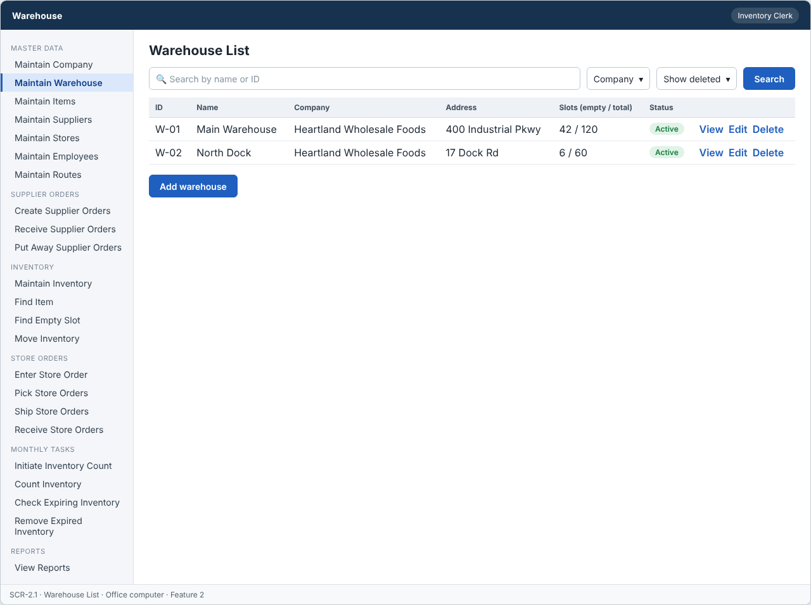
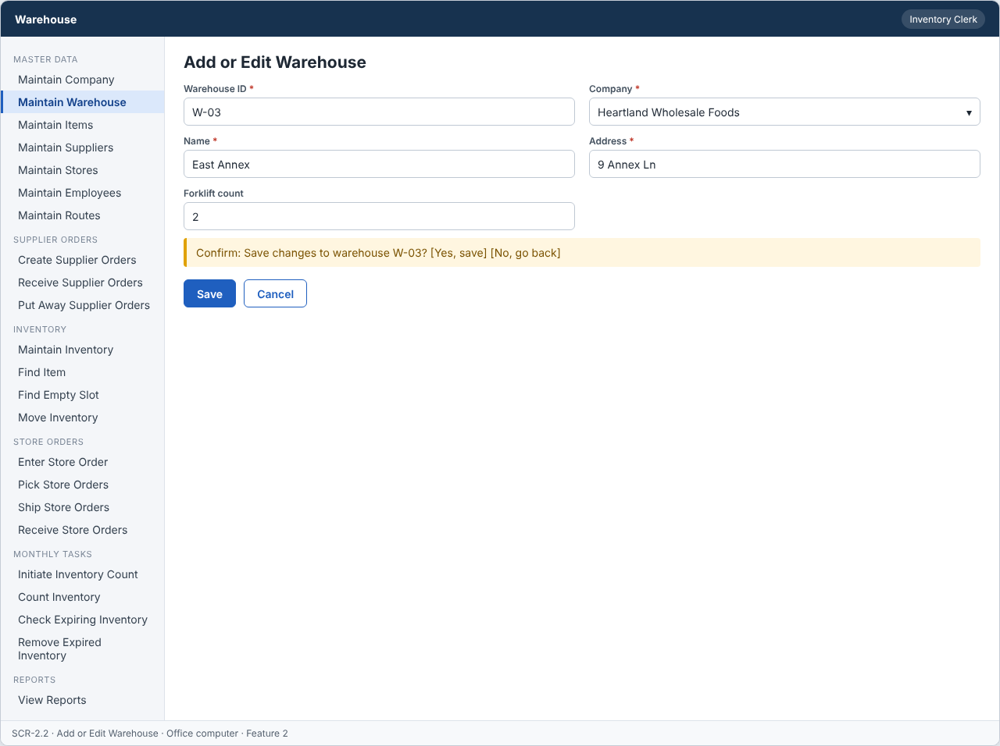
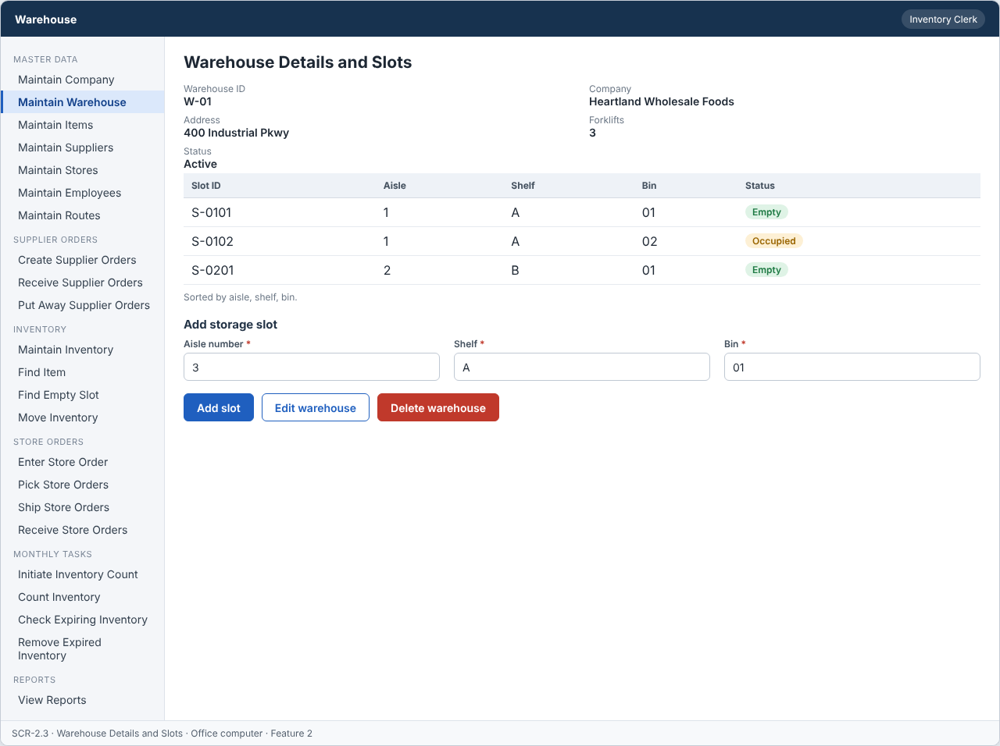

# Feature: Maintain Warehouse

**Feature ID:** 2
**Branch pattern:** `feature/2-maintain-warehouse`
**Status:** Draft
**Created:** 2026-09-25
**Input:** Maintain warehouse information, numbered aisles, and storage slots.
**Depends on:** [Feature 1 — Maintain Company](feature-1-maintain-company.md)

---

## User Stories

### US-2.1: Add warehouse

**As an** inventory clerk
**I want to** add a warehouse
**So that** the system can maintain warehouses.
**Priority:** P1
**Independent test:** Add a warehouse and verify that it is saved.
**Acceptance Scenarios:** see ### US-2.1 under Gherkin AC

### US-2.2: Edit warehouse

**As an** inventory clerk
**I want to** edit a warehouse
**So that** warehouse information stays accurate.
**Priority:** P1
**Independent test:** Edit a warehouse and verify that the change is saved.
**Acceptance Scenarios:** see ### US-2.2 under Gherkin AC

### US-2.3: Delete warehouse

**As an** inventory clerk
**I want to** delete a warehouse
**So that** incorrect or unused warehouses can be removed.
**Priority:** P1
**Independent test:** Delete a warehouse and verify that it is no longer active. 
**Acceptance Scenarios:** see ### US-2.3 under Gherkin AC

### US-2.4: View warehouse

**As a** warehouse worker
**I want to** view warehouse information
**So that** I can see where inventory is stored.
**Priority:** P1
**Independent test:** Open a warehouse and verify the current information is displayed. 
**Acceptance Scenarios:** see ### US-2.4 under Gherkin AC

### US-2.5: Add storage slot

**As an** inventory clerk
**I want to** add a storage slot to a numbered aisle
**So that** every item has a place to be stored.
**Priority:** P1
**Independent test:** Add a slot to a warehouse and verify it is saved as Empty. 
**Acceptance Scenarios:** see ### US-2.5 under Gherkin AC

---

## Functional Requirements

- **FR-001:** The system MUST maintain warehouses.
- **FR-002:** Each warehouse MUST have a unique identifier.
- **FR-003:** The system MUST allow authorized users to add warehouses.
- **FR-004:** The system MUST allow authorized users to edit warehouses.
- **FR-005:** The system MUST allow authorized users to delete warehouses.
- **FR-006:** The system MUST allow authorized users to view warehouses.
- **FR-007:** Required warehouse information MUST be provided before the warehouse can be saved (name, address).
- **FR-008:** The system MUST reject duplicate warehouse identifiers.
- **FR-009:** The system MUST NOT delete a warehouse that is used by inventory in its slots or an open inventory count.
- **FR-010:** Deleting a warehouse MUST only remove it from active records, so other features keep the original warehouse information.
- **FR-011:** The system MUST allow authorized users to add numbered aisles and storage slots (aisle, shelf, bin) to a warehouse.
- **FR-012:** A new storage slot MUST start with status Empty.
- **FR-013:** The system MUST reject a duplicate slot in the same warehouse.
- **FR-014:** The system MUST let an inventory clerk, a warehouse worker, and a manager use this feature (main user: inventory clerk), and MUST NOT let other roles change its information.
- **FR-015:** The system MUST work on an office computer.
- **FR-016:** This feature is not used very often, so the system MUST ask the user to confirm before saving a change.

---

## Assumptions

- **A-1:** A company can have several warehouses. A warehouse belongs to one active company.
- **A-2:** A slot is identified by warehouse, aisle number, shelf, and bin. One slot holds one item at a time (FR in Feature 16 and 10 depend on this).
- **A-3:** The clerk types the warehouse ID, or accepts the next free number. The ID and the company do not change after saving.
- **A-4:** Inventory clerks and managers add, edit, delete, and add slots. Warehouse workers view only (assumption: least privilege, and the user stories match this).
- **A-5:** A warehouse is "used" when an active inventory record sits in one of its slots, or when an inventory count for it is Open or Counted (not Closed).
- **A-6:** Slots start Empty. The system changes a slot to Occupied or Empty when inventory changes. A person never edits slot status by hand.
- **A-7:** Editing or deleting a slot is not in the requirements, so this feature only adds slots.

---

## Edge Cases

| ID | Situation | Expected behavior | Related |
|---|---|---|---|
| EC-1 | A warehouse has inventory in one slot only, and the clerk tries to delete it. | The system rejects the delete (IN_USE) and names the count of occupied slots. | FR-009 |
| EC-2 | A warehouse has an inventory count with status Counted (all lines entered, not closed). | The system treats the count as open and rejects the delete. | FR-009 |
| EC-3 | The clerk adds a slot with aisle number 0 or a negative number. | The system rejects it. The aisle number must be greater than zero. | FR-011 |
| EC-4 | The same aisle, shelf, and bin are entered twice in one warehouse, with different letter case ("a1" and "A1"). | The system rejects the second slot as a duplicate. The same aisle, shelf, and bin in another warehouse is allowed. | FR-013 |
| EC-5 | The clerk adds 200 slots one by one. | Each slot saves in under 1 second. The slot list in the warehouse stays sorted by aisle, shelf, and bin. | FR-011 |
| EC-6 | The forklift count is negative or not a whole number. | The system rejects the value. The field is optional, so an empty value is fine. | FR-007 |
| EC-7 | The company of a new warehouse was deleted a minute ago. | The system rejects the warehouse because the company must be active. | FR-007 |
| EC-8 | Two clerks edit the same warehouse at the same time. | The second save is rejected with VERSION_CONFLICT. | FR-004 |
| EC-9 | The clerk clicks Save and the confirmation dialog stays open for 10 minutes. | The save still works if no one else changed the record. If someone did, the clerk gets VERSION_CONFLICT. | FR-016 |

---

## Success Criteria

- **SC-1:** A clerk adds a warehouse and its first 20 slots in under 10 minutes.
- **SC-2:** 100% of duplicate slots in the same warehouse are rejected, and the same slot code in another warehouse is accepted.
- **SC-3:** A warehouse with inventory or an open count is never deleted (0 cases in testing).
- **SC-4:** A new slot always shows status Empty, and no screen lets a person change slot status by hand.
- **SC-5:** All 15 Gherkin scenarios in this file pass as automated tests, and each user story's independent test is shown to work in a demo.

---

## Key Entities

- **Warehouse** — A physical warehouse where inventory is stored.
- **Slot** — A numbered storage location (aisle, shelf, bin) inside a warehouse.

---

## Initial Data Model

### Warehouse

- warehouse_id: String — Required, unique
- company_id: Company reference — Required
- name: String — Required
- address: String — Required
- forklift_count: Integer — Optional, zero or greater
- is_active: Boolean — Required, false after delete

### Slot

- slot_id: String — Required, unique
- warehouse_id: Warehouse reference — Required
- aisle_number: Integer — Required, greater than zero
- shelf: String — Required
- bin: String — Required
- status: String/Enum — Empty, Occupied

---

## Gherkin AC

### US-2.1 — Add warehouse

#### Scenario: Warehouse is saved

- **Given** a warehouse does not already exist
- **When** the inventory clerk enters the required warehouse information and saves
- **Then** the system saves the warehouse

#### Scenario: Warehouse is not saved due to missing information

- **Given** a warehouse is being added
- **When** required warehouse information is missing
- **Then** the system does not save the warehouse

#### Scenario: Duplicate warehouse ID is rejected

- **Given** a warehouse with the same identifier already exists
- **When** the inventory clerk tries to add a warehouse with that identifier
- **Then** the system rejects the duplicate warehouse

#### Scenario: Wrong role cannot change information

- **Given** a driver is signed in
- **When** the driver tries to change information in this feature
- **Then** the system rejects the change

#### Scenario: Confirm before saving

- **Given** the user changes information
- **When** the user clicks save
- **Then** the system asks the user to confirm

### US-2.2 — Edit warehouse

#### Scenario: Warehouse is edited successfully

- **Given** a warehouse exists
- **When** the inventory clerk changes warehouse information and saves
- **Then** the system saves the updated warehouse

#### Scenario: Warehouse edit fails

- **Given** a warehouse exists
- **When** required information is removed during edit
- **Then** the system does not save the update

### US-2.3 — Delete warehouse

#### Scenario: Warehouse is deleted successfully

- **Given** a warehouse exists and is not in use
- **When** the inventory clerk deletes the warehouse
- **Then** the system removes the warehouse from active records

#### Scenario: Warehouse used by inventory in its slots cannot be deleted

- **Given** a warehouse is used by inventory in its slots
- **When** the inventory clerk tries to delete it
- **Then** the system rejects the delete operation
- **And** the warehouse and the other records stay unchanged

#### Scenario: Warehouse used by an open inventory count cannot be deleted

- **Given** a warehouse is used by an open inventory count
- **When** the inventory clerk tries to delete it
- **Then** the system rejects the delete operation
- **And** the warehouse and the other records stay unchanged

#### Scenario: Deleted warehouse does not change past records

- **Given** a warehouse was deleted and past records refer to it
- **When** someone views those past records
- **Then** the system still shows the original warehouse information

#### Scenario: Delete unknown warehouse fails

- **Given** the warehouse does not exist
- **When** the inventory clerk tries to delete it
- **Then** the system rejects the delete operation

### US-2.4 — View warehouse

#### Scenario: Warehouse information is displayed

- **Given** a warehouse exists
- **When** the warehouse worker views the warehouse
- **Then** the system displays the warehouse information

### US-2.5 — Add storage slot

#### Scenario: Slot is saved as empty

- **Given** a warehouse exists
- **When** the clerk enters an aisle number, shelf, and bin and saves
- **Then** the system saves the slot
- **And** the slot status is Empty

#### Scenario: Duplicate slot is rejected

- **Given** a slot already exists in the warehouse
- **When** the clerk tries to add the same aisle, shelf, and bin
- **Then** the system rejects the duplicate slot

---

## Data Ownership

| Data | Owner | This feature | Notes |
|---|---|---|---|
| Warehouse | This feature (Feature 2) | Owns | Creates, edits, and sets warehouses inactive. |
| Slot | This feature (Feature 2) | Owns | Creates slots (status Empty). Other features change the status only through this feature's slot status service. |
| Company | [Feature 1 — Maintain Company](feature-1-maintain-company.md) | Reads | A warehouse must refer to an active company. |
| Inventory Record | [Feature 9 — Maintain Inventory](feature-9-maintain-inventory.md) | Reads | Usage check: is there inventory in a slot of this warehouse? |
| Inventory Count | [Feature 19 — Initiate Inventory Count](feature-19-initiate-inventory-count.md) | Reads | Usage check: is a count for this warehouse Open or Counted? |
| Audit Log Entry | Platform (cross-cutting) | Updates (via owner) | Writes one entry for each change and denied attempt. |

**Rule:** each piece of data has one owning feature. A feature that needs to change data it does not own must call the owner's service, and must never write the owner's tables directly (ADR-004).

**Slot status:** Feature 9 (Inventory) calls `setSlotStatus(slotId, Empty|Occupied)` in this feature when a quantity changes, in the same transaction as the inventory change.

---

## API Requirements

Base path: `/api/v1`. All endpoints follow [ADR-003](../docs/ADRs/ADR-003-rest-api-conventions.md) (JSON, problem+json errors, `version` field for optimistic locking). Roles are checked on the server for every call ([NFR-S2](../docs/NFR.md)).

| # | Method and path | Purpose | Allowed roles | Success | Errors | Supports |
|---|---|---|---|---|---|---|
| 1 | `GET /warehouses` | List warehouses. Query: `search`, `includeInactive`. | Inventory Clerk, Warehouse Worker, Manager | 200 | — | US-2.4 |
| 2 | `POST /warehouses` | Add a warehouse. | Inventory Clerk, Manager | 201 + Location | 400 VALIDATION_FAILED, 409 DUPLICATE | US-2.1 |
| 3 | `GET /warehouses/{warehouseId}` | Get one warehouse with slot counts (total, empty, occupied). | Inventory Clerk, Warehouse Worker, Manager | 200 | 404 NOT_FOUND | US-2.4 |
| 4 | `PUT /warehouses/{warehouseId}` | Change a warehouse. The body must include `version`. | Inventory Clerk, Manager | 200 | 400 VALIDATION_FAILED, 404 NOT_FOUND, 409 VERSION_CONFLICT | US-2.2 |
| 5 | `DELETE /warehouses/{warehouseId}` | Set a warehouse inactive. | Inventory Clerk, Manager | 204 | 404 NOT_FOUND, 409 IN_USE (inventory in slots, or an open count) | US-2.3 |
| 6 | `GET /warehouses/{warehouseId}/slots` | List slots, sorted by aisle, shelf, bin. Query: `status` (Empty or Occupied). | Inventory Clerk, Warehouse Worker, Manager | 200 | 404 NOT_FOUND | US-2.4, US-2.5 |
| 7 | `POST /warehouses/{warehouseId}/slots` | Add a slot. The new slot has status Empty. | Inventory Clerk, Manager | 201 + Location | 400 VALIDATION_FAILED, 404 NOT_FOUND, 409 DUPLICATE | US-2.5 |

**Request and response notes**

- Warehouse body: `warehouse_id` (POST only), `company_id`, `name`, `address`, `forklift_count` (optional).
- Slot body: `slot_id`, `aisle_number` (greater than zero), `shelf`, `bin`. The server ignores any `status` sent by the client.

**Calls to other features (internal service calls, not public endpoints)**

- Feature 1 — Maintain Company: `isActive(companyId)` when a warehouse is added or its company changes.
- Feature 9 — Maintain Inventory: `countActiveInventoryInWarehouse(warehouseId)` before a delete.
- Feature 19 — Initiate Inventory Count: `hasOpenCount(warehouseId)` before a delete.

---

## Screen Requirements

The screen images are in [docs/UI](../docs/UI/README.md). Each image is a wireframe: it shows layout and content, not final colors.

| Screen | Name | Device | Purpose | Image | Stories |
|---|---|---|---|---|---|
| SCR-2.1 | Warehouse List | Office computer | Find a warehouse and start an add, edit, or delete. | [image](../docs/UI/images/scr-2-1-warehouse-list.png) | US-2.4 |
| SCR-2.2 | Add or Edit Warehouse | Office computer | Enter or change warehouse information, then confirm the save. | [image](../docs/UI/images/scr-2-2-add-or-edit-warehouse.png) | US-2.1, US-2.2 |
| SCR-2.3 | Warehouse Details and Slots | Office computer | Show the warehouse and its slots, and add a slot. | [image](../docs/UI/images/scr-2-3-warehouse-details-and-slots.png) | US-2.4, US-2.5 |

### SCR-2.1 — Warehouse List

**Device:** Office computer. **Purpose:** Find a warehouse and start an add, edit, or delete.

- Search box (Search by name or ID) and filters (Company, Show deleted).
- Table with columns: ID, Name, Company, Address, Slots (empty / total), Status.
- Buttons: Add warehouse.

### SCR-2.2 — Add or Edit Warehouse

**Device:** Office computer. **Purpose:** Enter or change warehouse information, then confirm the save.

- Fields: Warehouse ID (required), Company (required), Name (required), Address (required), Forklift count.
- Message (warn): Confirm: Save changes to warehouse W-03?  [Yes, save]  [No, go back]
- Buttons: Save, Cancel.
- The confirmation message appears every time the clerk clicks Save (FR-016).
- Only active companies are in the Company list.

### SCR-2.3 — Warehouse Details and Slots

**Device:** Office computer. **Purpose:** Show the warehouse and its slots, and add a slot.

- Details shown: Warehouse ID, Company, Address, Forklifts, Status.
- Table with columns: Slot ID, Aisle, Shelf, Bin, Status. Sorted by aisle, shelf, bin.
- Add storage slot: Aisle number (required), Shelf (required), Bin (required).
- Buttons: Add slot, Edit warehouse, Delete warehouse.
- A new slot is saved with status Empty. The status cannot be edited on this screen.
- Delete is disabled with an explanation when the warehouse has inventory or an open count.

---

## Definition of Done

This feature is done when all of these are true:

- [ ] All 5 user stories are built, and each story's independent test passes.
- [ ] All 16 functional requirements are built, and each one is covered by a Gherkin scenario, a unit test, or an NFR check.
- [ ] All 15 Gherkin scenarios are automated and pass in the build.
- [ ] The 7 API endpoints match the API Requirements table, are in the OpenAPI file, and have tests for success and for every listed error.
- [ ] The role rules are enforced on the server for every endpoint, with a test for a role that is not allowed.
- [ ] The screens (SCR-2.1, SCR-2.2, SCR-2.3) match the images in `docs/UI`, and were checked on: office computer.
- [ ] Validation messages show next to the field, and what the user typed stays on the screen after an error.
- [ ] Database changes (tables, keys, unique rules, not-null rules, checks) are in a migration script and match the Initial Data Model.
- [ ] Every create, edit, delete, and status change writes an audit log entry (who, when, what changed).
- [ ] A test shows that the slot status changes only through the slot status service, and never through a public endpoint.
- [ ] These non-functional checks pass (see [NFR](../docs/NFR.md)): NFR-U1, NFR-U5, NFR-U9, NFR-P1, NFR-S1, NFR-S2, NFR-S4, NFR-D1, NFR-D2, NFR-D3, NFR-D4, NFR-A1, NFR-M1.
- [ ] The code is reviewed in a pull request and merged into `main` with no open critical bugs.
- [ ] This feature file, the UI images, and the API table are updated if anything changed during the build.

---

## Out of Scope

- Editing or deleting a slot.
- Drawing a map of the warehouse or showing the slot position on a floor plan.
- Slot size, weight limits, or temperature zones.
- Moving a warehouse to another company.
- Restoring a deleted warehouse.
