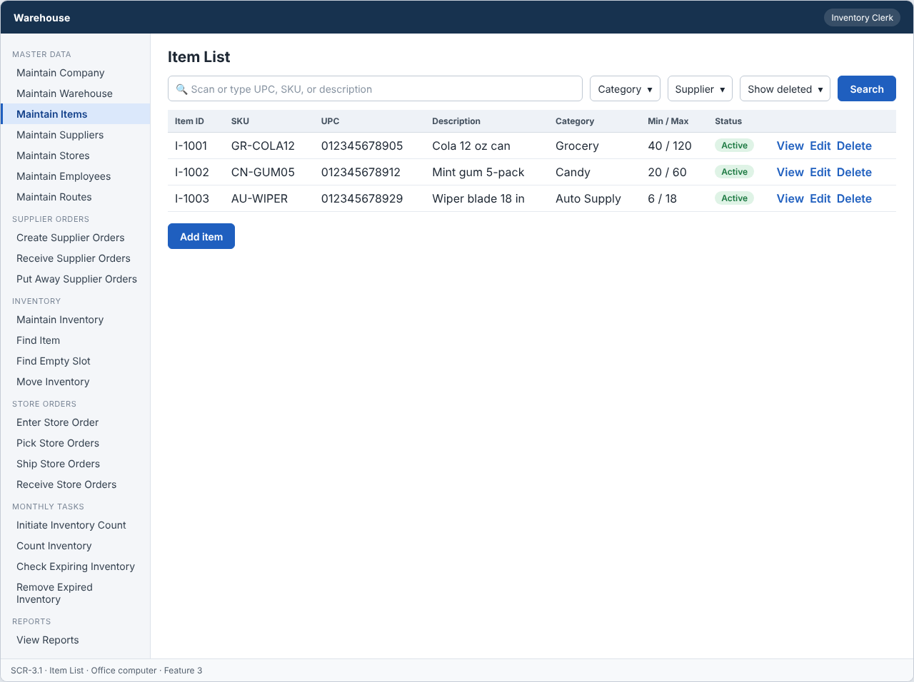
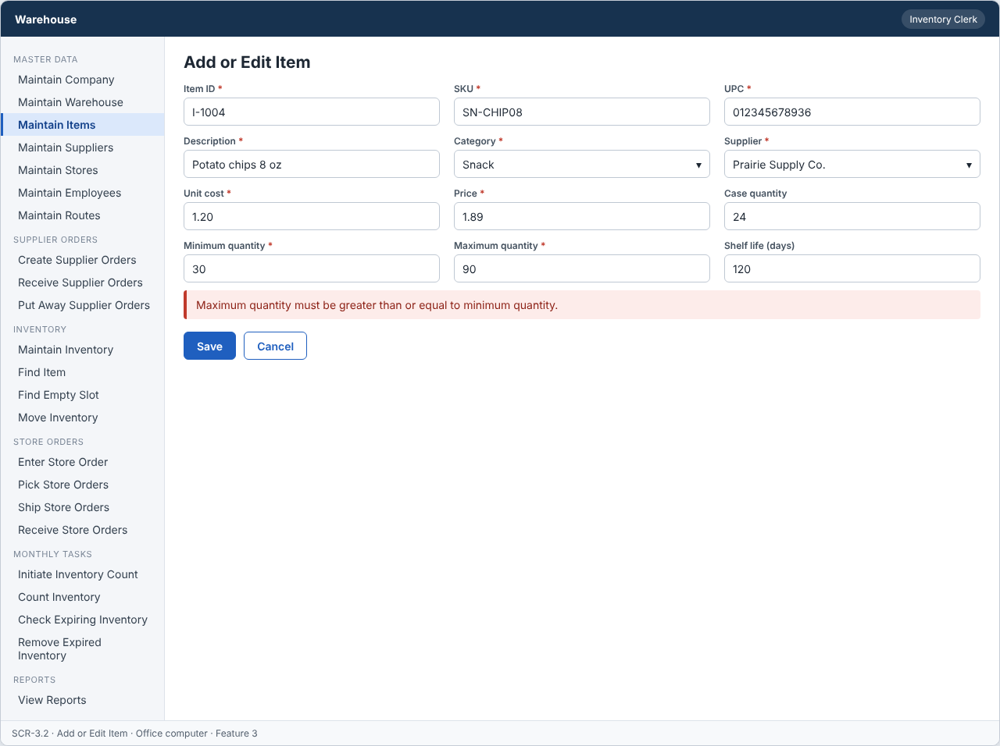
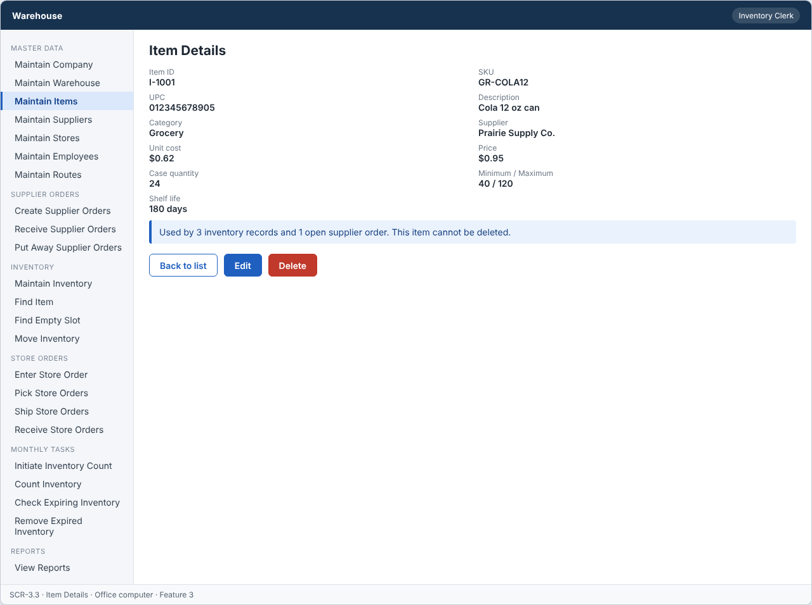

# Feature: Maintain Items

**Feature ID:** 3
**Branch pattern:** `feature/3-maintain-items`
**Status:** Draft
**Created:** 2026-09-26
**Input:** Maintain item information, UPC numbers, prices, and minimum and maximum quantities.
**Depends on:** [Feature 4 — Maintain Suppliers](feature-4-maintain-suppliers.md)

---

## User Stories

### US-3.1: Add item

**As an** inventory clerk
**I want to** add an item
**So that** the system can maintain items.
**Priority:** P1
**Independent test:** Add an item and verify that it is saved. 
**Acceptance Scenarios:** see ### US-3.1 under Gherkin AC

### US-3.2: Edit item

**As an** inventory clerk
**I want to** edit an item
**So that** item information stays accurate.
**Priority:** P1
**Independent test:** Edit an item and verify that the change is saved. 
**Acceptance Scenarios:** see ### US-3.2 under Gherkin AC

### US-3.3: Delete item

**As an** inventory clerk
**I want to** delete an item
**So that** incorrect or unused items can be removed.
**Priority:** P1
**Independent test:** Delete an item and verify that it is no longer active. 
**Acceptance Scenarios:** see ### US-3.3 under Gherkin AC

### US-3.4: View item

**As a** warehouse worker
**I want to** view item information
**So that** I can identify the product.
**Priority:** P1
**Independent test:** Open an item and verify the current information is displayed. 
**Acceptance Scenarios:** see ### US-3.4 under Gherkin AC

---

## Functional Requirements

- **FR-001:** The system MUST maintain items.
- **FR-002:** Each item MUST have a unique identifier.
- **FR-003:** The system MUST allow authorized users to add items.
- **FR-004:** The system MUST allow authorized users to edit items.
- **FR-005:** The system MUST allow authorized users to delete items.
- **FR-006:** The system MUST allow authorized users to view items.
- **FR-007:** Required item information MUST be provided before the item can be saved (SKU, UPC, description, supplier, cost, price, minimum quantity, maximum quantity).
- **FR-008:** The system MUST reject duplicate item identifiers.
- **FR-009:** The system MUST NOT delete an item that is used by an inventory record, an open supplier order or an open store order.
- **FR-010:** Deleting an item MUST only remove it from active records, so other features keep the original item information.
- **FR-011:** The system MUST reject duplicate SKU values.
- **FR-012:** The system MUST reject duplicate UPC values.
- **FR-013:** Maximum quantity MUST be greater than or equal to minimum quantity.
- **FR-014:** The system MUST keep minimum and maximum quantity so supplier orders can be calculated.
- **FR-015:** The system MUST let an inventory clerk, a warehouse worker, and a manager use this feature (main user: inventory clerk), and MUST NOT let other roles change its information.
- **FR-016:** The system MUST work on an office computer.
- **FR-017:** This feature is used every day, so each screen MUST need as few steps and clicks as possible.

---

## Assumptions

- **A-1:** Each item has one supplier. Items sold by two suppliers are two items in this version.
- **A-2:** SKU is the warehouse's own code. UPC is the barcode number (12 digits for UPC-A). Both are unique across all items, including deleted ones.
- **A-3:** The clerk types the item ID, or accepts the next free number. The ID never changes.
- **A-4:** Categories are fixed: Grocery, Candy, Snack, Beauty, Auto Supply.
- **A-5:** Money values have two decimal places and use one currency (US dollars). The price is what the store pays.
- **A-6:** An item is "used" when an active inventory record, an open supplier order (Draft or Sent), or an open store order (not yet Delivered) refers to it.
- **A-7:** Inventory clerks and managers add, edit, and delete. Warehouse workers view only (assumption: least privilege).
- **A-8:** This feature is used every day, so the list opens with search focused and the form keeps tab order short (NFR-U4).

---

## Edge Cases

| ID | Situation | Expected behavior | Related |
|---|---|---|---|
| EC-1 | The UPC has fewer than 12 digits, or contains letters. | The system rejects it with a message that explains the format. | FR-007, FR-012 |
| EC-2 | The clerk changes the SKU of an item to a SKU that a deleted item used. | The system rejects it. SKU and UPC stay unique across all items, including deleted ones. | FR-011 |
| EC-3 | Maximum quantity equals minimum quantity (for example, both are 10). | The system accepts it. Maximum must be greater than or equal to minimum. | FR-013 |
| EC-4 | Minimum quantity is 0. | The system accepts it (an item that is only ordered on demand). | FR-007, FR-013 |
| EC-5 | The case quantity is 0 or negative. | The system rejects it. Case quantity is optional but must be greater than zero when entered. | FR-007 |
| EC-6 | Unit cost is higher than price. | The system saves it and shows a warning that the margin is negative. | FR-007 |
| EC-7 | The shelf life is entered for an item that never expires. | The field is optional, so it stays empty for such items. Receiving then does not ask for an expiration date. | FR-007 |
| EC-8 | The supplier of a new item was deleted a minute ago. | The system rejects the item because the supplier must be active. | FR-007 |
| EC-9 | A clerk changes the minimum and maximum while a supplier order is being created. | The order uses the values that were saved when the clerk opened the suggestions. The clerk can refresh to use the new values. | FR-014 |
| EC-10 | A manager deletes an item that has only deleted inventory records. | The delete is allowed. Past records keep the original item information. | FR-009, FR-010 |

---

## Success Criteria

- **SC-1:** A clerk finds an item in the list by UPC, SKU, or part of the description in under 5 seconds.
- **SC-2:** 100% of items saved have a unique ID, SKU, and UPC, and a maximum that is not below the minimum.
- **SC-3:** An item used by inventory or an open order is never deleted (0 cases in testing).
- **SC-4:** Adding an item takes at most 3 screens or dialogs and no more than 12 clicks, counting from the item list.
- **SC-5:** All 16 Gherkin scenarios in this file pass as automated tests, and each user story's independent test is shown to work in a demo.

---

## Key Entities

- **Item** — A product bought from a supplier and sold to stores.

---

## Initial Data Model

### Item

- item_id: String — Required, unique
- sku: String — Required, unique
- upc: String — Required, unique
- description: String — Required
- category: String/Enum — Grocery, Candy, Snack, Beauty, Auto Supply
- supplier_id: Supplier reference — Required
- unit_cost: Decimal — Required, zero or greater
- price: Decimal — Required, zero or greater
- case_quantity: Integer — Optional, greater than zero
- minimum_quantity: Integer — Required, zero or greater
- maximum_quantity: Integer — Required, greater than or equal to minimum
- shelf_life_days: Integer — Optional, greater than zero
- is_active: Boolean — Required, false after delete

---

## Gherkin AC

### US-3.1 — Add item

#### Scenario: Item is saved

- **Given** an item does not already exist
- **When** the inventory clerk enters the required item information and saves
- **Then** the system saves the item

#### Scenario: Item is not saved due to missing information

- **Given** an item is being added
- **When** required item information is missing
- **Then** the system does not save the item

#### Scenario: Duplicate item ID is rejected

- **Given** an item with the same identifier already exists
- **When** the inventory clerk tries to add an item with that identifier
- **Then** the system rejects the duplicate item

#### Scenario: Duplicate SKU is rejected

- **Given** an item with a SKU already exists
- **When** the clerk tries to add another item with the same SKU
- **Then** the system rejects the duplicate SKU

#### Scenario: Duplicate UPC is rejected

- **Given** an item with a UPC already exists
- **When** the clerk tries to add another item with the same UPC
- **Then** the system rejects the duplicate UPC

#### Scenario: Maximum is less than minimum

- **Given** an item is being added
- **When** the clerk enters a minimum of 15 and a maximum of 10
- **Then** the system does not save the item

#### Scenario: Wrong role cannot change information

- **Given** a driver is signed in
- **When** the driver tries to change information in this feature
- **Then** the system rejects the change

### US-3.2 — Edit item

#### Scenario: Item is edited successfully

- **Given** an item exists
- **When** the inventory clerk changes item information and saves
- **Then** the system saves the updated item

#### Scenario: Item edit fails

- **Given** an item exists
- **When** required information is removed during edit
- **Then** the system does not save the update

### US-3.3 — Delete item

#### Scenario: Item is deleted successfully

- **Given** an item exists and is not in use
- **When** the inventory clerk deletes the item
- **Then** the system removes the item from active records

#### Scenario: Item used by an inventory record cannot be deleted

- **Given** an item is used by an inventory record
- **When** the inventory clerk tries to delete it
- **Then** the system rejects the delete operation
- **And** the item and the other records stay unchanged

#### Scenario: Item used by an open supplier order cannot be deleted

- **Given** an item is used by an open supplier order
- **When** the inventory clerk tries to delete it
- **Then** the system rejects the delete operation
- **And** the item and the other records stay unchanged

#### Scenario: Item used by an open store order cannot be deleted

- **Given** an item is used by an open store order
- **When** the inventory clerk tries to delete it
- **Then** the system rejects the delete operation
- **And** the item and the other records stay unchanged

#### Scenario: Deleted item does not change past records

- **Given** an item was deleted and past records refer to it
- **When** someone views those past records
- **Then** the system still shows the original item information

#### Scenario: Delete unknown item fails

- **Given** the item does not exist
- **When** the inventory clerk tries to delete it
- **Then** the system rejects the delete operation

### US-3.4 — View item

#### Scenario: Item information is displayed

- **Given** an item exists
- **When** the warehouse worker views the item
- **Then** the system displays the item information

---

## Data Ownership

| Data | Owner | This feature | Notes |
|---|---|---|---|
| Item | This feature (Feature 3) | Owns | Creates, edits, and sets items inactive. Keeps minimum and maximum quantity for ordering. |
| Supplier | [Feature 4 — Maintain Suppliers](feature-4-maintain-suppliers.md) | Reads | An item must refer to an active supplier. |
| Inventory Record | [Feature 9 — Maintain Inventory](feature-9-maintain-inventory.md) | Reads | Usage check before a delete. |
| Supplier Order Item | [Feature 11 — Create Supplier Orders](feature-11-create-supplier-orders.md) | Reads | Usage check: is the item on a Draft or Sent supplier order? |
| Store Order Item | [Feature 12 — Enter Store Order](feature-12-enter-store-order.md) | Reads | Usage check: is the item on a store order that is not Delivered? |
| Audit Log Entry | Platform (cross-cutting) | Updates (via owner) | Writes one entry for each change and denied attempt. |

**Rule:** each piece of data has one owning feature. A feature that needs to change data it does not own must call the owner's service, and must never write the owner's tables directly (ADR-004).

---

## API Requirements

Base path: `/api/v1`. All endpoints follow [ADR-003](../docs/ADRs/ADR-003-rest-api-conventions.md) (JSON, problem+json errors, `version` field for optimistic locking). Roles are checked on the server for every call ([NFR-S2](../docs/NFR.md)).

| # | Method and path | Purpose | Allowed roles | Success | Errors | Supports |
|---|---|---|---|---|---|---|
| 1 | `GET /items` | List items. Query: `search` (UPC, SKU, description), `category`, `supplierId`, `includeInactive`. | Inventory Clerk, Warehouse Worker, Manager | 200 | — | US-3.4 |
| 2 | `POST /items` | Add an item. | Inventory Clerk, Manager | 201 + Location | 400 VALIDATION_FAILED (including max below min), 409 DUPLICATE (ID, SKU, or UPC) | US-3.1 |
| 3 | `GET /items/{itemId}` | Get one item. | Inventory Clerk, Warehouse Worker, Manager | 200 | 404 NOT_FOUND | US-3.4 |
| 4 | `PUT /items/{itemId}` | Change an item. The body must include `version`. | Inventory Clerk, Manager | 200 | 400 VALIDATION_FAILED, 404 NOT_FOUND, 409 DUPLICATE, 409 VERSION_CONFLICT | US-3.2 |
| 5 | `DELETE /items/{itemId}` | Set an item inactive. | Inventory Clerk, Manager | 204 | 404 NOT_FOUND, 409 IN_USE (inventory, open supplier order, or open store order) | US-3.3 |

**Request and response notes**

- Body: `item_id` (POST only), `sku`, `upc`, `description`, `category`, `supplier_id`, `unit_cost`, `price`, `case_quantity` (optional), `minimum_quantity`, `maximum_quantity`, `shelf_life_days` (optional).
- The error body for DUPLICATE names the field that clashed (`item_id`, `sku`, or `upc`).

**Calls to other features (internal service calls, not public endpoints)**

- Feature 4 — Maintain Suppliers: `isActive(supplierId)` when an item is added or its supplier changes.
- Feature 9, 11, 12: usage checks before a delete (`countActiveInventoryForItem`, `countOpenSupplierOrderItems`, `countOpenStoreOrderItems`).

---

## Screen Requirements

The screen images are in [docs/UI](../docs/UI/README.md). Each image is a wireframe: it shows layout and content, not final colors.

| Screen | Name | Device | Purpose | Image | Stories |
|---|---|---|---|---|---|
| SCR-3.1 | Item List | Office computer | Find an item by UPC, SKU, or description with as few clicks as possible. | [image](../docs/UI/images/scr-3-1-item-list.png) | US-3.4 |
| SCR-3.2 | Add or Edit Item | Office computer | Enter or change item information. | [image](../docs/UI/images/scr-3-2-add-or-edit-item.png) | US-3.1, US-3.2 |
| SCR-3.3 | Item Details | Office computer | Show the current item information for a worker or clerk. | [image](../docs/UI/images/scr-3-3-item-details.png) | US-3.4, US-3.3 |

### SCR-3.1 — Item List

**Device:** Office computer. **Purpose:** Find an item by UPC, SKU, or description with as few clicks as possible.

- Search box (Scan or type UPC, SKU, or description) and filters (Category, Supplier, Show deleted).
- Table with columns: Item ID, SKU, UPC, Description, Category, Min / Max, Status.
- Buttons: Add item.

### SCR-3.2 — Add or Edit Item

**Device:** Office computer. **Purpose:** Enter or change item information.

- Fields: Item ID (required), SKU (required), UPC (required), Description (required), Category (required), Supplier (required), Unit cost (required), Price (required), Case quantity, Minimum quantity (required), Maximum quantity (required), Shelf life (days).
- Message (error): Maximum quantity must be greater than or equal to minimum quantity.
- Buttons: Save, Cancel.
- Errors show next to the field, and the typed values stay on the screen.
- A warning (not an error) shows when unit cost is higher than price.

### SCR-3.3 — Item Details

**Device:** Office computer. **Purpose:** Show the current item information for a worker or clerk.

- Details shown: Item ID, SKU, UPC, Description, Category, Supplier, Unit cost, Price, Case quantity, Minimum / Maximum, Shelf life.
- Message (info): Used by 3 inventory records and 1 open supplier order. This item cannot be deleted.
- Buttons: Back to list, Edit, Delete.

---

## Definition of Done

This feature is done when all of these are true:

- [ ] All 4 user stories are built, and each story's independent test passes.
- [ ] All 17 functional requirements are built, and each one is covered by a Gherkin scenario, a unit test, or an NFR check.
- [ ] All 16 Gherkin scenarios are automated and pass in the build.
- [ ] The 5 API endpoints match the API Requirements table, are in the OpenAPI file, and have tests for success and for every listed error.
- [ ] The role rules are enforced on the server for every endpoint, with a test for a role that is not allowed.
- [ ] The screens (SCR-3.1, SCR-3.2, SCR-3.3) match the images in `docs/UI`, and were checked on: office computer.
- [ ] Validation messages show next to the field, and what the user typed stays on the screen after an error.
- [ ] Database changes (tables, keys, unique rules, not-null rules, checks) are in a migration script and match the Initial Data Model.
- [ ] Every create, edit, delete, and status change writes an audit log entry (who, when, what changed).
- [ ] Adding an item from the list takes no more than 12 clicks, counted in a usability check (NFR-U4).
- [ ] These non-functional checks pass (see [NFR](../docs/NFR.md)): NFR-U1, NFR-U4, NFR-U9, NFR-P1, NFR-S1, NFR-S2, NFR-S4, NFR-D1, NFR-D3, NFR-D4, NFR-A1, NFR-M1.
- [ ] The code is reviewed in a pull request and merged into `main` with no open critical bugs.
- [ ] This feature file, the UI images, and the API table are updated if anything changed during the build.

---

## Out of Scope

- Several suppliers or several prices for one item.
- Item pictures, weight, size, or barcode label printing.
- Price history and price change approval.
- Bulk import of items from a file.
- Restoring a deleted item.
