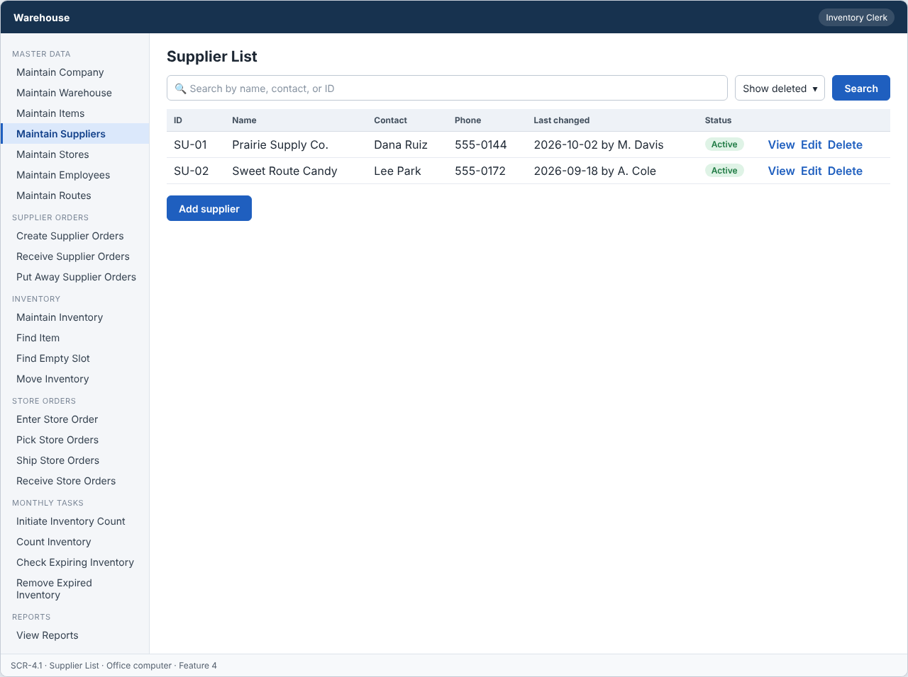
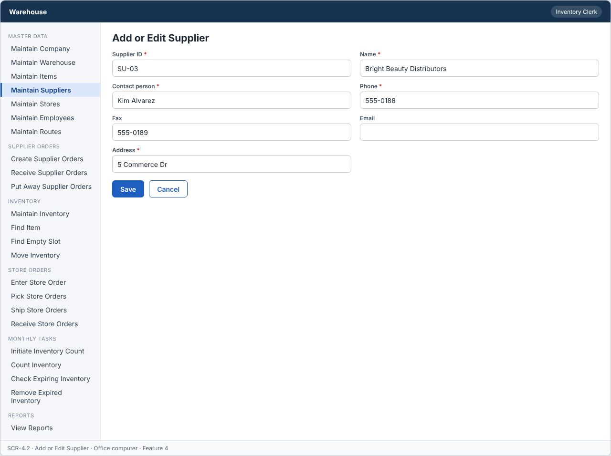
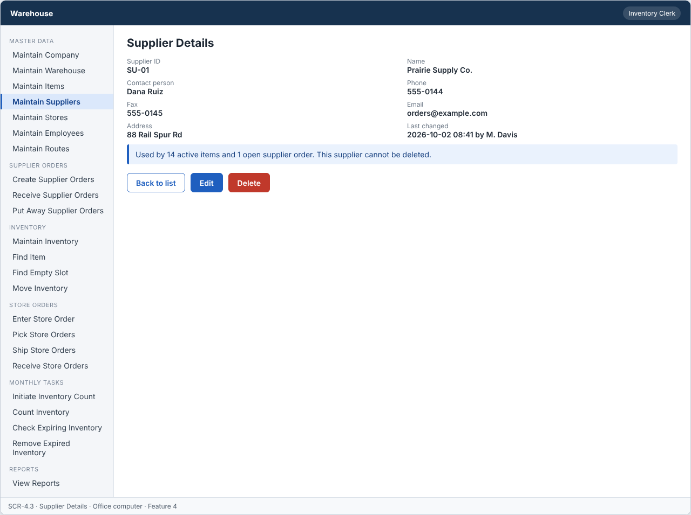

# Feature: Maintain Suppliers

**Feature ID:** 4  
**Branch pattern:** `feature/4-maintain-suppliers`  
**Status:** Draft  
**Created:** 2026-09-26 
**Input:** Maintain supplier information used to place supplier orders.  
**Depends on:** None

---

## User Stories

### US-4.1: Add supplier

**As an** inventory clerk
**I want to** add a supplier
**So that** the system can maintain suppliers.
**Priority:** P1
**Independent test:** Add a supplier and verify that it is saved. 
**Acceptance Scenarios:** see ### US-4.1 under Gherkin AC

### US-4.2: Edit supplier

**As an** inventory clerk
**I want to** edit a supplier
**So that** supplier information stays accurate.
**Priority:** P1
**Independent test:** Edit a supplier and verify that the change is saved. 
**Acceptance Scenarios:** see ### US-4.2 under Gherkin AC

### US-4.3: Delete supplier

**As an** inventory clerk
**I want to** delete a supplier
**So that** incorrect or unused suppliers can be removed.
**Priority:** P1
**Independent test:** Delete a supplier and verify that it is no longer active. 
**Acceptance Scenarios:** see ### US-4.3 under Gherkin AC

### US-4.4: View supplier

**As a** warehouse worker
**I want to** view supplier information
**So that** I can contact the supplier when I place an order.
**Priority:** P1
**Independent test:** Open a supplier and verify the current information is displayed. 
**Acceptance Scenarios:** see ### US-4.4 under Gherkin AC

---

## Functional Requirements

- **FR-001:** The system MUST maintain suppliers.
- **FR-002:** Each supplier MUST have a unique identifier.
- **FR-003:** The system MUST allow authorized users to add suppliers.
- **FR-004:** The system MUST allow authorized users to edit suppliers.
- **FR-005:** The system MUST allow authorized users to delete suppliers.
- **FR-006:** The system MUST allow authorized users to view suppliers.
- **FR-007:** Required supplier information MUST be provided before the supplier can be saved (name, contact person, phone, address).
- **FR-008:** The system MUST reject duplicate supplier identifiers.
- **FR-009:** The system MUST NOT delete a supplier that is used by an item or an open supplier order.
- **FR-010:** Deleting a supplier MUST only remove it from active records, so other features keep the original supplier information.
- **FR-011:** The system MUST NOT allow a supplier order for a supplier that does not exist.
- **FR-012:** The system MUST let an inventory clerk, a warehouse worker, and a manager use this feature (main user: inventory clerk), and MUST NOT let other roles change its information.
- **FR-013:** The system MUST work on an office computer.
- **FR-014:** This feature is used every week, so the system MUST show the date each record was last changed.

---

## Assumptions

- **A-1:** A supplier is a company that sells products to the warehouse. Contact is by phone, fax, or email.
- **A-2:** The clerk types the supplier ID, or accepts the next free number. The ID never changes.
- **A-3:** A supplier is "used" when an active item refers to it, or when a supplier order for it is Draft or Sent.
- **A-4:** Inventory clerks and managers add, edit, and delete. Warehouse workers view contact details when they receive an order (assumption: least privilege).
- **A-5:** The list and the details screen show the date and time of the last change and who made it, because the feature is used every week (FR-014).
- **A-6:** Phone and fax use the same format rule as company phone numbers (digits, spaces, +, -, brackets; at least 7 digits).

---

## Edge Cases

| ID | Situation | Expected behavior | Related |
|---|---|---|---|
| EC-1 | The contact person or phone is missing. | The system does not save the supplier and marks the missing fields. | FR-007 |
| EC-2 | A supplier has one active item and the clerk tries to delete it. | The system rejects the delete (IN_USE) and shows how many active items use the supplier. | FR-009 |
| EC-3 | A supplier has a Sent order that has not been received yet. | The system rejects the delete. After the order is Received, the delete is allowed. | FR-009 |
| EC-4 | A supplier order is created for a supplier that was deleted, or for an ID that never existed. | The system rejects the order (FR-011). Only active suppliers are offered in the order form. | FR-011 |
| EC-5 | Fax is entered but phone is empty. | The system rejects the save, because phone is required. Fax is optional. | FR-007 |
| EC-6 | The email address is invalid. | The system rejects the value. Email is optional, so an empty value is fine. | FR-007 |
| EC-7 | Two clerks edit the same supplier at the same time. | The second save is rejected with VERSION_CONFLICT. | FR-008 |
| EC-8 | The last changed time is shown for a record that was edited by a deleted employee. | The screen still shows the employee name as it was when the change was made. | FR-014 |

---

## Success Criteria

- **SC-1:** A clerk finds a supplier's phone number from the list in under 10 seconds.
- **SC-2:** 100% of supplier records show the last changed date and the name of the person who changed them.
- **SC-3:** A supplier with an active item or an open supplier order is never deleted (0 cases in testing).
- **SC-4:** No supplier order can be saved for a missing or deleted supplier (tested at the API and the screen).
- **SC-5:** All 13 Gherkin scenarios in this file pass as automated tests, and each user story's independent test is shown to work in a demo.

---

## Key Entities

- **Supplier** — A vendor that sells products to the warehouse.

---

## Initial Data Model

### Supplier

- supplier_id: String — Required, unique
- name: String — Required
- contact_person: String — Required
- phone: String — Required
- fax: String — Optional
- email: String — Optional
- address: String — Required
- is_active: Boolean — Required, false after delete

---

## Gherkin AC

### US-4.1 — Add supplier

#### Scenario: Supplier is saved

- **Given** a supplier does not already exist
- **When** the inventory clerk enters the required supplier information and saves
- **Then** the system saves the supplier

#### Scenario: Supplier is not saved due to missing information

- **Given** a supplier is being added
- **When** required supplier information is missing
- **Then** the system does not save the supplier

#### Scenario: Duplicate supplier ID is rejected

- **Given** a supplier with the same identifier already exists
- **When** the inventory clerk tries to add a supplier with that identifier
- **Then** the system rejects the duplicate supplier

#### Scenario: Wrong role cannot change information

- **Given** a driver is signed in
- **When** the driver tries to change information in this feature
- **Then** the system rejects the change

### US-4.2 — Edit supplier

#### Scenario: Supplier is edited successfully

- **Given** a supplier exists
- **When** the inventory clerk changes supplier information and saves
- **Then** the system saves the updated supplier

#### Scenario: Supplier edit fails

- **Given** a supplier exists
- **When** required information is removed during edit
- **Then** the system does not save the update

### US-4.3 — Delete supplier

#### Scenario: Supplier is deleted successfully

- **Given** a supplier exists and is not in use
- **When** the inventory clerk deletes the supplier
- **Then** the system removes the supplier from active records

#### Scenario: Supplier used by an item cannot be deleted

- **Given** a supplier is used by an item
- **When** the inventory clerk tries to delete it
- **Then** the system rejects the delete operation
- **And** the supplier and the other records stay unchanged

#### Scenario: Supplier used by an open supplier order cannot be deleted

- **Given** a supplier is used by an open supplier order
- **When** the inventory clerk tries to delete it
- **Then** the system rejects the delete operation
- **And** the supplier and the other records stay unchanged

#### Scenario: Deleted supplier does not change past records

- **Given** a supplier was deleted and past records refer to it
- **When** someone views those past records
- **Then** the system still shows the original supplier information

#### Scenario: Delete unknown supplier fails

- **Given** the supplier does not exist
- **When** the inventory clerk tries to delete it
- **Then** the system rejects the delete operation

### US-4.4 — View supplier

#### Scenario: Supplier information is displayed

- **Given** a supplier exists
- **When** the warehouse worker views the supplier
- **Then** the system displays the supplier information

#### Scenario: Last changed date is shown

- **Given** a record was changed last week
- **When** the user views the record
- **Then** the system shows the date it was last changed

---

## Data Ownership

| Data | Owner | This feature | Notes |
|---|---|---|---|
| Supplier | This feature (Feature 4) | Owns | Creates, edits, and sets suppliers inactive. |
| Item | [Feature 3 — Maintain Items](feature-3-maintain-items.md) | Reads | Usage check: does an active item use this supplier? |
| Supplier Order | [Feature 11 — Create Supplier Orders](feature-11-create-supplier-orders.md) | Reads | Usage check: is an order for this supplier Draft or Sent? |
| Audit Log Entry | Platform (cross-cutting) | Updates (via owner) | Writes one entry for each change and denied attempt. The last changed date comes from the record itself. |

**Rule:** each piece of data has one owning feature. A feature that needs to change data it does not own must call the owner's service, and must never write the owner's tables directly (ADR-004).

---

## API Requirements

Base path: `/api/v1`. All endpoints follow [ADR-003](../docs/ADRs/ADR-003-rest-api-conventions.md) (JSON, problem+json errors, `version` field for optimistic locking). Roles are checked on the server for every call ([NFR-S2](../docs/NFR.md)).

| # | Method and path | Purpose | Allowed roles | Success | Errors | Supports |
|---|---|---|---|---|---|---|
| 1 | `GET /suppliers` | List suppliers with last changed date. Query: `search`, `includeInactive`. | Inventory Clerk, Warehouse Worker, Manager | 200 | — | US-4.4 |
| 2 | `POST /suppliers` | Add a supplier. | Inventory Clerk, Manager | 201 + Location | 400 VALIDATION_FAILED, 409 DUPLICATE | US-4.1 |
| 3 | `GET /suppliers/{supplierId}` | Get one supplier. | Inventory Clerk, Warehouse Worker, Manager | 200 | 404 NOT_FOUND | US-4.4 |
| 4 | `PUT /suppliers/{supplierId}` | Change a supplier. The body must include `version`. | Inventory Clerk, Manager | 200 | 400 VALIDATION_FAILED, 404 NOT_FOUND, 409 VERSION_CONFLICT | US-4.2 |
| 5 | `DELETE /suppliers/{supplierId}` | Set a supplier inactive. | Inventory Clerk, Manager | 204 | 404 NOT_FOUND, 409 IN_USE (active item, or Draft or Sent order) | US-4.3 |

**Request and response notes**

- Body: `supplier_id` (POST only), `name`, `contact_person`, `phone`, `fax` (optional), `email` (optional), `address`.
- Responses include `updated_at` and `updated_by_name` for the last changed display.

**Calls to other features (internal service calls, not public endpoints)**

- Feature 3 — Maintain Items and Feature 11 — Create Supplier Orders: `countActiveItemsForSupplier`, `countOpenOrdersForSupplier` before a delete.

---

## Screen Requirements

The screen images are in [docs/UI](../docs/UI/README.md). Each image is a wireframe: it shows layout and content, not final colors.

| Screen | Name | Device | Purpose | Image | Stories |
|---|---|---|---|---|---|
| SCR-4.1 | Supplier List | Office computer | Find a supplier and see when each record was last changed. | [image](../docs/UI/images/scr-4-1-supplier-list.png) | US-4.4 |
| SCR-4.2 | Add or Edit Supplier | Office computer | Enter or change supplier information. | [image](../docs/UI/images/scr-4-2-add-or-edit-supplier.png) | US-4.1, US-4.2 |
| SCR-4.3 | Supplier Details | Office computer | Show supplier contact information when placing an order. | [image](../docs/UI/images/scr-4-3-supplier-details.png) | US-4.4, US-4.3 |

### SCR-4.1 — Supplier List

**Device:** Office computer. **Purpose:** Find a supplier and see when each record was last changed.

- Search box (Search by name, contact, or ID) and filters (Show deleted).
- Table with columns: ID, Name, Contact, Phone, Last changed, Status.
- Buttons: Add supplier.

### SCR-4.2 — Add or Edit Supplier

**Device:** Office computer. **Purpose:** Enter or change supplier information.

- Fields: Supplier ID (required), Name (required), Contact person (required), Phone (required), Fax, Email, Address (required).
- Buttons: Save, Cancel.

### SCR-4.3 — Supplier Details

**Device:** Office computer. **Purpose:** Show supplier contact information when placing an order.

- Details shown: Supplier ID, Name, Contact person, Phone, Fax, Email, Address, Last changed.
- Message (info): Used by 14 active items and 1 open supplier order. This supplier cannot be deleted.
- Buttons: Back to list, Edit, Delete.

---

## Definition of Done

This feature is done when all of these are true:

- [ ] All 4 user stories are built, and each story's independent test passes.
- [ ] All 14 functional requirements are built, and each one is covered by a Gherkin scenario, a unit test, or an NFR check.
- [ ] All 13 Gherkin scenarios are automated and pass in the build.
- [ ] The 5 API endpoints match the API Requirements table, are in the OpenAPI file, and have tests for success and for every listed error.
- [ ] The role rules are enforced on the server for every endpoint, with a test for a role that is not allowed.
- [ ] The screens (SCR-4.1, SCR-4.2, SCR-4.3) match the images in `docs/UI`, and were checked on: office computer.
- [ ] Validation messages show next to the field, and what the user typed stays on the screen after an error.
- [ ] Database changes (tables, keys, unique rules, not-null rules, checks) are in a migration script and match the Initial Data Model.
- [ ] Every create, edit, delete, and status change writes an audit log entry (who, when, what changed).
- [ ] The last changed date and name show on the list and the details screens, and a test checks the value after an edit.
- [ ] These non-functional checks pass (see [NFR](../docs/NFR.md)): NFR-U1, NFR-U6, NFR-U9, NFR-P1, NFR-S1, NFR-S2, NFR-S4, NFR-D1, NFR-D3, NFR-D4, NFR-A1, NFR-M1.
- [ ] The code is reviewed in a pull request and merged into `main` with no open critical bugs.
- [ ] This feature file, the UI images, and the API table are updated if anything changed during the build.

---

## Out of Scope

- Supplier ratings, contracts, or payment terms.
- Sending email or fax from this feature (see Feature 11 and ADR-011).
- Several contact people for one supplier.
- Restoring a deleted supplier.
