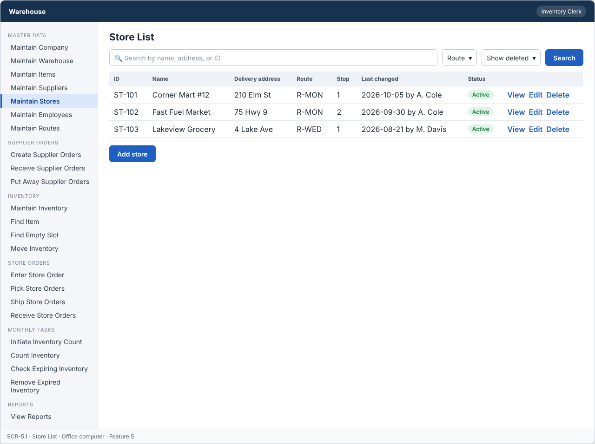
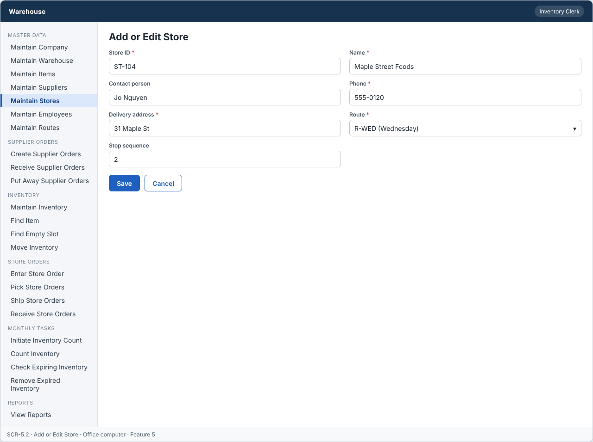
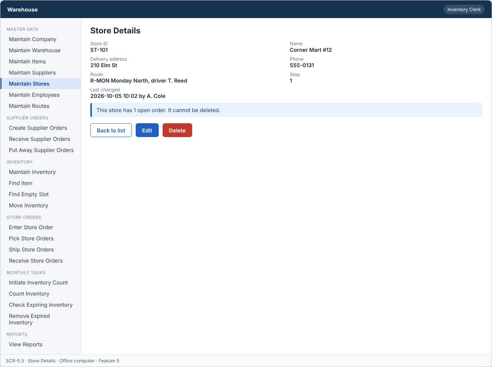

# Feature: Maintain Stores

**Feature ID:** 5
**Branch pattern:** `feature/5-maintain-stores`
**Status:** Final
**Created:** 2026-09-26
**Input:** Maintain information about the retail stores we sell to and the route each one is delivered on.
**Depends on:** [Feature 7 — Maintain Routes](feature-7-maintain-routes.md)

---

## User Stories

### US-5.1: Add store

**As an** inventory clerk
**I want to** add a store
**So that** the system can maintain stores.
**Priority:** P1
**Independent test:** Add a store and verify that it is saved. 
**Acceptance Scenarios:** see ### US-5.1 under Gherkin AC

### US-5.2: Edit store

**As an** inventory clerk
**I want to** edit a store
**So that** store information stays accurate.
**Priority:** P1
**Independent test:** Edit a store and verify that the change is saved. 
**Acceptance Scenarios:** see ### US-5.2 under Gherkin AC

### US-5.3: Delete store

**As an** inventory clerk
**I want to** delete a store
**So that** incorrect or unused stores can be removed.
**Priority:** P1
**Independent test:** Delete a store and verify that it is no longer active.
**Acceptance Scenarios:** see ### US-5.3 under Gherkin AC

### US-5.4: View store

**As a** warehouse worker
**I want to** view store information
**So that** I can see where and when to deliver.
**Priority:** P1
**Independent test:** Open a store and verify the current information is displayed. 
**Acceptance Scenarios:** see ### US-5.4 under Gherkin AC

---

## Functional Requirements

- **FR-001:** The system MUST maintain stores.
- **FR-002:** Each store MUST have a unique identifier.
- **FR-003:** The system MUST allow authorized users to add stores.
- **FR-004:** The system MUST allow authorized users to edit stores.
- **FR-005:** The system MUST allow authorized users to delete stores.
- **FR-006:** The system MUST allow authorized users to view stores.
- **FR-007:** Required store information MUST be provided before the store can be saved (name, phone, delivery address, route).
- **FR-008:** The system MUST reject duplicate store identifiers.
- **FR-009:** The system MUST NOT delete a store that is used by an open store order or an open shipment.
- **FR-010:** Deleting a store MUST only remove it from active records, so other features keep the original store information.
- **FR-011:** Each store MUST be assigned to one delivery route.
- **FR-012:** The system MUST let an inventory clerk, a warehouse worker, and a manager use this feature (main user: inventory clerk), and MUST NOT let other roles change its information.
- **FR-013:** The system MUST work on an office computer.
- **FR-014:** This feature is used every week, so the system MUST show the date each record was last changed.

---

## Assumptions

- **A-1:** A store is a retail customer. Each store is on exactly one delivery route (FR-011). Moving a store to another route is an edit.
- **A-2:** The clerk types the store ID, or accepts the next free number. The ID never changes.
- **A-3:** The stop sequence is the order of the store on its route. It is optional, but when entered it must be greater than zero.
- **A-4:** A store is "used" when a store order for it is not yet Delivered, or when a shipment for it is Shipped and not yet Delivered.
- **A-5:** Inventory clerks and managers add, edit, and delete. Warehouse workers view only. Shipping clerks and drivers see store address and phone through shipments (Features 17 and 18).
- **A-6:** The list and the details screen show the last changed date and who made the change (FR-014).

---

## Edge Cases

| ID | Situation | Expected behavior | Related |
|---|---|---|---|
| EC-1 | A store is added without a route, or with a route that was deleted. | The system rejects the store. The route must exist and be active. | FR-007, FR-011 |
| EC-2 | The route of a store is changed while a shipment for the store is on the old route. | The shipment keeps the route it was shipped on. Only new shipments use the new route. | FR-011 |
| EC-3 | Two stores have the same stop sequence on the same route. | The system saves both and shows a warning on the route screen. Sequence is a hint for the driver, not a rule. | FR-011 |
| EC-4 | A store has a Picked order (not shipped yet) and the clerk deletes the store. | The system rejects the delete (IN_USE), because the order is not Delivered. | FR-009 |
| EC-5 | A store has only Delivered orders and the clerk deletes the store. | The delete is allowed. Reports (Feature 23) still show the store name for past deliveries. | FR-009, FR-010 |
| EC-6 | The delivery address is empty or only spaces. | The system rejects the store. | FR-007 |
| EC-7 | The phone number contains letters. | The system rejects the value and shows a message next to the field. | FR-007 |
| EC-8 | Two clerks edit the same store at the same time. | The second save is rejected with VERSION_CONFLICT. | FR-004 |

---

## Success Criteria

- **SC-1:** A clerk adds a store with its route in under 1 minute.
- **SC-2:** 100% of stores have exactly one active route when they are saved.
- **SC-3:** A store with an open order or an open shipment is never deleted (0 cases in testing).
- **SC-4:** Past deliveries still show the original store name and address after the store is deleted (100% of reports checked).
- **SC-5:** All 14 Gherkin scenarios in this file pass as automated tests, and each user story's independent test is shown to work in a demo.

---

## Key Entities

- **Store** — A retail store that buys products from the warehouse.

---

## Initial Data Model

### Store

- store_id: String — Required, unique
- name: String — Required
- contact_person: String — Optional
- phone: String — Required
- delivery_address: String — Required
- route_id: Route reference — Required
- stop_sequence: Integer — Optional, greater than zero
- is_active: Boolean — Required, false after delete

---

## Gherkin AC

### US-5.1 — Add store

#### Scenario: Store is saved

- **Given** a store does not already exist
- **When** the inventory clerk enters the required store information and saves
- **Then** the system saves the store

#### Scenario: Store is not saved due to missing information

- **Given** a store is being added
- **When** required store information is missing
- **Then** the system does not save the store

#### Scenario: Duplicate store ID is rejected

- **Given** a store with the same identifier already exists
- **When** the inventory clerk tries to add a store with that identifier
- **Then** the system rejects the duplicate store

#### Scenario: Store without a route is rejected

- **Given** a store is being added
- **When** no route is selected
- **Then** the system does not save the store

#### Scenario: Wrong role cannot change information

- **Given** a driver is signed in
- **When** the driver tries to change information in this feature
- **Then** the system rejects the change

### US-5.2 — Edit store

#### Scenario: Store is edited successfully

- **Given** a store exists
- **When** the inventory clerk changes store information and saves
- **Then** the system saves the updated store

#### Scenario: Store edit fails

- **Given** a store exists
- **When** required information is removed during edit
- **Then** the system does not save the update

### US-5.3 — Delete store

#### Scenario: Store is deleted successfully

- **Given** a store exists and is not in use
- **When** the inventory clerk deletes the store
- **Then** the system removes the store from active records

#### Scenario: Store used by an open store order cannot be deleted

- **Given** a store is used by an open store order
- **When** the inventory clerk tries to delete it
- **Then** the system rejects the delete operation
- **And** the store and the other records stay unchanged

#### Scenario: Store used by an open shipment cannot be deleted

- **Given** a store is used by an open shipment
- **When** the inventory clerk tries to delete it
- **Then** the system rejects the delete operation
- **And** the store and the other records stay unchanged

#### Scenario: Deleted store does not change past records

- **Given** a store was deleted and past records refer to it
- **When** someone views those past records
- **Then** the system still shows the original store information

#### Scenario: Delete unknown store fails

- **Given** the store does not exist
- **When** the inventory clerk tries to delete it
- **Then** the system rejects the delete operation

### US-5.4 — View store

#### Scenario: Store information is displayed

- **Given** a store exists
- **When** the warehouse worker views the store
- **Then** the system displays the store information

#### Scenario: Last changed date is shown

- **Given** a record was changed last week
- **When** the user views the record
- **Then** the system shows the date it was last changed

---

## Data Ownership

| Data | Owner | This feature | Notes |
|---|---|---|---|
| Store | This feature (Feature 5) | Owns | Creates, edits, and sets stores inactive. |
| Route | [Feature 7 — Maintain Routes](feature-7-maintain-routes.md) | Reads | A store must refer to an active route. |
| Store Order | [Feature 12 — Enter Store Order](feature-12-enter-store-order.md) | Reads | Usage check: is an order for this store not Delivered? |
| Shipment | [Feature 17 — Ship Store Orders](feature-17-ship-store-orders.md) | Reads | Usage check: is a shipment for this store Shipped and not Delivered? |
| Audit Log Entry | Platform (cross-cutting) | Updates (via owner) | Writes one entry for each change and denied attempt. |

**Rule:** each piece of data has one owning feature. A feature that needs to change data it does not own must call the owner's service, and must never write the owner's tables directly (ADR-004).

---

## API Requirements

Base path: `/api/v1`. All endpoints follow [ADR-003](../docs/ADRs/ADR-003-rest-api-conventions.md) (JSON, problem+json errors, `version` field for optimistic locking). Roles are checked on the server for every call ([NFR-S2](../docs/NFR.md)).

| # | Method and path | Purpose | Allowed roles | Success | Errors | Supports |
|---|---|---|---|---|---|---|
| 1 | `GET /stores` | List stores with route and last changed date. Query: `search`, `routeId`, `includeInactive`. | Inventory Clerk, Warehouse Worker, Manager | 200 | — | US-5.4 |
| 2 | `POST /stores` | Add a store. | Inventory Clerk, Manager | 201 + Location | 400 VALIDATION_FAILED (including no route), 409 DUPLICATE | US-5.1 |
| 3 | `GET /stores/{storeId}` | Get one store. | Inventory Clerk, Warehouse Worker, Manager | 200 | 404 NOT_FOUND | US-5.4 |
| 4 | `PUT /stores/{storeId}` | Change a store. The body must include `version`. | Inventory Clerk, Manager | 200 | 400 VALIDATION_FAILED, 404 NOT_FOUND, 409 VERSION_CONFLICT | US-5.2 |
| 5 | `DELETE /stores/{storeId}` | Set a store inactive. | Inventory Clerk, Manager | 204 | 404 NOT_FOUND, 409 IN_USE (open store order or open shipment) | US-5.3 |

**Request and response notes**

- Body: `store_id` (POST only), `name`, `contact_person` (optional), `phone`, `delivery_address`, `route_id`, `stop_sequence` (optional).

**Calls to other features (internal service calls, not public endpoints)**

- Feature 7 — Maintain Routes: `isActive(routeId)` when a store is added or its route changes.
- Feature 12 and 17: `countOpenOrdersForStore`, `countOpenShipmentsForStore` before a delete.

---

## Screen Requirements

The screen images are in [docs/UI](../docs/UI/README.md). Each image is a wireframe: it shows layout and content, not final colors.

| Screen | Name | Device | Purpose | Image | Stories |
|---|---|---|---|---|---|
| SCR-5.1 | Store List | Office computer | Find a store and see its route. | [image](../docs/UI/images/scr-5-1-store-list.png) | US-5.4 |
| SCR-5.2 | Add or Edit Store | Office computer | Enter or change store information and choose its route. | [image](../docs/UI/images/scr-5-2-add-or-edit-store.png) | US-5.1, US-5.2 |
| SCR-5.3 | Store Details | Office computer | Show where and when to deliver. | [image](../docs/UI/images/scr-5-3-store-details.png) | US-5.4, US-5.3 |

### SCR-5.1 — Store List

**Device:** Office computer. **Purpose:** Find a store and see its route.

- Search box (Search by name, address, or ID) and filters (Route, Show deleted).
- Table with columns: ID, Name, Delivery address, Route, Stop, Last changed, Status.
- Buttons: Add store.

### SCR-5.2 — Add or Edit Store

**Device:** Office computer. **Purpose:** Enter or change store information and choose its route.

- Fields: Store ID (required), Name (required), Contact person, Phone (required), Delivery address (required), Route (required), Stop sequence.
- Buttons: Save, Cancel.

### SCR-5.3 — Store Details

**Device:** Office computer. **Purpose:** Show where and when to deliver.

- Details shown: Store ID, Name, Delivery address, Phone, Route, Stop, Last changed.
- Message (info): This store has 1 open order. It cannot be deleted.
- Buttons: Back to list, Edit, Delete.

---

## Definition of Done

This feature is done when all of these are true:

- [ ] All 4 user stories are built, and each story's independent test passes.
- [ ] All 14 functional requirements are built, and each one is covered by a Gherkin scenario, a unit test, or an NFR check.
- [ ] All 14 Gherkin scenarios are automated and pass in the build.
- [ ] The 5 API endpoints match the API Requirements table, are in the OpenAPI file, and have tests for success and for every listed error.
- [ ] The role rules are enforced on the server for every endpoint, with a test for a role that is not allowed.
- [ ] The screens (SCR-5.1, SCR-5.2, SCR-5.3) match the images in `docs/UI`, and were checked on: office computer.
- [ ] Validation messages show next to the field, and what the user typed stays on the screen after an error.
- [ ] Database changes (tables, keys, unique rules, not-null rules, checks) are in a migration script and match the Initial Data Model.
- [ ] Every create, edit, delete, and status change writes an audit log entry (who, when, what changed).
- [ ] A test shows that a store always has exactly one active route when saved.
- [ ] These non-functional checks pass (see [NFR](../docs/NFR.md)): NFR-U1, NFR-U6, NFR-U9, NFR-P1, NFR-S1, NFR-S2, NFR-S4, NFR-D1, NFR-D3, NFR-D4, NFR-A1, NFR-M1.
- [ ] The code is reviewed in a pull request and merged into `main` with no open critical bugs.
- [ ] This feature file, the UI images, and the API table are updated if anything changed during the build.

---

## Out of Scope

- Store credit limits, invoices, or payment.
- Several delivery addresses or opening hours for one store.
- Store login or a store portal for placing orders.
- Optimizing the order of stops on a route.
- Restoring a deleted store.
