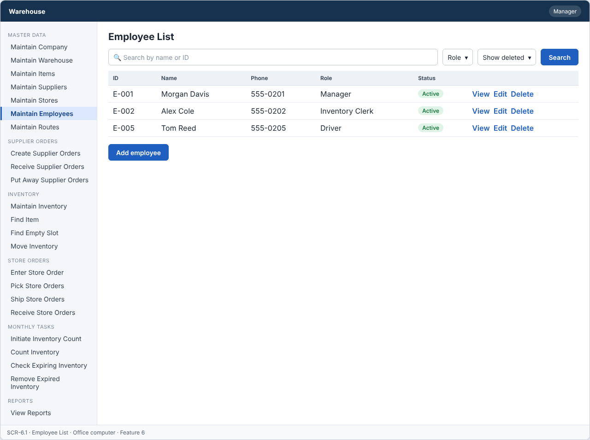
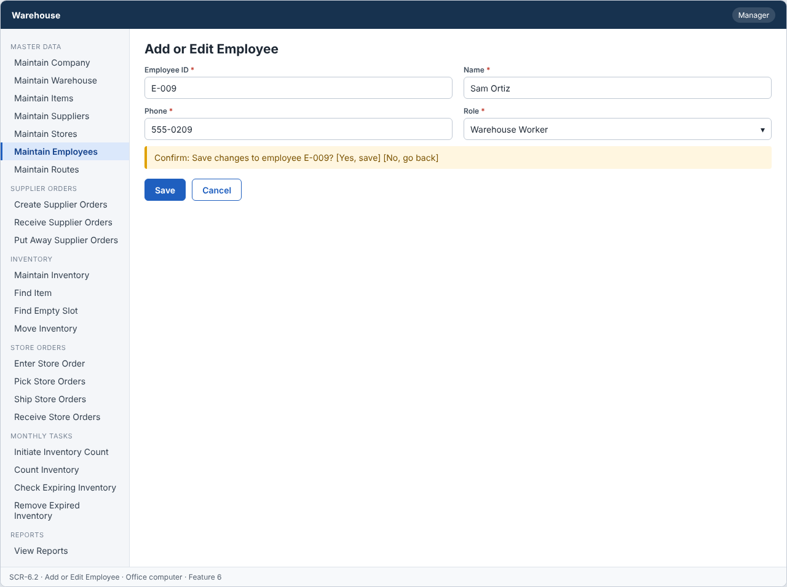
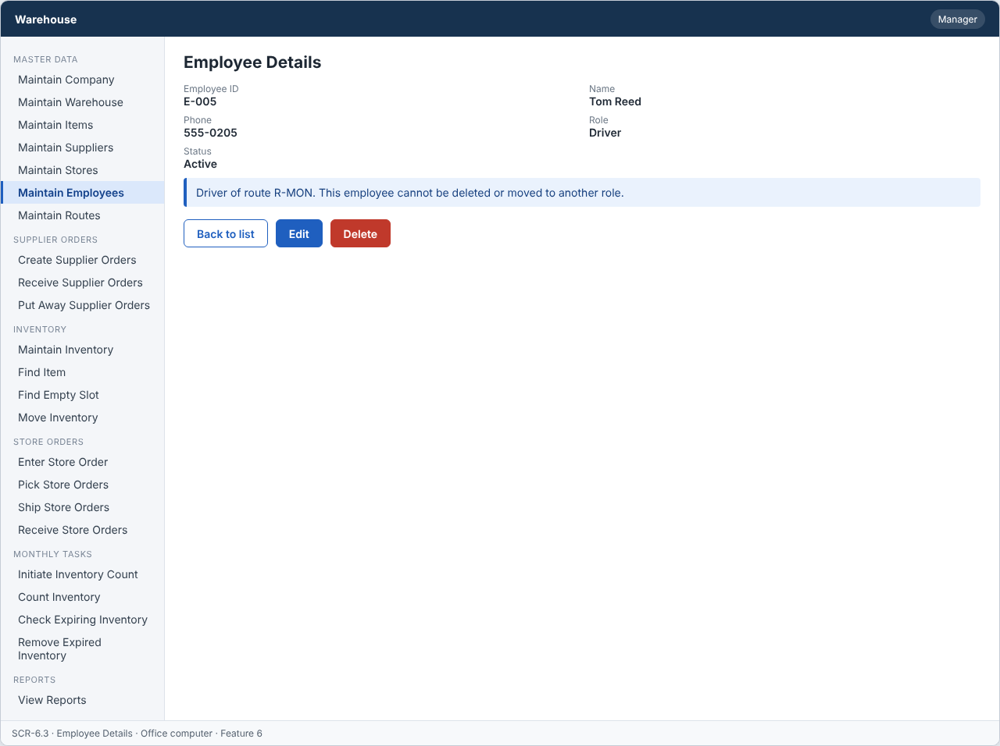

# Feature: Maintain Employees

**Feature ID:** 6
**Branch pattern:** `feature/6-maintain-employees`
**Status:** Draft
**Created:** 2026-09-26
**Input:** Maintain employee information and roles.
**Depends on:** None

---

## User Stories

### US-6.1: Add employee

**As a** manager
**I want to** add an employee
**So that** the system can maintain employees.
**Priority:** P1
**Independent test:** Add an employee and verify that it is saved. 
 **Acceptance Scenarios:** see ### US-6.1 under Gherkin AC

### US-6.2: Edit employee

**As a** manager
**I want to** edit an employee
**So that** employee information stays accurate.
**Priority:** P1
**Independent test:** Edit an employee and verify that the change is saved. 
**Acceptance Scenarios:** see ### US-6.2 under Gherkin AC

### US-6.3: Delete employee

**As a** manager
**I want to** delete an employee
**So that** incorrect or unused employees can be removed.
**Priority:** P1
**Independent test:** Delete an employee and verify that it is no longer active. 
**Acceptance Scenarios:** see ### US-6.3 under Gherkin AC

### US-6.4: View employee

**As a** manager
**I want to** view employee information
**So that** I can see who works in each role.
**Priority:** P1
**Independent test:** Open an employee and verify the current information is displayed. 
 **Acceptance Scenarios:** see ### US-6.4 under Gherkin AC

---

## Functional Requirements

- **FR-001:** The system MUST maintain employees.
- **FR-002:** Each employee MUST have a unique identifier.
- **FR-003:** The system MUST allow authorized users to add employees.
- **FR-004:** The system MUST allow authorized users to edit employees.
- **FR-005:** The system MUST allow authorized users to delete employees.
- **FR-006:** The system MUST allow authorized users to view employees.
- **FR-007:** Required employee information MUST be provided before the employee can be saved (name, phone, role).
- **FR-008:** The system MUST reject duplicate employee identifiers.
- **FR-009:** The system MUST NOT delete an employee that is used by a route as its driver, an open pick list or an open inventory count.
- **FR-010:** Deleting an employee MUST only remove it from active records, so other features keep the original employee information.
- **FR-011:** Each employee MUST have exactly one role.
- **FR-012:** The system MUST let a manager use this feature (main user: manager), and MUST NOT let other roles change its information.
- **FR-013:** The system MUST work on an office computer.
- **FR-014:** This feature is not used very often, so the system MUST ask the user to confirm before saving a change.

---

## Assumptions

- **A-1:** Roles are fixed: Inventory Clerk, Warehouse Worker, Shipping Clerk, Driver, Manager. An employee has exactly one role (FR-011).
- **A-2:** Only managers use this feature. The employee list shows phone numbers, so it is not shown to other roles.
- **A-3:** The manager types the employee ID, or accepts the next free number. The ID never changes.
- **A-4:** An employee is "used" when the employee is the driver of an active route, is named on an open pick list, or is named on an open inventory count.
- **A-5:** Sign-in credentials (user name and password) are not stored in the employee record. They belong to the security module (ADR-006) and are outside the 23 features.
- **A-6:** Changing an employee's role takes effect on the employee's next request, not at the next sign-in (ADR-006).
- **A-7:** This feature is not used often, so every save asks for confirmation (FR-014).

---

## Edge Cases

| ID | Situation | Expected behavior | Related |
|---|---|---|---|
| EC-1 | A manager changes a driver to a clerk while the employee is the driver of an active route. | The system rejects the role change (IN_USE) until the route has another driver. Only the Driver role can be a route driver (Feature 7). | FR-009, FR-011 |
| EC-2 | A manager deletes an employee who is named on an open inventory count. | The system rejects the delete (IN_USE). After the count is Closed, the delete is allowed. | FR-009 |
| EC-3 | A role outside the five allowed roles is sent to the API. | The system rejects it (VALIDATION_FAILED). | FR-011 |
| EC-4 | The only manager tries to delete or change their own role. | The system rejects it with a message: at least one active manager must remain. | FR-009, FR-012 |
| EC-5 | A manager deletes an employee who is signed in at that moment. | The next request of that employee is rejected as NOT_AUTHENTICATED, because inactive employees cannot use the system. | FR-010 |
| EC-6 | The phone number is missing or has letters. | The system rejects the employee. | FR-007 |
| EC-7 | Past records (receipts, put aways, picks) name an employee who was deleted later. | The past records still show the employee's name as saved (FR-010). | FR-010 |
| EC-8 | Two managers edit the same employee at the same time. | The second save is rejected with VERSION_CONFLICT. | FR-004 |

---

## Success Criteria

- **SC-1:** A manager adds an employee with a role in under 1 minute, including the confirmation.
- **SC-2:** No employee has more than one role or no role (0 cases in testing and in the database constraint).
- **SC-3:** An employee used by an active route, an open pick list, or an open count is never deleted (0 cases in testing).
- **SC-4:** A non-manager who opens the employee list receives FORBIDDEN_ROLE in 100% of tests.
- **SC-5:** All 15 Gherkin scenarios in this file pass as automated tests, and each user story's independent test is shown to work in a demo.

---

## Key Entities

- **Employee** — A person who works in the warehouse, office, or delivery fleet.

---

## Initial Data Model

### Employee

- employee_id: String — Required, unique
- name: String — Required
- phone: String — Required
- role: String/Enum — Required, Inventory Clerk, Warehouse Worker, Shipping Clerk, Driver, Manager
- is_active: Boolean — Required, false after delete

---

## Gherkin AC

### US-6.1 — Add employee

#### Scenario: Employee is saved

- **Given** an employee does not already exist
- **When** the manager enters the required employee information and saves
- **Then** the system saves the employee

#### Scenario: Employee is not saved due to missing information

- **Given** an employee is being added
- **When** required employee information is missing
- **Then** the system does not save the employee

#### Scenario: Duplicate employee ID is rejected

- **Given** an employee with the same identifier already exists
- **When** the manager tries to add an employee with that identifier
- **Then** the system rejects the duplicate employee

#### Scenario: Invalid role is rejected

- **Given** an employee is being added
- **When** the manager enters a role that is not in the role list
- **Then** the system does not save the employee

#### Scenario: Wrong role cannot change information

- **Given** a driver is signed in
- **When** the driver tries to change information in this feature
- **Then** the system rejects the change

#### Scenario: Confirm before saving

- **Given** the user changes information
- **When** the user clicks save
- **Then** the system asks the user to confirm

### US-6.2 — Edit employee

#### Scenario: Employee is edited successfully

- **Given** an employee exists
- **When** the manager changes employee information and saves
- **Then** the system saves the updated employee

#### Scenario: Employee edit fails

- **Given** an employee exists
- **When** required information is removed during edit
- **Then** the system does not save the update

### US-6.3 — Delete employee

#### Scenario: Employee is deleted successfully

- **Given** an employee exists and is not in use
- **When** the manager deletes the employee
- **Then** the system removes the employee from active records

#### Scenario: Employee used by a route as its driver cannot be deleted

- **Given** an employee is used by a route as its driver
- **When** the manager tries to delete it
- **Then** the system rejects the delete operation
- **And** the employee and the other records stay unchanged

#### Scenario: Employee used by an open pick list cannot be deleted

- **Given** an employee is used by an open pick list
- **When** the manager tries to delete it
- **Then** the system rejects the delete operation
- **And** the employee and the other records stay unchanged

#### Scenario: Employee used by an open inventory count cannot be deleted

- **Given** an employee is used by an open inventory count
- **When** the manager tries to delete it
- **Then** the system rejects the delete operation
- **And** the employee and the other records stay unchanged

#### Scenario: Deleted employee does not change past records

- **Given** an employee was deleted and past records refer to it
- **When** someone views those past records
- **Then** the system still shows the original employee information

#### Scenario: Delete unknown employee fails

- **Given** the employee does not exist
- **When** the manager tries to delete it
- **Then** the system rejects the delete operation

### US-6.4 — View employee

#### Scenario: Employee information is displayed

- **Given** an employee exists
- **When** the manager views the employee
- **Then** the system displays the employee information

---

## Data Ownership

| Data | Owner | This feature | Notes |
|---|---|---|---|
| Employee | This feature (Feature 6) | Owns | Creates, edits, and sets employees inactive. Provides the role used by the security checks. |
| Route | [Feature 7 — Maintain Routes](feature-7-maintain-routes.md) | Reads | Usage check: is the employee the driver of an active route? |
| Pick Line | [Feature 15 — Pick Store Orders](feature-15-pick-store-orders.md) | Reads | Usage check: is the employee named on an open pick list? |
| Inventory Count | [Feature 19 — Initiate Inventory Count](feature-19-initiate-inventory-count.md) | Reads | Usage check: is the employee named on an open inventory count? |
| Audit Log Entry | Platform (cross-cutting) | Updates (via owner) | Writes one entry for each change (with the old and new role) and denied attempt. |

**Rule:** each piece of data has one owning feature. A feature that needs to change data it does not own must call the owner's service, and must never write the owner's tables directly (ADR-004).

---

## API Requirements

Base path: `/api/v1`. All endpoints follow [ADR-003](../docs/ADRs/ADR-003-rest-api-conventions.md) (JSON, problem+json errors, `version` field for optimistic locking). Roles are checked on the server for every call ([NFR-S2](../docs/NFR.md)).

| # | Method and path | Purpose | Allowed roles | Success | Errors | Supports |
|---|---|---|---|---|---|---|
| 1 | `GET /employees` | List employees. Query: `search`, `role`, `includeInactive`. | Manager | 200 | — | US-6.4 |
| 2 | `POST /employees` | Add an employee. | Manager | 201 + Location | 400 VALIDATION_FAILED, 409 DUPLICATE | US-6.1 |
| 3 | `GET /employees/{employeeId}` | Get one employee. | Manager | 200 | 404 NOT_FOUND | US-6.4 |
| 4 | `PUT /employees/{employeeId}` | Change an employee. The body must include `version`. | Manager | 200 | 400 VALIDATION_FAILED, 404 NOT_FOUND, 409 IN_USE (role change blocked), 409 VERSION_CONFLICT | US-6.2 |
| 5 | `DELETE /employees/{employeeId}` | Set an employee inactive. | Manager | 204 | 404 NOT_FOUND, 409 IN_USE (driver, open pick list, open count, or last manager) | US-6.3 |
| 6 | `GET /employees/lookup` | Names and IDs only, for drop-down lists. Query: `role`, `search`. | Shipping Clerk, Manager | 200 | — | US-6.4 |

**Request and response notes**

- Body: `employee_id` (POST only), `name`, `phone`, `role` (one of the five roles).
- `/employees/lookup` returns `employee_id` and `name` only, so the route form can list drivers without showing phone numbers.

**Calls to other features (internal service calls, not public endpoints)**

- Features 7, 15, 19, 20: `isEmployeeInUse(employeeId)` before a delete or a role change.

---

## Screen Requirements

The screen images are in [docs/UI](../docs/UI/README.md). Each image is a wireframe: it shows layout and content, not final colors.

| Screen | Name | Device | Purpose | Image | Stories |
|---|---|---|---|---|---|
| SCR-6.1 | Employee List | Office computer | Find an employee and see the role. | [image](../docs/UI/images/scr-6-1-employee-list.png) | US-6.4 |
| SCR-6.2 | Add or Edit Employee | Office computer | Enter or change an employee, then confirm the save. | [image](../docs/UI/images/scr-6-2-add-or-edit-employee.png) | US-6.1, US-6.2 |
| SCR-6.3 | Employee Details | Office computer | Show who works in each role. | [image](../docs/UI/images/scr-6-3-employee-details.png) | US-6.4, US-6.3 |

### SCR-6.1 — Employee List

**Device:** Office computer. **Purpose:** Find an employee and see the role.

- Search box (Search by name or ID) and filters (Role, Show deleted).
- Table with columns: ID, Name, Phone, Role, Status.
- Buttons: Add employee.

### SCR-6.2 — Add or Edit Employee

**Device:** Office computer. **Purpose:** Enter or change an employee, then confirm the save.

- Fields: Employee ID (required), Name (required), Phone (required), Role (required).
- Message (warn): Confirm: Save changes to employee E-009?  [Yes, save]  [No, go back]
- Buttons: Save, Cancel.
- The role list has exactly five choices.
- The confirmation message appears every time the manager clicks Save (FR-014).

### SCR-6.3 — Employee Details

**Device:** Office computer. **Purpose:** Show who works in each role.

- Details shown: Employee ID, Name, Phone, Role, Status.
- Message (info): Driver of route R-MON. This employee cannot be deleted or moved to another role.
- Buttons: Back to list, Edit, Delete.

---

## Definition of Done

This feature is done when all of these are true:

- [ ] All 4 user stories are built, and each story's independent test passes.
- [ ] All 14 functional requirements are built, and each one is covered by a Gherkin scenario, a unit test, or an NFR check.
- [ ] All 15 Gherkin scenarios are automated and pass in the build.
- [ ] The 6 API endpoints match the API Requirements table, are in the OpenAPI file, and have tests for success and for every listed error.
- [ ] The role rules are enforced on the server for every endpoint, with a test for a role that is not allowed.
- [ ] The screens (SCR-6.1, SCR-6.2, SCR-6.3) match the images in `docs/UI`, and were checked on: office computer.
- [ ] Validation messages show next to the field, and what the user typed stays on the screen after an error.
- [ ] Database changes (tables, keys, unique rules, not-null rules, checks) are in a migration script and match the Initial Data Model.
- [ ] Every create, edit, delete, and status change writes an audit log entry (who, when, what changed).
- [ ] A test shows that the last active manager cannot be deleted or moved to another role.
- [ ] These non-functional checks pass (see [NFR](../docs/NFR.md)): NFR-U1, NFR-U5, NFR-U9, NFR-P1, NFR-S1, NFR-S2, NFR-S4, NFR-D1, NFR-D3, NFR-D4, NFR-A1, NFR-M1.
- [ ] The code is reviewed in a pull request and merged into `main` with no open critical bugs.
- [ ] This feature file, the UI images, and the API table are updated if anything changed during the build.

---

## Out of Scope

- User names, passwords, and password reset (ADR-006).
- Pay, hours, schedules, or time sheets.
- More than one role for one employee.
- Restoring a deleted employee.
- Photos, addresses, or personal documents of employees.
