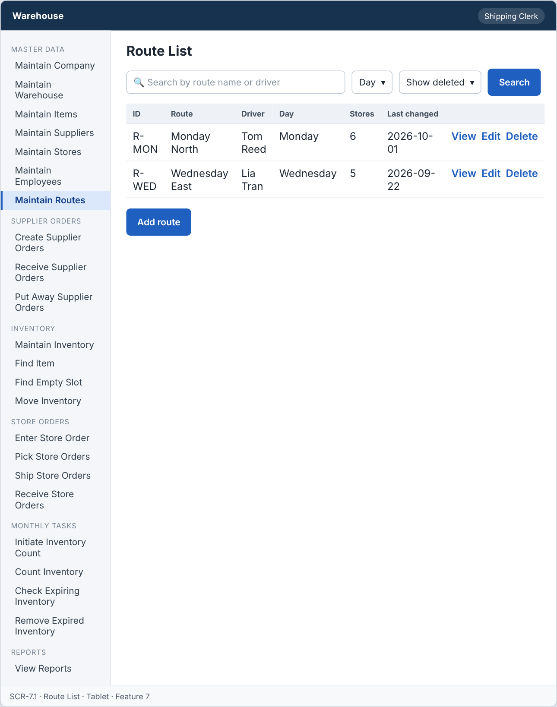
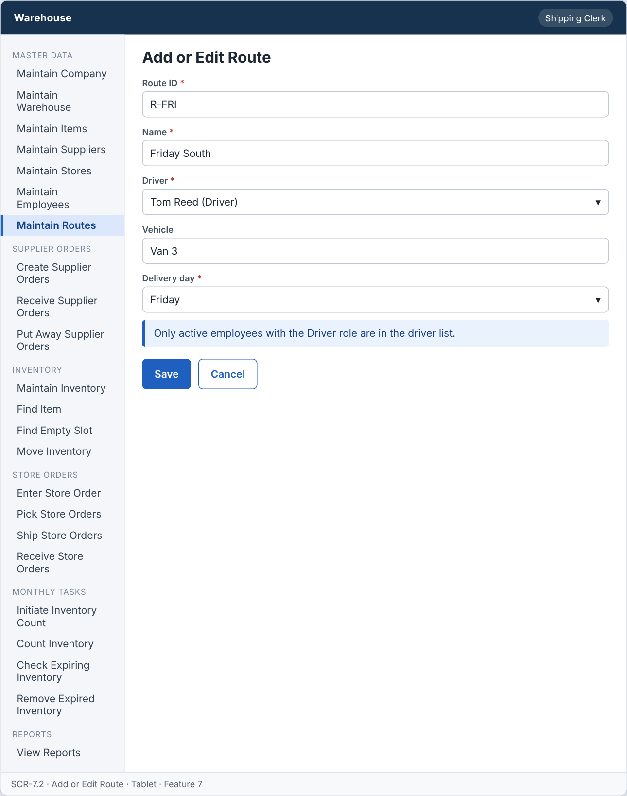
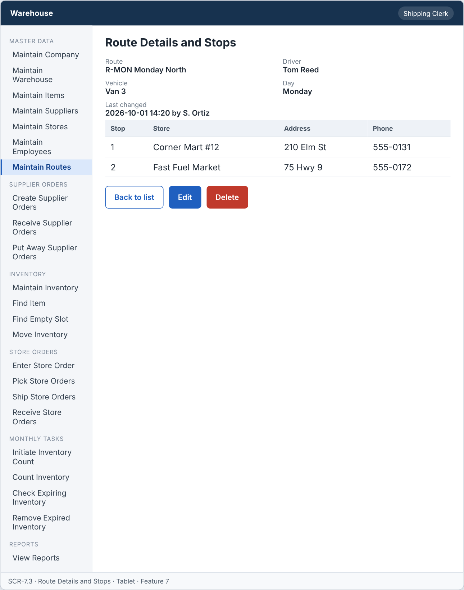

# Feature: Maintain Routes

**Feature ID:** 7
**Branch pattern:** `feature/7-maintain-routes`
**Status:** Draft
**Created:** 2026-09-27
**Input:** Maintain delivery routes and the driver of each route.
**Depends on:** [Feature 6 — Maintain Employees](feature-6-maintain-employess.md)

---

## User Stories

### US-7.1: Add route

**As a** shipping clerk
**I want to** add a route
**So that** the system can maintain routes.
**Priority:** P1
**Independent test:** Add a route and verify that it is saved. 
 **Acceptance Scenarios:** see ### US-7.1 under Gherkin AC

### US-7.2: Edit route

**As a** shipping clerk
**I want to** edit a route
**So that** route information stays accurate.
**Priority:** P1
**Independent test:** Edit a route and verify that the change is saved. 
 **Acceptance Scenarios:** see ### US-7.2 under Gherkin AC

### US-7.3: Delete route

**As a** shipping clerk
**I want to** delete a route
**So that** incorrect or unused routes can be removed.
**Priority:** P1
**Independent test:** Delete a route and verify that it is no longer active. 
**Acceptance Scenarios:** see ### US-7.3 under Gherkin AC

### US-7.4: View route

**As a** driver
**I want to** view route information
**So that** I can see my route and my stops.
**Priority:** P1
**Independent test:** Open a route and verify the current information is displayed.  
**Acceptance Scenarios:** see ### US-7.4 under Gherkin AC

---

## Functional Requirements

- **FR-001:** The system MUST maintain routes.
- **FR-002:** Each route MUST have a unique identifier.
- **FR-003:** The system MUST allow authorized users to add routes.
- **FR-004:** The system MUST allow authorized users to edit routes.
- **FR-005:** The system MUST allow authorized users to delete routes.
- **FR-006:** The system MUST allow authorized users to view routes.
- **FR-007:** Required route information MUST be provided before the route can be saved (name, driver, delivery day).
- **FR-008:** The system MUST reject duplicate route identifiers.
- **FR-009:** The system MUST NOT delete a route that is used by a store or an open shipment.
- **FR-010:** Deleting a route MUST only remove it from active records, so other features keep the original route information.
- **FR-011:** Only an employee with the Driver role MUST be assigned to a route.
- **FR-012:** The system MUST let a shipping clerk, a driver, and a manager use this feature (main user: shipping clerk), and MUST NOT let other roles change its information.
- **FR-013:** The system MUST be easy to use on the warehouse floor, on a handheld device or a tablet.
- **FR-014:** This feature is used every week, so the system MUST show the date each record was last changed.

---

## Assumptions

- **A-1:** A route is driven by one driver on one delivery day. Several stores are on a route (Feature 5).
- **A-2:** The shipping clerk types the route ID, or accepts the next free number. The ID never changes.
- **A-3:** Delivery day is one weekday (Monday to Sunday). A route that runs on two days is two routes.
- **A-4:** A route is "used" when an active store is on it, or when a shipment on it is Shipped and not yet Delivered.
- **A-5:** Shipping clerks and managers add, edit, and delete routes. Drivers view only their own route and its stops (assumption: least privilege).
- **A-6:** Screens are used on the warehouse floor, so they are designed for a tablet or handheld device (FR-013).
- **A-7:** The list and details show the last changed date and who made the change (FR-014).

---

## Edge Cases

| ID | Situation | Expected behavior | Related |
|---|---|---|---|
| EC-1 | The chosen driver does not have the Driver role. | The system rejects the route (FR-011). | FR-011 |
| EC-2 | The chosen driver was deleted a minute ago. | The system rejects the route because the employee must be active. | FR-011 |
| EC-3 | The same driver is assigned to two routes on the same delivery day. | The system saves both and shows a warning. A driver cannot drive two routes at once, but the shipping clerk decides. | FR-011 |
| EC-4 | The driver of a route with a Shipped shipment is changed. | The shipment keeps the driver it was shipped with. New shipments use the new driver. | FR-009, FR-011 |
| EC-5 | A route has stores but the clerk tries to delete it. | The system rejects the delete (IN_USE) and lists the stores. The clerk must move the stores first. | FR-009 |
| EC-6 | A driver opens the list of routes. | The driver sees only the routes where he or she is the driver, with the stops in sequence order. | FR-012 |
| EC-7 | The delivery day is empty or not a weekday. | The system rejects the route. | FR-007 |
| EC-8 | The touch screen of a handheld is used with gloves, and the user taps the wrong row. | Every delete asks for confirmation, and rows have large tap targets (NFR-C2). | FR-013 |

---

## Success Criteria

- **SC-1:** A shipping clerk adds a route and assigns a driver in under 1 minute on a tablet.
- **SC-2:** 100% of routes have an active employee with the Driver role as the driver when saved.
- **SC-3:** A route used by a store or an open shipment is never deleted (0 cases in testing).
- **SC-4:** A driver sees the list of stops on his or her route in 2 taps or fewer from the home screen.
- **SC-5:** All 14 Gherkin scenarios in this file pass as automated tests, and each user story's independent test is shown to work in a demo.

---

## Key Entities

- **Route** — A delivery route driven by one driver to a group of stores.

---

## Initial Data Model

### Route

- route_id: String — Required, unique
- name: String — Required
- driver_id: Employee reference — Required, employee role is Driver
- vehicle: String — Optional
- delivery_day: String — Required
- is_active: Boolean — Required, false after delete

---

## Gherkin AC

### US-7.1 — Add route

#### Scenario: Route is saved

- **Given** a route does not already exist
- **When** the shipping clerk enters the required route information and saves
- **Then** the system saves the route

#### Scenario: Route is not saved due to missing information

- **Given** a route is being added
- **When** required route information is missing
- **Then** the system does not save the route

#### Scenario: Duplicate route ID is rejected

- **Given** a route with the same identifier already exists
- **When** the shipping clerk tries to add a route with that identifier
- **Then** the system rejects the duplicate route

#### Scenario: Non-driver cannot be assigned

- **Given** an employee has the role Warehouse Worker
- **When** the clerk assigns the employee to a route
- **Then** the system rejects the assignment

#### Scenario: Wrong role cannot change information

- **Given** a warehouse worker is signed in
- **When** the warehouse worker tries to change information in this feature
- **Then** the system rejects the change

### US-7.2 — Edit route

#### Scenario: Route is edited successfully

- **Given** a route exists
- **When** the shipping clerk changes route information and saves
- **Then** the system saves the updated route

#### Scenario: Route edit fails

- **Given** a route exists
- **When** required information is removed during edit
- **Then** the system does not save the update

### US-7.3 — Delete route

#### Scenario: Route is deleted successfully

- **Given** a route exists and is not in use
- **When** the shipping clerk deletes the route
- **Then** the system removes the route from active records

#### Scenario: Route used by a store cannot be deleted

- **Given** a route is used by a store
- **When** the shipping clerk tries to delete it
- **Then** the system rejects the delete operation
- **And** the route and the other records stay unchanged

#### Scenario: Route used by an open shipment cannot be deleted

- **Given** a route is used by an open shipment
- **When** the shipping clerk tries to delete it
- **Then** the system rejects the delete operation
- **And** the route and the other records stay unchanged

#### Scenario: Deleted route does not change past records

- **Given** a route was deleted and past records refer to it
- **When** someone views those past records
- **Then** the system still shows the original route information

#### Scenario: Delete unknown route fails

- **Given** the route does not exist
- **When** the shipping clerk tries to delete it
- **Then** the system rejects the delete operation

### US-7.4 — View route

#### Scenario: Route information is displayed

- **Given** a route exists
- **When** the driver views the route
- **Then** the system displays the route information

#### Scenario: Last changed date is shown

- **Given** a record was changed last week
- **When** the user views the record
- **Then** the system shows the date it was last changed

---

## Data Ownership

| Data | Owner | This feature | Notes |
|---|---|---|---|
| Route | This feature (Feature 7) | Owns | Creates, edits, and sets routes inactive. |
| Employee | [Feature 6 — Maintain Employees](feature-6-maintain-employess.md) | Reads | The driver must be an active employee with the Driver role. |
| Store | [Feature 5 — Maintain Stores](feature-5-maintain-stores.md) | Reads | Usage check, and the list of stops (stores on the route in stop order). |
| Shipment | [Feature 17 — Ship Store Orders](feature-17-ship-store-orders.md) | Reads | Usage check: is a shipment on this route Shipped and not Delivered? |
| Audit Log Entry | Platform (cross-cutting) | Updates (via owner) | Writes one entry for each change and denied attempt. |

**Rule:** each piece of data has one owning feature. A feature that needs to change data it does not own must call the owner's service, and must never write the owner's tables directly (ADR-004).

---

## API Requirements

Base path: `/api/v1`. All endpoints follow [ADR-003](../docs/ADRs/ADR-003-rest-api-conventions.md) (JSON, problem+json errors, `version` field for optimistic locking). Roles are checked on the server for every call ([NFR-S2](../docs/NFR.md)).

| # | Method and path | Purpose | Allowed roles | Success | Errors | Supports |
|---|---|---|---|---|---|---|
| 1 | `GET /routes` | List routes with driver and last changed date. A driver gets only own routes. Query: `search`, `includeInactive`. | Shipping Clerk, Driver, Manager | 200 | — | US-7.4 |
| 2 | `POST /routes` | Add a route. | Shipping Clerk, Manager | 201 + Location | 400 VALIDATION_FAILED (including a driver without the Driver role), 409 DUPLICATE | US-7.1 |
| 3 | `GET /routes/{routeId}` | Get one route. A driver can open only own route. | Shipping Clerk, Driver, Manager | 200 | 403 FORBIDDEN_ROLE (not own route), 404 NOT_FOUND | US-7.4 |
| 4 | `GET /routes/{routeId}/stops` | List the stores on the route in stop order. | Shipping Clerk, Driver, Manager | 200 | 403 FORBIDDEN_ROLE (not own route), 404 NOT_FOUND | US-7.4 |
| 5 | `PUT /routes/{routeId}` | Change a route. The body must include `version`. | Shipping Clerk, Manager | 200 | 400 VALIDATION_FAILED, 404 NOT_FOUND, 409 VERSION_CONFLICT | US-7.2 |
| 6 | `DELETE /routes/{routeId}` | Set a route inactive. | Shipping Clerk, Manager | 204 | 404 NOT_FOUND, 409 IN_USE (store or open shipment) | US-7.3 |

**Request and response notes**

- Body: `route_id` (POST only), `name`, `driver_id`, `vehicle` (optional), `delivery_day`.

**Calls to other features (internal service calls, not public endpoints)**

- Feature 6 — Maintain Employees: `isActiveWithRole(driverId, Driver)` and `/employees/lookup?role=Driver` for the driver list.
- Feature 5 and 17: `countActiveStoresOnRoute`, `countOpenShipmentsOnRoute` before a delete.

---

## Screen Requirements

The screen images are in [docs/UI](../docs/UI/README.md). Each image is a wireframe: it shows layout and content, not final colors.

| Screen | Name | Device | Purpose | Image | Stories |
|---|---|---|---|---|---|
| SCR-7.1 | Route List | Tablet | Find a route and its driver on a tablet. | [image](../docs/UI/images/scr-7-1-route-list.png) | US-7.4 |
| SCR-7.2 | Add or Edit Route | Tablet | Enter or change a route and choose its driver. | [image](../docs/UI/images/scr-7-2-add-or-edit-route.png) | US-7.1, US-7.2 |
| SCR-7.3 | Route Details and Stops | Tablet | Show the route, its driver, and the stops in order. | [image](../docs/UI/images/scr-7-3-route-details-and-stops.png) | US-7.4 |

### SCR-7.1 — Route List

**Device:** Tablet. **Purpose:** Find a route and its driver on a tablet.

- Search box (Search by route name or driver) and filters (Day, Show deleted).
- Table with columns: ID, Route, Driver, Day, Stores, Last changed.
- Buttons: Add route.

### SCR-7.2 — Add or Edit Route

**Device:** Tablet. **Purpose:** Enter or change a route and choose its driver.

- Fields: Route ID (required), Name (required), Driver (required), Vehicle, Delivery day (required).
- Message (info): Only active employees with the Driver role are in the driver list.
- Buttons: Save, Cancel.

### SCR-7.3 — Route Details and Stops

**Device:** Tablet. **Purpose:** Show the route, its driver, and the stops in order.

- Details shown: Route, Driver, Vehicle, Day, Last changed.
- Table with columns: Stop, Store, Address, Phone.
- Buttons: Back to list, Edit, Delete.
- A driver sees this screen for the driver's own route only.

---

## Definition of Done

This feature is done when all of these are true:

- [ ] All 4 user stories are built, and each story's independent test passes.
- [ ] All 14 functional requirements are built, and each one is covered by a Gherkin scenario, a unit test, or an NFR check.
- [ ] All 14 Gherkin scenarios are automated and pass in the build.
- [ ] The 6 API endpoints match the API Requirements table, are in the OpenAPI file, and have tests for success and for every listed error.
- [ ] The role rules are enforced on the server for every endpoint, with a test for a role that is not allowed.
- [ ] The screens (SCR-7.1, SCR-7.2, SCR-7.3) match the images in `docs/UI`, and were checked on: tablet.
- [ ] Validation messages show next to the field, and what the user typed stays on the screen after an error.
- [ ] Database changes (tables, keys, unique rules, not-null rules, checks) are in a migration script and match the Initial Data Model.
- [ ] Every create, edit, delete, and status change writes an audit log entry (who, when, what changed).
- [ ] Screens were checked on a tablet-size screen (820 px wide) and a handheld-size screen (390 px wide).
- [ ] These non-functional checks pass (see [NFR](../docs/NFR.md)): NFR-U2, NFR-U6, NFR-U9, NFR-P1, NFR-S1, NFR-S2, NFR-S4, NFR-D1, NFR-D3, NFR-D4, NFR-A1, NFR-M1.
- [ ] The code is reviewed in a pull request and merged into `main` with no open critical bugs.
- [ ] This feature file, the UI images, and the API table are updated if anything changed during the build.

---

## Out of Scope

- Route maps, GPS tracking, or distance and time planning.
- Choosing the best order of stops automatically.
- Vehicle records (maintenance, capacity, fuel).
- Restoring a deleted route.
