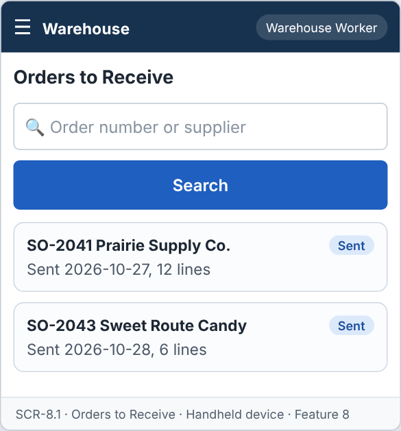
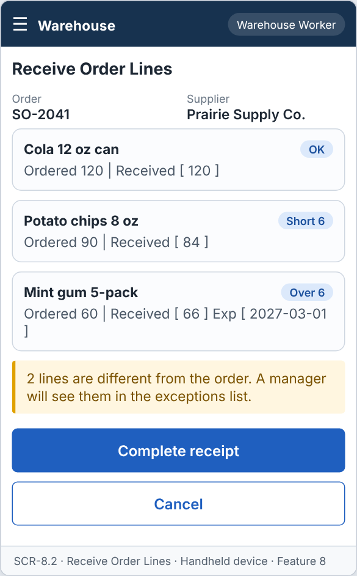
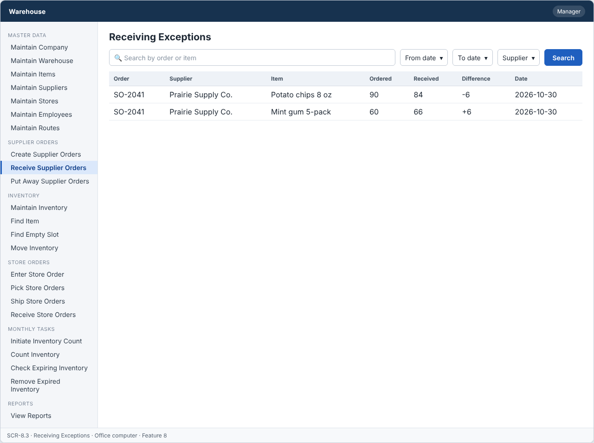

# Feature: Receive Supplier Orders

**Feature ID:** 8
**Branch pattern:** `feature/8-receive-supplier-orders`
**Status:** Draft
**Created:** 2026-09-27
**Input:** Receive products ordered from suppliers, check them in, and compare ordered and received quantities.
**Depends on:** [Feature 11 — Create Supplier Orders](feature-11-create-supplier-orders.md)

---

## User Stories

### US-8.1: Receive supplier order

**As a** warehouse worker
**I want to** check in a supplier order
**So that** received products can be recorded.
**Priority:** P1
**Independent test:** Receive a supplier order and verify a receipt record is created. 
**Acceptance Scenarios:** see ### US-8.1 under Gherkin AC

### US-8.2: Record quantity received

**As a** warehouse worker
**I want to** record quantity received and expiration date
**So that** actual received inventory is known.
**Priority:** P1
**Independent test:** Enter a quantity received on a receipt and verify it is saved. 
**Acceptance Scenarios:** see ### US-8.2 under Gherkin AC

### US-8.3: Identify receiving exception

**As a** manager
**I want to** compare quantity ordered with quantity received
**So that** I can see supplier receiving differences.
**Priority:** P1
**Independent test:** Create a receipt with a quantity mismatch and verify the system flags an exception. 
**Acceptance Scenarios:** see ### US-8.3 under Gherkin AC

---

## Functional Requirements

- **FR-001:** The system MUST identify the supplier order being received.
- **FR-002:** The system MUST maintain quantity ordered separately from quantity received.
- **FR-003:** The system MUST record quantity received.
- **FR-004:** Quantity received MUST NOT be negative.
- **FR-005:** The system MUST record the expiration date for items that have a shelf life.
- **FR-006:** The system MUST compare quantity ordered and quantity received.
- **FR-007:** The system MUST identify when quantity received differs from quantity ordered.
- **FR-008:** The system MUST set the supplier order to Received when all items are received.
- **FR-009:** Receiving exceptions MUST be available to management.
- **FR-010:** The system MUST let a warehouse worker and a manager use this feature (main user: warehouse worker), and MUST NOT let other roles change its information.
- **FR-011:** The system MUST be easy to use on the warehouse floor, on a handheld device or a tablet.

---

## Assumptions

- **A-1:** Only supplier orders with status Sent can be received. The worker finds the order by order number or by supplier name.
- **A-2:** One order is received in one visit. The worker records a received quantity for every line, then completes the receipt.
- **A-3:** A line with nothing delivered is recorded with quantity received 0. It is not left empty.
- **A-4:** The order becomes Received when every line has a received quantity, even when some quantities differ from the ordered quantity. The difference is a receiving exception, not a reason to keep the order open (FR-008).
- **A-5:** Items with a shelf life (`shelf_life_days` is set in Feature 3) need an expiration date. Items without a shelf life do not ask for one. The expiration date must be after the receiving date.
- **A-6:** A received quantity may be higher than the ordered quantity (the supplier sent extra). The system accepts it and marks the line as an exception.
- **A-7:** Receiving does not change inventory. Inventory changes when the items are put away (Feature 10).
- **A-8:** A receipt cannot be changed after it is completed. A mistake is handled by a manager through an inventory correction (Feature 9).
- **A-9:** The warehouse worker uses a handheld device or a tablet at the receiving dock (FR-011).

---

## Edge Cases

| ID | Situation | Expected behavior | Related |
|---|---|---|---|
| EC-1 | The worker opens an order that is Draft (not sent) or already Received. | The system does not list it for receiving. A direct request returns 409 WRONG_STATUS. | FR-001 |
| EC-2 | A line is received with quantity 0. | The system saves it as an exception (short by the full ordered quantity). | FR-003, FR-007 |
| EC-3 | The quantity received is negative or has a decimal part. | The system rejects the value. Quantity received must be a whole number of 0 or more. | FR-004 |
| EC-4 | The quantity received is more than the ordered quantity. | The system accepts it, marks the line as an exception (over), and shows a notice to the worker. | FR-006, FR-007 |
| EC-5 | An item has a shelf life and the expiration date is empty. | The system rejects the line and marks the date field. | FR-005 |
| EC-6 | The expiration date is today or in the past. | The system rejects the date and shows a message. Items that already expired are not accepted into stock. | FR-005 |
| EC-7 | Two workers receive the same order at the same time. | The first completed receipt wins. The second gets 409 WRONG_STATUS (already Received), and the screen reloads. | FR-008 |
| EC-8 | The worker closes the screen before completing the receipt. | Nothing is saved. The order stays Sent. (A draft receipt is not kept in this version.) | FR-008 |
| EC-9 | A supplier order has 60 lines. | The worker can scroll and enter lines in any order. Complete is allowed only when every line has a value. | FR-003, FR-008 |
| EC-10 | A clerk (not a worker or manager) calls the receive endpoint. | The server answers FORBIDDEN_ROLE and changes nothing. | FR-010 |

---

## Success Criteria

- **SC-1:** A worker receives an order of 10 lines in under 3 minutes on a handheld device.
- **SC-2:** 100% of lines with a different received quantity appear in the exceptions list for the manager.
- **SC-3:** An order is set to Received in 100% of completed receipts, and never before every line has a quantity (0 cases in testing).
- **SC-4:** Quantity ordered never changes during receiving (0 cases in testing).
- **SC-5:** All 9 Gherkin scenarios in this file pass as automated tests, and each user story's independent test is shown to work in a demo.

---

## Key Entities

- **Supplier Order** — The original order being received against.
- **Supplier Order Receipt** — Record of what was actually received for an order.
- **Item** — Product being received.
- **Supplier** — Vendor that shipped the order.

---

## Initial Data Model

### Supplier Order Receipt

- receipt_id: String — Required, unique
- supplier_order_id: Supplier Order reference — Required
- item_id: Item reference — Required
- quantity_ordered: Integer — From order
- quantity_received: Integer — Required, zero or greater
- expiration_date: Date — Optional, required when the item has a shelf life
- received_date: Date — Required
- received_by: Employee reference — Required
- exception: Boolean — True when quantities differ
- note: String — Optional, shortage or damage

---

## Gherkin AC

### US-8.1 — Receive supplier order

#### Scenario: Receive supplier order

- **Given** a supplier order was sent to a supplier
- **When** the worker receives the supplier order
- **Then** the system creates a supplier order receipt for the order

#### Scenario: Wrong role cannot change information

- **Given** a driver is signed in
- **When** the driver tries to change information in this feature
- **Then** the system rejects the change

### US-8.2 — Record quantity received

#### Scenario: Record quantity received

- **Given** a supplier order receipt is being created
- **When** the worker enters the quantity received
- **Then** the system saves the quantity received

#### Scenario: Record expiration date

- **Given** the item has a shelf life
- **When** the worker enters the expiration date
- **Then** the system saves the expiration date

#### Scenario: Invalid negative quantity

- **Given** the worker enters a negative quantity received
- **When** the worker tries to save the receipt
- **Then** the system rejects the negative quantity

### US-8.3 — Identify receiving exception

#### Scenario: Received quantity equals ordered quantity

- **Given** quantity ordered is 100
- **And** quantity received is 100
- **When** the system compares the quantities
- **Then** the system does not mark the receipt as an exception

#### Scenario: Received quantity is less than ordered quantity

- **Given** quantity ordered is 100
- **And** quantity received is 80
- **When** the system compares the quantities
- **Then** the system marks the receipt as a receiving exception

#### Scenario: Received quantity is greater than ordered quantity

- **Given** quantity ordered is 100
- **And** quantity received is 110
- **When** the system compares the quantities
- **Then** the system marks the receipt as a receiving exception

#### Scenario: Receiving exception is displayed

- **Given** a receiving exception exists
- **When** the manager views receiving exceptions
- **Then** the system displays the supplier order, quantity ordered, and quantity received

---

## Data Ownership

| Data | Owner | This feature | Notes |
|---|---|---|---|
| Supplier Order Receipt | This feature (Feature 8) | Owns | Creates the receipt and its lines (quantity received, expiration date). |
| Supplier Order | [Feature 11 — Create Supplier Orders](feature-11-create-supplier-orders.md) | Updates (via owner) | Calls the owner's service `markReceived(orderId)` in the same transaction as the receipt. |
| Item | [Feature 3 — Maintain Items](feature-3-maintain-items.md) | Reads | Shelf life: does the item need an expiration date? |
| Audit Log Entry | Platform (cross-cutting) | Updates (via owner) | Writes one entry for each completed receipt. |

**Rule:** each piece of data has one owning feature. A feature that needs to change data it does not own must call the owner's service, and must never write the owner's tables directly (ADR-004).

---

## API Requirements

Base path: `/api/v1`. All endpoints follow [ADR-003](../docs/ADRs/ADR-003-rest-api-conventions.md) (JSON, problem+json errors, `version` field for optimistic locking). Roles are checked on the server for every call ([NFR-S2](../docs/NFR.md)).

| # | Method and path | Purpose | Allowed roles | Success | Errors | Supports |
|---|---|---|---|---|---|---|
| 1 | `GET /supplier-orders/receivable` | List supplier orders with status Sent. Query: `search` (order number or supplier). | Warehouse Worker, Manager | 200 | — | US-8.1 |
| 2 | `GET /supplier-orders/{supplierOrderId}/receipt` | Get the order lines to receive: item, quantity ordered, shelf life flag. | Warehouse Worker, Manager | 200 | 404 NOT_FOUND, 409 WRONG_STATUS | US-8.1, US-8.2 |
| 3 | `POST /supplier-orders/{supplierOrderId}/receipts` | Complete the receipt with one received quantity (and expiration date when needed) for every line. | Warehouse Worker, Manager | 201 + Location | 400 VALIDATION_FAILED, 404 NOT_FOUND, 409 WRONG_STATUS | US-8.1, US-8.2 |
| 4 | `GET /receiving-exceptions` | List lines where quantity received differs from quantity ordered. Query: `from`, `to`, `supplierId`. | Manager | 200 | — | US-8.3 |

**Request and response notes**

- POST body: `lines` = list of {`item_id`, `quantity_received`, `expiration_date` (when the item has a shelf life)}. Every ordered line must be present.
- The response lists each line with `quantity_ordered`, `quantity_received`, and `difference` (received minus ordered).

**Calls to other features (internal service calls, not public endpoints)**

- Feature 11 — Create Supplier Orders: `getOrder(orderId)` for the lines, and `markReceived(orderId)` after the receipt is saved.

---

## Screen Requirements

The screen images are in [docs/UI](../docs/UI/README.md). Each image is a wireframe: it shows layout and content, not final colors.

| Screen | Name | Device | Purpose | Image | Stories |
|---|---|---|---|---|---|
| SCR-8.1 | Orders to Receive | Handheld device | Choose the supplier order that arrived. | [image](../docs/UI/images/scr-8-1-orders-to-receive.png) | US-8.1 |
| SCR-8.2 | Receive Order Lines | Handheld device | Enter the quantity received (and expiration date) for each line. | [image](../docs/UI/images/scr-8-2-receive-order-lines.png) | US-8.2, US-8.1 |
| SCR-8.3 | Receiving Exceptions | Office computer | Show lines where received and ordered quantities differ. | [image](../docs/UI/images/scr-8-3-receiving-exceptions.png) | US-8.3 |

### SCR-8.1 — Orders to Receive

**Device:** Handheld device. **Purpose:** Choose the supplier order that arrived.

- Search box (Order number or supplier).
- List of cards: SO-2041  Prairie Supply Co.; SO-2043  Sweet Route Candy.

### SCR-8.2 — Receive Order Lines

**Device:** Handheld device. **Purpose:** Enter the quantity received (and expiration date) for each line.

- Details shown: Order, Supplier.
- List of cards: Cola 12 oz can; Potato chips 8 oz; Mint gum 5-pack.
- Message (warn): 2 lines are different from the order. A manager will see them in the exceptions list.
- Buttons: Complete receipt, Cancel.
- Complete is enabled only when every line has a quantity.
- The expiration date field appears only for items with a shelf life.

### SCR-8.3 — Receiving Exceptions

**Device:** Office computer. **Purpose:** Show lines where received and ordered quantities differ.

- Search box (Search by order or item) and filters (From date, To date, Supplier).
- Table with columns: Order, Supplier, Item, Ordered, Received, Difference, Date.

---

## Definition of Done

This feature is done when all of these are true:

- [ ] All 3 user stories are built, and each story's independent test passes.
- [ ] All 11 functional requirements are built, and each one is covered by a Gherkin scenario, a unit test, or an NFR check.
- [ ] All 9 Gherkin scenarios are automated and pass in the build.
- [ ] The 4 API endpoints match the API Requirements table, are in the OpenAPI file, and have tests for success and for every listed error.
- [ ] The role rules are enforced on the server for every endpoint, with a test for a role that is not allowed.
- [ ] The screens (SCR-8.1, SCR-8.2, SCR-8.3) match the images in `docs/UI`, and were checked on: handheld device, office computer.
- [ ] Validation messages show next to the field, and what the user typed stays on the screen after an error.
- [ ] Database changes (tables, keys, unique rules, not-null rules, checks) are in a migration script and match the Initial Data Model.
- [ ] Every create, edit, delete, and status change writes an audit log entry (who, when, what changed).
- [ ] A test shows that completing a receipt never changes the ordered quantity and never changes inventory.
- [ ] These non-functional checks pass (see [NFR](../docs/NFR.md)): NFR-U2, NFR-U9, NFR-P1, NFR-S1, NFR-S2, NFR-S4, NFR-D1, NFR-A1, NFR-M1.
- [ ] The code is reviewed in a pull request and merged into `main` with no open critical bugs.
- [ ] This feature file, the UI images, and the API table are updated if anything changed during the build.

---

## Out of Scope

- Saving a half-finished receipt and finishing it later.
- Receiving one order in several deliveries (partial deliveries keep the order Sent).
- Paying the supplier, matching invoices, or returning goods to the supplier.
- Putting items into slots (Feature 10).
- Quality checks or photos of damaged goods.
