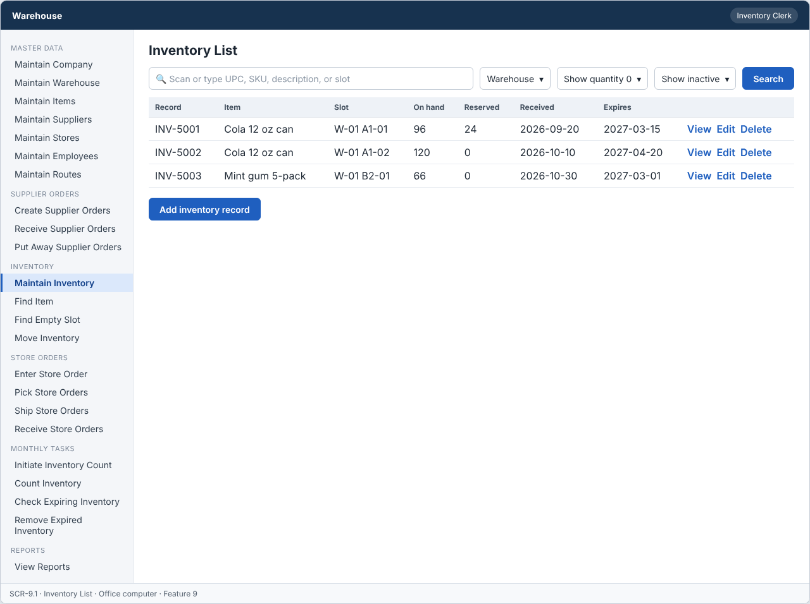
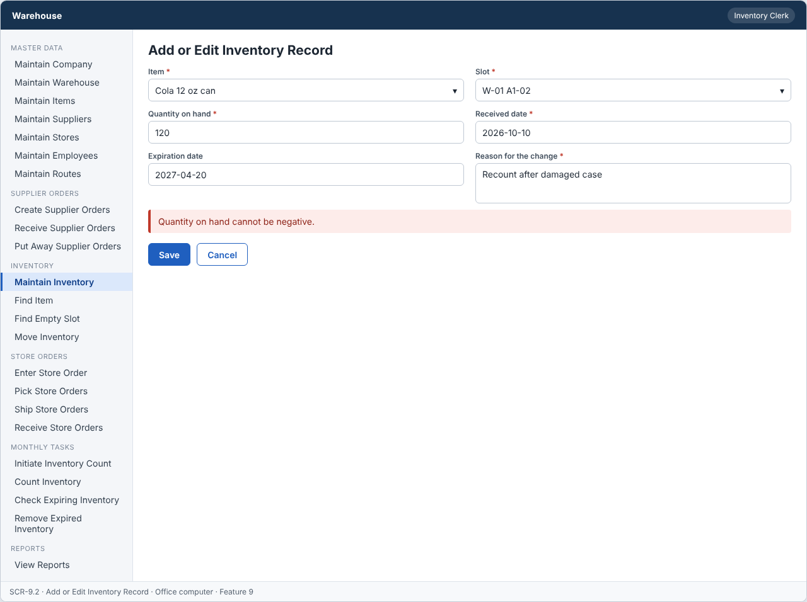
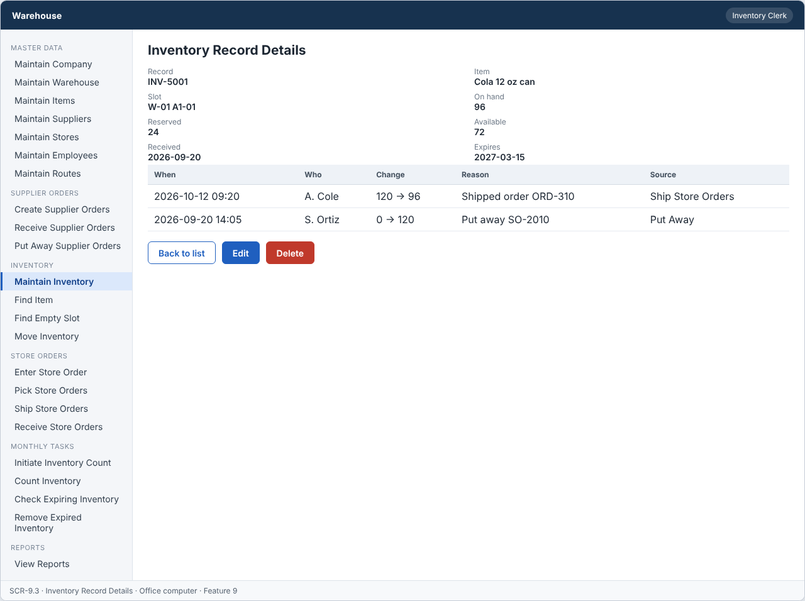

# Feature: Maintain Inventory

**Feature ID:** 9
**Branch pattern:** `feature/9-maintain-inventory`
**Status:** Draft
**Created:** 2026-09-27
**Input:** Maintain the quantity of each item in each storage slot.
**Depends on:** [Feature 2 — Maintain Warehouse](feature-2-maintain-warehouse.md); [Feature 3 — Maintain Items](feature-3-maintain-items.md)

---

## User Stories

### US-9.1: Add inventory record

**As an** inventory clerk
**I want to** add an inventory record
**So that** the system can maintain inventory records.
**Priority:** P1
**Independent test:** Add an inventory record and verify that it is saved. 
 **Acceptance Scenarios:** see ### US-9.1 under Gherkin AC

### US-9.2: Edit inventory record

**As an** inventory clerk
**I want to** edit an inventory record
**So that** inventory record information stays accurate.
**Priority:** P1
**Independent test:** Edit an inventory record and verify that the change is saved. 
**Acceptance Scenarios:** see ### US-9.2 under Gherkin AC

### US-9.3: Delete inventory record

**As an** inventory clerk
**I want to** delete an inventory record
**So that** incorrect or unused inventory records can be removed.
**Priority:** P1
**Independent test:** Delete an inventory record and verify that it is no longer active.
 **Acceptance Scenarios:** see ### US-9.3 under Gherkin AC

### US-9.4: View inventory record

**As a** warehouse worker
**I want to** view inventory record information
**So that** I can see how many items are in each slot.
**Priority:** P1
**Independent test:** Open an inventory record and verify the current information is displayed. 
**Acceptance Scenarios:** see ### US-9.4 under Gherkin AC

---

## Functional Requirements

- **FR-001:** The system MUST maintain inventory records.
- **FR-002:** Each inventory record MUST have a unique identifier.
- **FR-003:** The system MUST allow authorized users to add inventory records.
- **FR-004:** The system MUST allow authorized users to edit inventory records.
- **FR-005:** The system MUST allow authorized users to delete inventory records.
- **FR-006:** The system MUST allow authorized users to view inventory records.
- **FR-007:** Required inventory record information MUST be provided before the inventory record can be saved (item, slot, quantity on hand, received date).
- **FR-008:** The system MUST reject duplicate inventory record identifiers.
- **FR-009:** The system MUST NOT delete an inventory record that is used by an open pick list, an open inventory count or an open removal list.
- **FR-010:** Deleting an inventory record MUST only remove it from active records, so other features keep the original inventory record information.
- **FR-011:** Quantity on hand MUST NOT be negative.
- **FR-012:** The system MUST require a reason when quantity on hand is changed by hand.
- **FR-013:** The system MUST keep the received date so the oldest stock is used first (FIFO).
- **FR-014:** The system MUST let an inventory clerk, a warehouse worker, and a manager use this feature (main user: inventory clerk), and MUST NOT let other roles change its information.
- **FR-015:** The system MUST work on an office computer.
- **FR-016:** This feature is used every day, so each screen MUST need as few steps and clicks as possible.

---

## Assumptions

- **A-1:** One inventory record holds one item, in one slot, with one received date. The same item can have many records (different slots or received dates).
- **A-2:** Quantity on hand is a whole number of 0 or more. A record that reaches 0 stays in the system with quantity 0 until it is deleted. When a record reaches 0, the slot becomes Empty.
- **A-3:** A hand change (add, edit, delete) needs a reason, written in the reason field (FR-012). Changes made by other features (put away, move, ship, count, removal) fill the reason automatically.
- **A-4:** Feature 9 is the only place that changes inventory quantity. Other features call its service (ADR-005). Every change writes an inventory change entry (who, when, old and new quantity, reason, source feature).
- **A-5:** Available quantity = quantity on hand minus quantity reserved by open pick lists.
- **A-6:** Delete means the record is set inactive (`is_active = false`), and the slot becomes Empty when no active record is left in it. It is not allowed when an open pick list, open count, or open removal list uses the record (FR-009).
- **A-7:** Inventory clerks and managers add, edit, and delete. Warehouse workers view only.
- **A-8:** The inventory clerk uses this feature every day on an office computer, so the list opens with the search focused (FR-015, FR-016).

---

## Edge Cases

| ID | Situation | Expected behavior | Related |
|---|---|---|---|
| EC-1 | The clerk changes the quantity on hand to a negative number. | The system rejects the change (FR-011). | FR-011 |
| EC-2 | The clerk changes the quantity without a reason. | The system rejects the change and marks the reason field (FR-012). | FR-012 |
| EC-3 | The clerk adds a record for a slot that already holds a different item. | The system rejects it. One slot holds one item at a time (CONFLICT_SLOT_OCCUPIED). | FR-007 |
| EC-4 | The clerk adds a record for an item that is inactive, or a slot that is inactive. | The system rejects the record. Item and slot must be active. | FR-007 |
| EC-5 | The received date is in the future. | The system rejects it. The received date must be today or earlier. | FR-007, FR-013 |
| EC-6 | Two users change the quantity of the same record at the same time. | The first save works. The second gets VERSION_CONFLICT, and the screen shows the new quantity. No quantity is lost. | FR-004, FR-011 |
| EC-7 | A shipment reduces the quantity while the clerk edits the same record. | The clerk's change is rejected with VERSION_CONFLICT if the quantity moved. The clerk reloads and decides again. | FR-004 |
| EC-8 | A record is deleted that an open pick list uses. | The system rejects the delete (IN_USE) and names the pick list. | FR-009 |
| EC-9 | The clerk sets quantity to 0 on a record. | The record is saved, and the slot becomes Empty in the same transaction. | FR-004, FR-011 |
| EC-10 | The database fails while saving. | The whole change is rolled back. The quantity and the slot status stay as before, and the clerk sees an error with a reference code. | FR-004 |

---

## Success Criteria

- **SC-1:** A clerk adds a record, or corrects a quantity, in under 1 minute.
- **SC-2:** Quantity on hand is never negative (0 cases in testing, and a database check rule exists).
- **SC-3:** 100% of quantity changes have an inventory change entry with the user, the time, the old and new quantity, and the reason.
- **SC-4:** After a quantity change, the slot status always matches: Occupied when quantity is above 0, Empty when no active record is left (0 mismatches in the daily check).
- **SC-5:** Two users changing the same record never lose a change (concurrency test).
- **SC-6:** All 15 Gherkin scenarios in this file pass as automated tests, and each user story's independent test is shown to work in a demo.

---

## Key Entities

- **Inventory record** — Quantity of an item stored in one slot.

---

## Initial Data Model

### Inventory record

- inventory_id: String — Required, unique
- item_id: Item reference — Required
- slot_id: Slot reference — Required
- quantity_on_hand: Integer — Required, zero or greater
- received_date: Date — Required
- expiration_date: Date — Optional, required when the item has a shelf life
- is_active: Boolean — Required, false after delete

---

## Gherkin AC

### US-9.1 — Add inventory record

#### Scenario: Inventory record is saved

- **Given** an inventory record does not already exist
- **When** the inventory clerk enters the required inventory record information and saves
- **Then** the system saves the inventory record

#### Scenario: Inventory record is not saved due to missing information

- **Given** an inventory record is being added
- **When** required inventory record information is missing
- **Then** the system does not save the inventory record

#### Scenario: Duplicate inventory record ID is rejected

- **Given** an inventory record with the same identifier already exists
- **When** the inventory clerk tries to add an inventory record with that identifier
- **Then** the system rejects the duplicate inventory record

#### Scenario: Negative quantity is rejected

- **Given** the employee enters a negative quantity on hand
- **When** the employee tries to save the inventory record
- **Then** the system rejects the negative quantity

#### Scenario: Missing slot is rejected

- **Given** no slot is selected
- **When** the employee tries to save the inventory record
- **Then** the system does not save the inventory record

#### Scenario: Wrong role cannot change information

- **Given** a driver is signed in
- **When** the driver tries to change information in this feature
- **Then** the system rejects the change

### US-9.2 — Edit inventory record

#### Scenario: Inventory record is edited successfully

- **Given** an inventory record exists
- **When** the inventory clerk changes inventory record information and saves
- **Then** the system saves the updated inventory record

#### Scenario: Inventory record edit fails

- **Given** an inventory record exists
- **When** required information is removed during edit
- **Then** the system does not save the update

### US-9.3 — Delete inventory record

#### Scenario: Inventory record is deleted successfully

- **Given** an inventory record exists and is not in use
- **When** the inventory clerk deletes the inventory record
- **Then** the system removes the inventory record from active records

#### Scenario: Inventory record used by an open pick list cannot be deleted

- **Given** an inventory record is used by an open pick list
- **When** the inventory clerk tries to delete it
- **Then** the system rejects the delete operation
- **And** the inventory record and the other records stay unchanged

#### Scenario: Inventory record used by an open inventory count cannot be deleted

- **Given** an inventory record is used by an open inventory count
- **When** the inventory clerk tries to delete it
- **Then** the system rejects the delete operation
- **And** the inventory record and the other records stay unchanged

#### Scenario: Inventory record used by an open removal list cannot be deleted

- **Given** an inventory record is used by an open removal list
- **When** the inventory clerk tries to delete it
- **Then** the system rejects the delete operation
- **And** the inventory record and the other records stay unchanged

#### Scenario: Deleted inventory record does not change past records

- **Given** an inventory record was deleted and past records refer to it
- **When** someone views those past records
- **Then** the system still shows the original inventory record information

#### Scenario: Delete unknown inventory record fails

- **Given** the inventory record does not exist
- **When** the inventory clerk tries to delete it
- **Then** the system rejects the delete operation

### US-9.4 — View inventory record

#### Scenario: Inventory record information is displayed

- **Given** an inventory record exists
- **When** the warehouse worker views the inventory record
- **Then** the system displays the inventory record information

---

## Data Ownership

| Data | Owner | This feature | Notes |
|---|---|---|---|
| Inventory Record | This feature (Feature 9) | Owns | Creates, edits, and sets records inactive. The only feature that changes `quantity_on_hand`. |
| Item | [Feature 3 — Maintain Items](feature-3-maintain-items.md) | Reads | A record must refer to an active item. |
| Slot | [Feature 2 — Maintain Warehouse](feature-2-maintain-warehouse.md) | Updates (via owner) | Calls Feature 2's `setSlotStatus` in the same transaction as the quantity change. |
| Pick Line | [Feature 15 — Pick Store Orders](feature-15-pick-store-orders.md) | Reads | Usage check and reserved quantity (picks reserve stock, shipping reduces it). |
| Inventory Count | [Feature 19 — Initiate Inventory Count](feature-19-initiate-inventory-count.md) | Reads | Usage check: is the record on an open count? |
| Removal Line | [Feature 21 — Initial Check for Exp Inventory](feature-21-initial-check-for-exp-inventory.md) | Reads | Usage check: is the record on an open removal list? |
| Audit Log Entry | Platform (cross-cutting) | Updates (via owner) | Writes the inventory change entry. |

**Rule:** each piece of data has one owning feature. A feature that needs to change data it does not own must call the owner's service, and must never write the owner's tables directly (ADR-004).

**Inventory service:** `adjust(recordId, delta, reason, source)` is the only way other features change quantity. It checks that the result is not negative, saves the change entry, and updates the slot status in one transaction (ADR-005).

---

## API Requirements

Base path: `/api/v1`. All endpoints follow [ADR-003](../docs/ADRs/ADR-003-rest-api-conventions.md) (JSON, problem+json errors, `version` field for optimistic locking). Roles are checked on the server for every call ([NFR-S2](../docs/NFR.md)).

| # | Method and path | Purpose | Allowed roles | Success | Errors | Supports |
|---|---|---|---|---|---|---|
| 1 | `GET /inventory-records` | List inventory records. Query: `search`, `itemId`, `warehouseId`, `slotId`, `includeInactive`. | Inventory Clerk, Warehouse Worker, Manager | 200 | — | US-9.4 |
| 2 | `POST /inventory-records` | Add an inventory record (item, slot, quantity, received date, reason). | Inventory Clerk, Manager | 201 + Location | 400 VALIDATION_FAILED, 409 SLOT_OCCUPIED_BY_OTHER_ITEM | US-9.1 |
| 3 | `GET /inventory-records/{inventoryRecordId}` | Get one record with reserved and available quantity. | Inventory Clerk, Warehouse Worker, Manager | 200 | 404 NOT_FOUND | US-9.4 |
| 4 | `PUT /inventory-records/{inventoryRecordId}` | Change a record. The body must include `version` and `reason`. | Inventory Clerk, Manager | 200 | 400 VALIDATION_FAILED, 404 NOT_FOUND, 409 VERSION_CONFLICT | US-9.2 |
| 5 | `DELETE /inventory-records/{inventoryRecordId}` | Set a record inactive. The request must include `reason`. | Inventory Clerk, Manager | 204 | 400 VALIDATION_FAILED, 404 NOT_FOUND, 409 IN_USE | US-9.3 |
| 6 | `GET /inventory-records/{inventoryRecordId}/changes` | List the change history of a record. | Inventory Clerk, Manager | 200 | 404 NOT_FOUND | US-9.4 |

**Request and response notes**

- Body: `inventory_record_id` (POST only), `item_id`, `slot_id`, `quantity_on_hand`, `received_date`, `expiration_date` (optional), `reason`.
- Responses include `quantity_reserved` and `quantity_available`.

**Calls to other features (internal service calls, not public endpoints)**

- Feature 2 — Maintain Warehouse: `setSlotStatus(slotId, status)`.
- Features 10, 16, 17, 20, 22 call `adjust(...)` of this feature. They never write inventory tables.

---

## Screen Requirements

The screen images are in [docs/UI](../docs/UI/README.md). Each image is a wireframe: it shows layout and content, not final colors.

| Screen | Name | Device | Purpose | Image | Stories |
|---|---|---|---|---|---|
| SCR-9.1 | Inventory List | Office computer | Find inventory by item, slot, or warehouse. | [image](../docs/UI/images/scr-9-1-inventory-list.png) | US-9.4 |
| SCR-9.2 | Add or Edit Inventory Record | Office computer | Add a record or correct a quantity, with a reason. | [image](../docs/UI/images/scr-9-2-add-or-edit-inventory-record.png) | US-9.1, US-9.2 |
| SCR-9.3 | Inventory Record Details | Office computer | Show one record and its change history. | [image](../docs/UI/images/scr-9-3-inventory-record-details.png) | US-9.4 |

### SCR-9.1 — Inventory List

**Device:** Office computer. **Purpose:** Find inventory by item, slot, or warehouse.

- Search box (Scan or type UPC, SKU, description, or slot) and filters (Warehouse, Show quantity 0, Show inactive).
- Table with columns: Record, Item, Slot, On hand, Reserved, Received, Expires.
- Buttons: Add inventory record.

### SCR-9.2 — Add or Edit Inventory Record

**Device:** Office computer. **Purpose:** Add a record or correct a quantity, with a reason.

- Fields: Item (required), Slot (required), Quantity on hand (required), Received date (required), Expiration date, Reason for the change (required).
- Message (error): Quantity on hand cannot be negative.
- Buttons: Save, Cancel.
- The reason is required for every hand change (FR-012).

### SCR-9.3 — Inventory Record Details

**Device:** Office computer. **Purpose:** Show one record and its change history.

- Details shown: Record, Item, Slot, On hand, Reserved, Available, Received, Expires.
- Table with columns: When, Who, Change, Reason, Source.
- Buttons: Back to list, Edit, Delete.

---

## Definition of Done

This feature is done when all of these are true:

- [ ] All 4 user stories are built, and each story's independent test passes.
- [ ] All 16 functional requirements are built, and each one is covered by a Gherkin scenario, a unit test, or an NFR check.
- [ ] All 15 Gherkin scenarios are automated and pass in the build.
- [ ] The 6 API endpoints match the API Requirements table, are in the OpenAPI file, and have tests for success and for every listed error.
- [ ] The role rules are enforced on the server for every endpoint, with a test for a role that is not allowed.
- [ ] The screens (SCR-9.1, SCR-9.2, SCR-9.3) match the images in `docs/UI`, and were checked on: office computer.
- [ ] Validation messages show next to the field, and what the user typed stays on the screen after an error.
- [ ] Database changes (tables, keys, unique rules, not-null rules, checks) are in a migration script and match the Initial Data Model.
- [ ] Every create, edit, delete, and status change writes an audit log entry (who, when, what changed).
- [ ] A concurrency test shows that two users changing the same record never lose a change.
- [ ] A database check rule blocks a negative quantity even when the application code is bypassed.
- [ ] These non-functional checks pass (see [NFR](../docs/NFR.md)): NFR-U1, NFR-U4, NFR-U9, NFR-P1, NFR-S1, NFR-S2, NFR-S4, NFR-D1, NFR-D2, NFR-D3, NFR-A1, NFR-A2, NFR-M1.
- [ ] The code is reviewed in a pull request and merged into `main` with no open critical bugs.
- [ ] This feature file, the UI images, and the API table are updated if anything changed during the build.

---

## Out of Scope

- Cost value of inventory, FIFO costing, or accounting entries.
- Several items in one slot, or slot capacity limits.
- Barcode label printing.
- Bulk import or export of inventory.
- Restoring a deleted inventory record.
