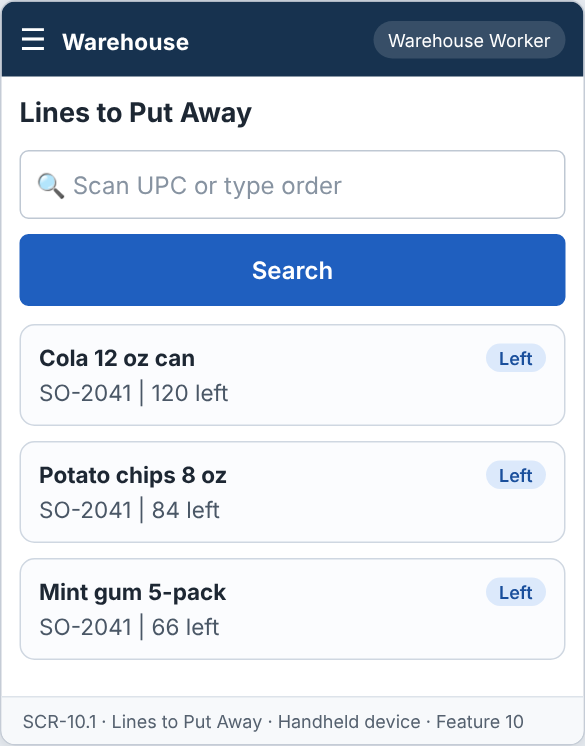
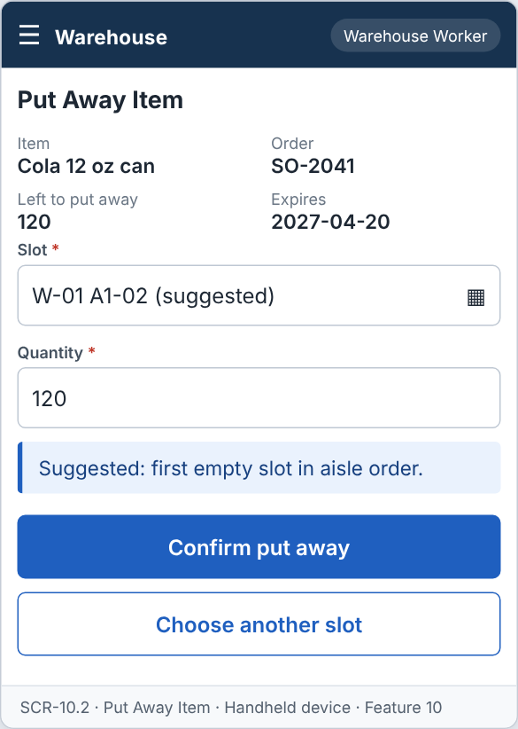
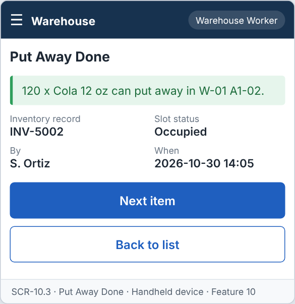

# Feature: Put Away Supplier Orders

**Feature ID:** 10
**Branch pattern:** `feature/10-put-away-supplier-orders`
**Status:** Draft
**Created:** 2026-09-28
**Input:** Put received products into storage slots and update inventory.
**Depends on:** [Feature 8 — Receive Supplier Orders](feature-8-receive-supplier-orders.md); [Feature 14 — Find Empty Slot](feature-14-find-empty-slot.md); [Feature 9 — Maintain Inventory](feature-9-maintain-inventory.md)

---

## User Stories

### US-10.1: Put away received items

**As a** warehouse worker
**I want to** put received items into a storage slot
**So that** items can be stored and found later.
**Priority:** P1
**Independent test:** Put away a received item and verify the put away record is saved. 
**Acceptance Scenarios:** see ### US-10.1 under Gherkin AC

### US-10.2: Record quantity put away

**As a** warehouse worker
**I want to** record how many items I put in the slot
**So that** the quantity stored is correct.
**Priority:** P1
**Independent test:** Enter a quantity on a put away record and verify it is saved. 
**Acceptance Scenarios:** see ### US-10.2 under Gherkin AC

### US-10.3: Update inventory

**As a** warehouse worker
**I want to** have inventory updated when I put items away
**So that** the system knows what is in each slot.
**Priority:** P1
**Independent test:** Put away items and verify inventory and the slot are updated. 
**Acceptance Scenarios:** see ### US-10.3 under Gherkin AC

---

## Functional Requirements

- **FR-001:** The system MUST allow received items to be assigned to a storage slot.
- **FR-002:** The system MUST maintain the storage slot of received items.
- **FR-003:** The system MUST NOT allow an item to be put away without a slot.
- **FR-004:** The system MUST NOT put away more than the quantity received.
- **FR-005:** The system MUST create an inventory record with quantity, received date, and expiration date when items are put away.
- **FR-006:** The system MUST change the slot status to Occupied.
- **FR-007:** The system MUST record who put away the items and when.
- **FR-008:** The system MUST let a warehouse worker and a manager use this feature (main user: warehouse worker), and MUST NOT let other roles change its information.
- **FR-009:** The system MUST be easy to use on the warehouse floor, on a handheld device or a tablet.
- **FR-010:** This feature is used every day, so each screen MUST need as few steps and clicks as possible.

---

## Assumptions

- **A-1:** Only lines of a Received supplier order that still have quantity left to put away are listed.
- **A-2:** The worker puts away one line at a time: scans or picks an empty slot, enters the quantity, and confirms. One put away can use one slot. A line can use several put aways (several slots) until all is put away.
- **A-3:** The system suggests the first empty slot (Feature 14). The worker may choose another empty slot.
- **A-4:** The quantity put away cannot be more than the quantity received minus what is already put away (FR-004).
- **A-5:** Each put away creates one inventory record, with the received date of the order and the expiration date entered at receiving (FR-005), and changes the slot to Occupied.
- **A-6:** The person and the time are saved automatically from the signed-in user (FR-007).
- **A-7:** A put away is not changed afterwards. A mistake is moved with Feature 16 or corrected with Feature 9.
- **A-8:** The worker uses a handheld device or a tablet on the warehouse floor (FR-009).

---

## Edge Cases

| ID | Situation | Expected behavior | Related |
|---|---|---|---|
| EC-1 | The worker tries to put away without a slot. | The system rejects it (FR-003). The Confirm button stays disabled. | FR-003 |
| EC-2 | The quantity is more than what is left to put away. | The system rejects it and shows the quantity left. | FR-004 |
| EC-3 | The chosen slot became Occupied a moment ago (another worker used it). | The system rejects the put away with SLOT_NOT_EMPTY and suggests the next empty slot. | FR-001, FR-006 |
| EC-4 | There is no empty slot in the warehouse. | The system shows "No empty slots" (Feature 14). The put away cannot be saved, and the manager can see the unplaced lines. | FR-003 |
| EC-5 | The worker enters quantity 0. | The system rejects it. Quantity must be greater than 0. | FR-004 |
| EC-6 | A line has been put away in full. | The line disappears from the list. The order shows Put away complete. | FR-004 |
| EC-7 | Two workers put away the same line at the same time. | The total can never go above the quantity received. The second request is checked against the new remaining quantity and may be rejected. | FR-004 |
| EC-8 | The inventory record cannot be created (for example the database fails). | Nothing is saved: no put away, no inventory, and the slot stays Empty. | FR-005, FR-006 |
| EC-9 | The scanned slot code does not exist or is in another warehouse than the order. | The system rejects it with a clear message. | FR-002 |

---

## Success Criteria

- **SC-1:** A worker puts away one line in under 30 seconds, with 4 taps or fewer after scanning the slot.
- **SC-2:** 100% of put aways create exactly one inventory record and change exactly one slot to Occupied.
- **SC-3:** The total put away for a line is never more than the quantity received (0 cases in testing).
- **SC-4:** Every put away shows who did it and when (100%).
- **SC-5:** All 7 Gherkin scenarios in this file pass as automated tests, and each user story's independent test is shown to work in a demo.

---

## Key Entities

- **Put Away Record** — Record of where a received item was stored.
- **Item** — Product being put away.
- **Slot** — Location where the item is stored.
- **Inventory** — Quantity of the item stored in the slot.

---

## Initial Data Model

### Put Away Record

- put_away_id: String — Required, unique
- receipt_id: Supplier Order Receipt reference — Required
- item_id: Item reference — Required
- slot_id: Slot reference — Required
- quantity: Integer — Required, greater than zero
- put_away_by: Employee reference — Required
- put_away_date: Date — Required

---

## Gherkin AC

### US-10.1 — Put away received items

#### Scenario: Successful put away

- **Given** received items exist for a supplier order
- **When** the worker puts the items away to an empty slot
- **Then** the system saves the put away record

#### Scenario: Missing slot

- **Given** no slot is selected
- **When** the worker tries to put the items away
- **Then** the system does not save the put away record

#### Scenario: Occupied slot is rejected

- **Given** a slot holds a different item
- **When** the worker tries to put the items away to that slot
- **Then** the system rejects the put away

#### Scenario: Wrong role cannot change information

- **Given** a driver is signed in
- **When** the driver tries to change information in this feature
- **Then** the system rejects the change

### US-10.2 — Record quantity put away

#### Scenario: Invalid quantity

- **Given** the worker enters a quantity of zero or less
- **When** the worker tries to save the put away record
- **Then** the system rejects the invalid quantity

#### Scenario: Quantity is more than received

- **Given** 10 units were received
- **When** the worker tries to put away 12 units
- **Then** the system rejects the put away

### US-10.3 — Update inventory

#### Scenario: Inventory is updated

- **Given** 10 units were received and put away to an empty slot
- **When** the put away is saved
- **Then** the system adds an inventory record of 10 units
- **And** the slot status is Occupied

---

## Data Ownership

| Data | Owner | This feature | Notes |
|---|---|---|---|
| Put Away Record | This feature (Feature 10) | Owns | Creates the put away (line, slot, quantity, worker, time). |
| Supplier Order Receipt | [Feature 8 — Receive Supplier Orders](feature-8-receive-supplier-orders.md) | Reads | Quantity received and expiration date per line. |
| Slot | [Feature 2 — Maintain Warehouse](feature-2-maintain-warehouse.md) | Reads | Which slots are Empty (through Feature 14). |
| Inventory Record | [Feature 9 — Maintain Inventory](feature-9-maintain-inventory.md) | Updates (via owner) | Calls Feature 9's `create(...)` and `adjust(...)` in the same transaction. |
| Audit Log Entry | Platform (cross-cutting) | Updates (via owner) | Writes one entry for each put away. |

**Rule:** each piece of data has one owning feature. A feature that needs to change data it does not own must call the owner's service, and must never write the owner's tables directly (ADR-004).

---

## API Requirements

Base path: `/api/v1`. All endpoints follow [ADR-003](../docs/ADRs/ADR-003-rest-api-conventions.md) (JSON, problem+json errors, `version` field for optimistic locking). Roles are checked on the server for every call ([NFR-S2](../docs/NFR.md)).

| # | Method and path | Purpose | Allowed roles | Success | Errors | Supports |
|---|---|---|---|---|---|---|
| 1 | `GET /put-aways/pending` | List received order lines that still have quantity to put away. | Warehouse Worker, Manager | 200 | — | US-10.1 |
| 2 | `GET /put-aways/pending/{receiptLineId}` | Get one line with quantity left and the suggested empty slot. | Warehouse Worker, Manager | 200 | 404 NOT_FOUND | US-10.1, US-10.2 |
| 3 | `POST /put-aways` | Put away a quantity of one line into one slot. | Warehouse Worker, Manager | 201 + Location | 400 VALIDATION_FAILED, 404 NOT_FOUND, 409 SLOT_NOT_EMPTY, 409 QUANTITY_EXCEEDS_RECEIVED | US-10.1, US-10.2, US-10.3 |
| 4 | `GET /put-aways` | List put aways. Query: `from`, `to`, `employeeId`. | Manager | 200 | — | US-10.3 |

**Request and response notes**

- POST body: `receipt_line_id`, `slot_id`, `quantity`. The server sets `put_away_by` and `put_away_at`.
- The response includes the new `inventory_record_id`.

**Calls to other features (internal service calls, not public endpoints)**

- Feature 8 — Receive Supplier Orders: `getReceiptLine(receiptLineId)`.
- Feature 14 — Find Empty Slot: `suggestSlot(warehouseId)`.
- Feature 9 — Maintain Inventory: `create(...)` and `adjust(...)`.
- Feature 2 — Maintain Warehouse: `setSlotStatus(slotId, Occupied)`.

---

## Screen Requirements

The screen images are in [docs/UI](../docs/UI/README.md). Each image is a wireframe: it shows layout and content, not final colors.

| Screen | Name | Device | Purpose | Image | Stories |
|---|---|---|---|---|---|
| SCR-10.1 | Lines to Put Away | Handheld device | Choose a received item that must go into a slot. | [image](../docs/UI/images/scr-10-1-lines-to-put-away.png) | US-10.1 |
| SCR-10.2 | Put Away Item | Handheld device | Confirm the slot and quantity. | [image](../docs/UI/images/scr-10-2-put-away-item.png) | US-10.1, US-10.2 |
| SCR-10.3 | Put Away Done | Handheld device | Show the result and the new inventory. | [image](../docs/UI/images/scr-10-3-put-away-done.png) | US-10.3 |

### SCR-10.1 — Lines to Put Away

**Device:** Handheld device. **Purpose:** Choose a received item that must go into a slot.

- Search box (Scan UPC or type order).
- List of cards: Cola 12 oz can; Potato chips 8 oz; Mint gum 5-pack.

### SCR-10.2 — Put Away Item

**Device:** Handheld device. **Purpose:** Confirm the slot and quantity.

- Details shown: Item, Order, Left to put away, Expires.
- Fields: Slot (required), Quantity (required).
- Message (info): Suggested: first empty slot in aisle order.
- Buttons: Confirm put away, Choose another slot.

### SCR-10.3 — Put Away Done

**Device:** Handheld device. **Purpose:** Show the result and the new inventory.

- Message (ok): 120 x Cola 12 oz can put away in W-01 A1-02.
- Details shown: Inventory record, Slot status, By, When.
- Buttons: Next item, Back to list.

---

## Definition of Done

This feature is done when all of these are true:

- [ ] All 3 user stories are built, and each story's independent test passes.
- [ ] All 10 functional requirements are built, and each one is covered by a Gherkin scenario, a unit test, or an NFR check.
- [ ] All 7 Gherkin scenarios are automated and pass in the build.
- [ ] The 4 API endpoints match the API Requirements table, are in the OpenAPI file, and have tests for success and for every listed error.
- [ ] The role rules are enforced on the server for every endpoint, with a test for a role that is not allowed.
- [ ] The screens (SCR-10.1, SCR-10.2, SCR-10.3) match the images in `docs/UI`, and were checked on: handheld device.
- [ ] Validation messages show next to the field, and what the user typed stays on the screen after an error.
- [ ] Database changes (tables, keys, unique rules, not-null rules, checks) are in a migration script and match the Initial Data Model.
- [ ] Every create, edit, delete, and status change writes an audit log entry (who, when, what changed).
- [ ] A failure test shows that when the inventory record cannot be saved, no put away and no slot change remain.
- [ ] These non-functional checks pass (see [NFR](../docs/NFR.md)): NFR-U2, NFR-U4, NFR-U9, NFR-P1, NFR-S1, NFR-S2, NFR-S4, NFR-D1, NFR-D2, NFR-A1, NFR-A2, NFR-M1.
- [ ] The code is reviewed in a pull request and merged into `main` with no open critical bugs.
- [ ] This feature file, the UI images, and the API table are updated if anything changed during the build.

---

## Out of Scope

- Choosing the best slot by size, weight, or turnover.
- Putting one item into several slots in one step (use several put aways).
- Undoing a put away (use Move Inventory or an inventory correction).
- Printing slot labels.
