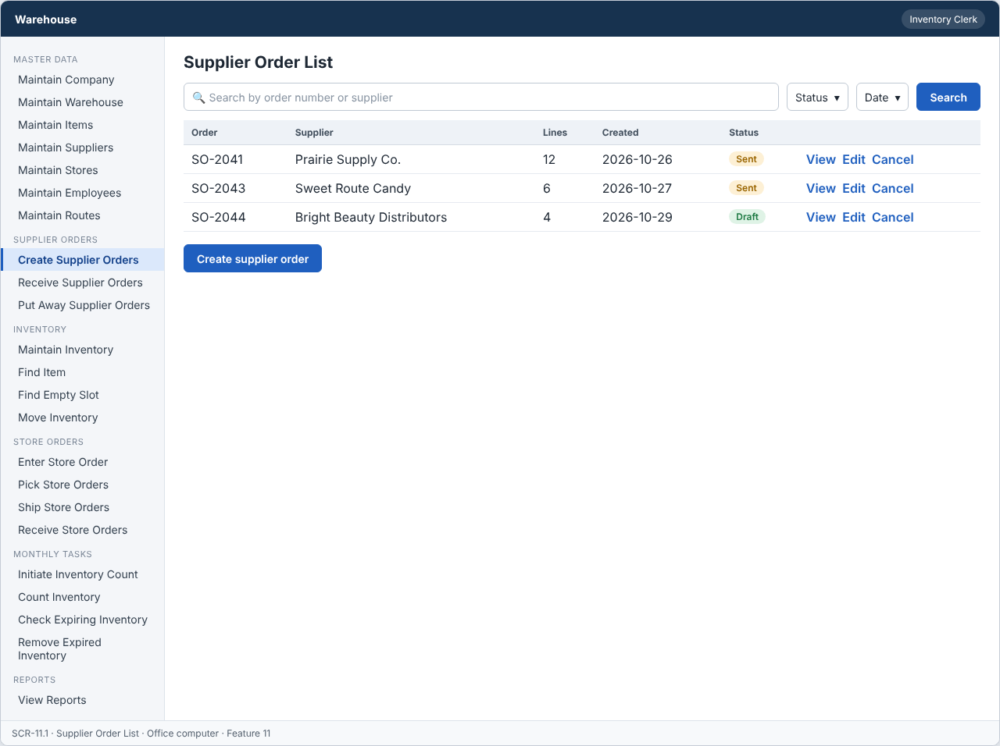
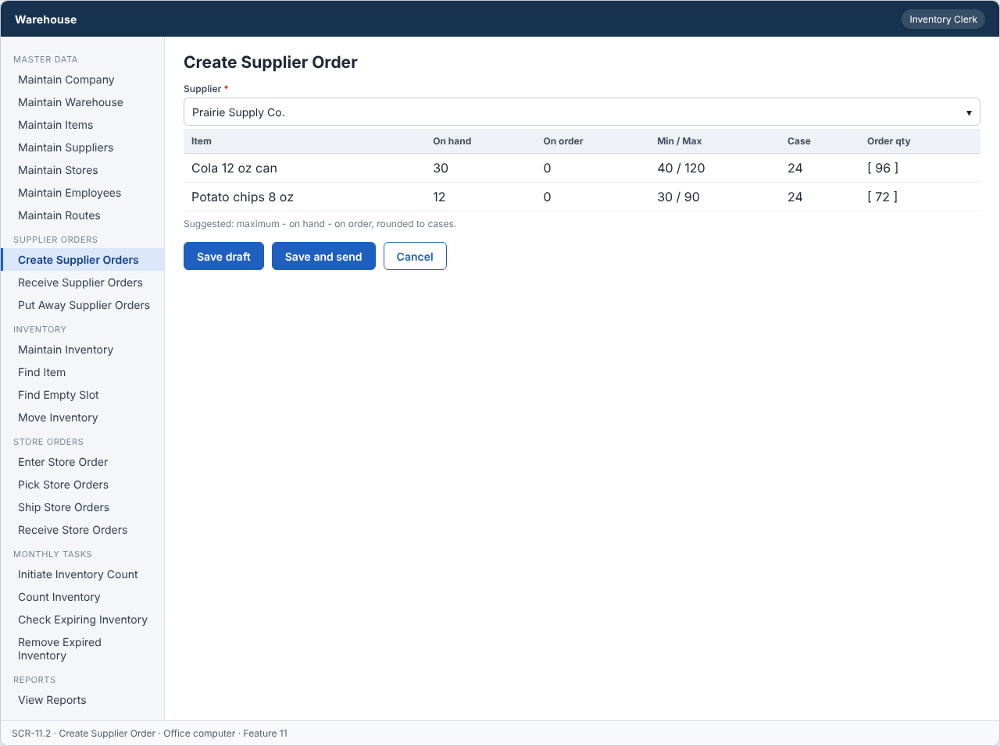
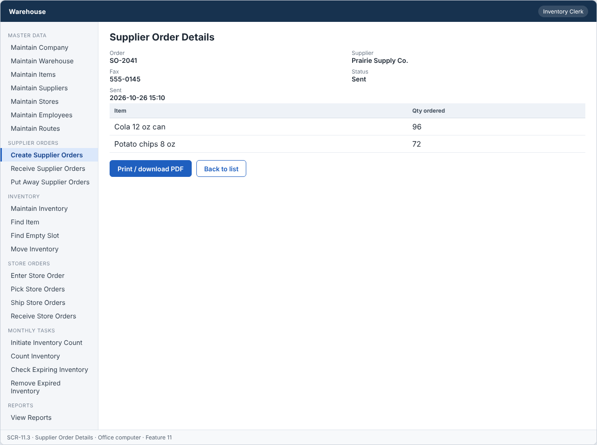

# Feature: Create Supplier Orders

**Feature ID:** 11
**Branch pattern:** `feature/11-create-supplier-orders`
**Status:** Draft
**Created:** 2026-09-28
**Input:** Create supplier orders using the minimum and maximum quantity of each item.
**Depends on:** [Feature 3 — Maintain Items](feature-3-maintain-items.md); [Feature 4 — Maintain Suppliers](feature-4-maintain-suppliers.md); [Feature 9 — Maintain Inventory](feature-9-maintain-inventory.md)

---

## User Stories

### US-11.1: Create supplier order

**As an** inventory clerk
**I want to** create an order for a supplier
**So that** products can be reordered before inventory runs out.
**Priority:** P1
**Independent test:** Create a supplier order for a low-inventory item and verify that it is saved. 
**Acceptance Scenarios:** see ### US-11.1 under Gherkin AC

### US-11.2: Calculate supplier order quantity

**As an** inventory clerk
**I want to** have the system calculate the amount to order
**So that** inventory can be brought back to the maximum level.
**Priority:** P1
**Independent test:** Trigger the calculation for a low-inventory item and verify the calculated quantity reaches the maximum. 
**Acceptance Scenarios:** see ### US-11.2 under Gherkin AC

### US-11.3: Send supplier order

**As an** inventory clerk
**I want to** send the supplier order by fax or print
**So that** the supplier receives the order.
**Priority:** P1
**Independent test:** Send a saved supplier order and verify its status changes to Sent. 
**Acceptance Scenarios:** see ### US-11.3 under Gherkin AC

---

## Functional Requirements

- **FR-001:** The system MUST identify inventory below the required minimum.
- **FR-002:** The system MUST consider quantity on hand and quantity on order.
- **FR-003:** If quantity on hand plus quantity on order is below minimum, the system MUST calculate the amount needed to reach maximum (maximum minus on hand minus on order).
- **FR-004:** The calculated order quantity MUST be rounded to the nearest case quantity when case quantity is used.
- **FR-005:** A supplier order MUST identify the supplier.
- **FR-006:** A supplier order MUST identify each item and quantity ordered.
- **FR-007:** The system MUST allow an authorized employee to send the supplier order.
- **FR-008:** The system MUST keep quantity ordered separate from quantity received.
- **FR-009:** The system MUST NOT save a supplier order without items.
- **FR-010:** The system MUST let an inventory clerk and a manager use this feature (main user: inventory clerk), and MUST NOT let other roles change its information.
- **FR-011:** The system MUST work on an office computer.

---

## Assumptions

- **A-1:** A supplier order has one supplier and one or more lines (item and quantity). All items on one order belong to that supplier.
- **A-2:** Order status: Draft (being prepared) → Sent (printed or faxed to the supplier) → Received (set by Feature 8). A Draft can be cancelled by deleting it.
- **A-3:** Suggested quantity per item: if (on hand + on order) is below the minimum, suggest maximum − on hand − on order. On order means quantity on Sent orders not yet Received (FR-002, FR-003).
- **A-4:** If the item has a case quantity, the suggestion is rounded to the nearest whole number of cases. If rounding gives 0, the item is left out of the suggestion (FR-004).
- **A-5:** The clerk can change a suggested quantity before saving. The quantity must be greater than 0.
- **A-6:** "Send" locks the order and shows a printable PDF for printing or faxing (ADR-011). The system does not send the fax or email itself.
- **A-7:** Only active suppliers and active items are used (FR-005, Feature 4).
- **A-8:** Inventory clerks and managers use this feature on an office computer.

---

## Edge Cases

| ID | Situation | Expected behavior | Related |
|---|---|---|---|
| EC-1 | An order has no lines. | The system rejects the save (FR-009). | FR-009 |
| EC-2 | On hand 30 + on order 20 = 50, minimum 40. | Not below minimum, so no suggestion is made for this item. | FR-001, FR-002 |
| EC-3 | Suggested quantity is 47 and the case quantity is 24. | The suggestion is rounded to 48 (2 cases), the nearest whole number of cases. | FR-004 |
| EC-4 | Suggested quantity is 10 and the case quantity is 24. | Rounded to 0 cases is not allowed. The item is suggested as 1 case (24) because the stock is below minimum. | FR-004 |
| EC-5 | An item has no case quantity. | The suggested quantity is used as calculated. | FR-003, FR-004 |
| EC-6 | The clerk sets a line quantity to 0 or a negative number. | The system rejects the value. | FR-006 |
| EC-7 | A supplier is deleted while an order is Draft. | The delete is rejected (Feature 4: open order). The Draft must be cancelled first. | FR-005 |
| EC-8 | The clerk tries to edit a Sent order. | The system rejects it. A Sent order is locked, and the clerk creates a new order for changes. | FR-007, FR-008 |
| EC-9 | The same item is added twice to one order. | The system merges them into one line (the quantities are added). | FR-006 |
| EC-10 | Two clerks create orders for the same supplier on the same day. | Both orders are saved. On-order quantities of Sent orders are counted by the next suggestion, so double ordering is avoided once the first is Sent. | FR-002 |

---

## Success Criteria

- **SC-1:** A clerk creates and sends an order with 20 lines in under 5 minutes, using the suggested quantities.
- **SC-2:** The suggested quantity follows the rule (maximum − on hand − on order, rounded to cases) in 100% of 50 test cases.
- **SC-3:** No order is saved without lines or for an unknown supplier (0 cases in testing).
- **SC-4:** Quantity ordered is never changed by receiving (0 cases in testing).
- **SC-5:** All 11 Gherkin scenarios in this file pass as automated tests, and each user story's independent test is shown to work in a demo.

---

## Key Entities

- **Supplier Order** — Request to reorder products from a supplier.
- **Supplier** — Vendor receiving the order.
- **Item** — Product being ordered.
- **Inventory** — Current stock levels driving the reorder decision.

---

## Initial Data Model

### Supplier Order

- supplier_order_id: String — Required, unique
- supplier_id: Supplier reference — Required
- order_date: Date — Required
- created_by: Employee reference — Required
- status: String/Enum — Draft, Sent, Received

### Supplier Order Item

- supplier_order_id: Supplier Order reference — Required
- item_id: Item reference — Required
- quantity_ordered: Integer — Required, greater than zero
- unit_cost: Decimal — Required, zero or greater

### Reorder Values (calculated from Item and Inventory)

- quantity_on_hand: Integer — Zero or greater
- quantity_on_order: Integer — Zero or greater
- minimum_quantity: Integer — Zero or greater
- maximum_quantity: Integer — Greater than or equal to minimum

---

## Gherkin AC

### US-11.1 — Create supplier order

#### Scenario: Low inventory creates an order quantity

- **Given** quantity on hand plus quantity on order is below the minimum quantity
- **When** the clerk creates a supplier order for the item
- **Then** the system includes the item on the supplier order

#### Scenario: Inventory does not need an order

- **Given** quantity on hand plus quantity on order is at or above the minimum quantity
- **When** the clerk reviews inventory for ordering
- **Then** the system does not include the item on a supplier order

#### Scenario: Supplier order saves successfully

- **Given** a supplier and at least one item needing reorder are identified
- **When** the clerk saves the supplier order
- **Then** the system saves the supplier order with status Draft

#### Scenario: Supplier order does not save when supplier is missing

- **Given** no supplier is selected
- **When** the clerk tries to save the supplier order
- **Then** the system does not save the supplier order

#### Scenario: Wrong role cannot change information

- **Given** a driver is signed in
- **When** the driver tries to change information in this feature
- **Then** the system rejects the change

### US-11.2 — Calculate supplier order quantity

#### Scenario: Quantity is below minimum

- **Given** quantity on hand plus quantity on order is below the minimum quantity
- **When** the system calculates the order quantity
- **Then** the system calculates the amount needed to reach the maximum quantity

#### Scenario: Example calculation

- **Given** an item has 10 on hand, 0 on order, a minimum of 15, and a maximum of 50
- **When** the system calculates the order quantity
- **Then** the order quantity is 40

#### Scenario: Quantity is above minimum

- **Given** an item has 30 on hand, a minimum of 15, and a maximum of 50
- **When** the system calculates the order quantity
- **Then** the system does not order the item

#### Scenario: Case quantity rounding

- **Given** the calculated order quantity does not match a whole case quantity
- **When** the system finalizes the order quantity
- **Then** the system rounds the order quantity to the nearest case quantity

### US-11.3 — Send supplier order

#### Scenario: Supplier order is sent successfully

- **Given** a supplier order has been saved with a supplier and items
- **When** the clerk sends the supplier order
- **Then** the system marks the supplier order as Sent

#### Scenario: Empty order cannot be sent

- **Given** a supplier order has no items
- **When** the clerk tries to send the supplier order
- **Then** the system does not send the supplier order

---

## Data Ownership

| Data | Owner | This feature | Notes |
|---|---|---|---|
| Supplier Order | This feature (Feature 11) | Owns | Creates the order, keeps the status, and provides `markReceived`. |
| Supplier Order Item | This feature (Feature 11) | Owns | Order lines (item, quantity ordered). |
| Supplier | [Feature 4 — Maintain Suppliers](feature-4-maintain-suppliers.md) | Reads | The supplier must be active. |
| Item | [Feature 3 — Maintain Items](feature-3-maintain-items.md) | Reads | Minimum, maximum, and case quantity. |
| Inventory Record | [Feature 9 — Maintain Inventory](feature-9-maintain-inventory.md) | Reads | Quantity on hand per item (sum of active records). |
| Audit Log Entry | Platform (cross-cutting) | Updates (via owner) | Writes one entry for create, edit, send, and cancel. |

**Rule:** each piece of data has one owning feature. A feature that needs to change data it does not own must call the owner's service, and must never write the owner's tables directly (ADR-004).

---

## API Requirements

Base path: `/api/v1`. All endpoints follow [ADR-003](../docs/ADRs/ADR-003-rest-api-conventions.md) (JSON, problem+json errors, `version` field for optimistic locking). Roles are checked on the server for every call ([NFR-S2](../docs/NFR.md)).

| # | Method and path | Purpose | Allowed roles | Success | Errors | Supports |
|---|---|---|---|---|---|---|
| 1 | `GET /supplier-orders` | List supplier orders. Query: `status`, `supplierId`, `from`, `to`. | Inventory Clerk, Manager | 200 | — | US-11.1 |
| 2 | `GET /supplier-orders/suggestions` | Calculate suggested lines for a supplier. Query: `supplierId`. | Inventory Clerk, Manager | 200 | 404 NOT_FOUND (supplier) | US-11.2 |
| 3 | `POST /supplier-orders` | Create a Draft order with lines. | Inventory Clerk, Manager | 201 + Location | 400 VALIDATION_FAILED (no lines, quantity), 409 SUPPLIER_INACTIVE | US-11.1, US-11.2 |
| 4 | `GET /supplier-orders/{supplierOrderId}` | Get one order with lines. | Inventory Clerk, Manager | 200 | 404 NOT_FOUND | US-11.1 |
| 5 | `PUT /supplier-orders/{supplierOrderId}` | Change a Draft order. The body must include `version`. | Inventory Clerk, Manager | 200 | 400 VALIDATION_FAILED, 404 NOT_FOUND, 409 WRONG_STATUS, 409 VERSION_CONFLICT | US-11.1 |
| 6 | `DELETE /supplier-orders/{supplierOrderId}` | Cancel a Draft order (sets it inactive). | Inventory Clerk, Manager | 204 | 404 NOT_FOUND, 409 WRONG_STATUS | US-11.1 |
| 7 | `POST /supplier-orders/{supplierOrderId}/send` | Set the order to Sent and return the printable PDF. | Inventory Clerk, Manager | 200 | 404 NOT_FOUND, 409 WRONG_STATUS | US-11.3 |
| 8 | `GET /supplier-orders/{supplierOrderId}/document` | Download the order PDF again for printing or faxing. | Inventory Clerk, Manager | 200 | 404 NOT_FOUND, 409 WRONG_STATUS (Draft) | US-11.3 |

**Request and response notes**

- Suggestions response: for each item below minimum: `item_id`, `on_hand`, `on_order`, `minimum`, `maximum`, `case_quantity`, `suggested_quantity`.
- Order body: `supplier_id`, `lines` = list of {`item_id`, `quantity_ordered`}.

**Calls to other features (internal service calls, not public endpoints)**

- Feature 4 — Maintain Suppliers: `isActive(supplierId)`.
- Feature 3 — Maintain Items: item minimum, maximum, case quantity.
- Feature 9 — Maintain Inventory: `sumOnHand(itemId)`.
- Feature 8 calls this feature's `markReceived(orderId)`.

---

## Screen Requirements

The screen images are in [docs/UI](../docs/UI/README.md). Each image is a wireframe: it shows layout and content, not final colors.

| Screen | Name | Device | Purpose | Image | Stories |
|---|---|---|---|---|---|
| SCR-11.1 | Supplier Order List | Office computer | See orders and their status. | [image](../docs/UI/images/scr-11-1-supplier-order-list.png) | US-11.1 |
| SCR-11.2 | Create Supplier Order | Office computer | Pick a supplier, review the suggested quantities, and save. | [image](../docs/UI/images/scr-11-2-create-supplier-order.png) | US-11.1, US-11.2 |
| SCR-11.3 | Supplier Order Details | Office computer | Show an order and print it for the supplier. | [image](../docs/UI/images/scr-11-3-supplier-order-details.png) | US-11.3 |

### SCR-11.1 — Supplier Order List

**Device:** Office computer. **Purpose:** See orders and their status.

- Search box (Search by order number or supplier) and filters (Status, Date).
- Table with columns: Order, Supplier, Lines, Created, Status.
- Buttons: Create supplier order.

### SCR-11.2 — Create Supplier Order

**Device:** Office computer. **Purpose:** Pick a supplier, review the suggested quantities, and save.

- Fields: Supplier (required).
- Table with columns: Item, On hand, On order, Min / Max, Case, Order qty. Suggested: maximum - on hand - on order, rounded to cases.
- Buttons: Save draft, Save and send, Cancel.

### SCR-11.3 — Supplier Order Details

**Device:** Office computer. **Purpose:** Show an order and print it for the supplier.

- Details shown: Order, Supplier, Fax, Status, Sent.
- Table with columns: Item, Qty ordered.
- Buttons: Print / download PDF, Back to list.

---

## Definition of Done

This feature is done when all of these are true:

- [ ] All 3 user stories are built, and each story's independent test passes.
- [ ] All 11 functional requirements are built, and each one is covered by a Gherkin scenario, a unit test, or an NFR check.
- [ ] All 11 Gherkin scenarios are automated and pass in the build.
- [ ] The 8 API endpoints match the API Requirements table, are in the OpenAPI file, and have tests for success and for every listed error.
- [ ] The role rules are enforced on the server for every endpoint, with a test for a role that is not allowed.
- [ ] The screens (SCR-11.1, SCR-11.2, SCR-11.3) match the images in `docs/UI`, and were checked on: office computer.
- [ ] Validation messages show next to the field, and what the user typed stays on the screen after an error.
- [ ] Database changes (tables, keys, unique rules, not-null rules, checks) are in a migration script and match the Initial Data Model.
- [ ] Every create, edit, delete, and status change writes an audit log entry (who, when, what changed).
- [ ] A table-driven test covers the quantity calculation: below and above minimum, with and without case quantity, with on-order quantity.
- [ ] These non-functional checks pass (see [NFR](../docs/NFR.md)): NFR-U1, NFR-U9, NFR-P1, NFR-S1, NFR-S2, NFR-S4, NFR-D1, NFR-D2, NFR-D3, NFR-A1, NFR-M1.
- [ ] The code is reviewed in a pull request and merged into `main` with no open critical bugs.
- [ ] This feature file, the UI images, and the API table are updated if anything changed during the build.

---

## Out of Scope

- Sending the fax or email from the system (the PDF is printed or sent by the clerk, ADR-011).
- Changing a Sent order, or partial cancel.
- Supplier prices, discounts, taxes, or payment.
- Automatic orders without a clerk.
- Delivery date promises from the supplier.
