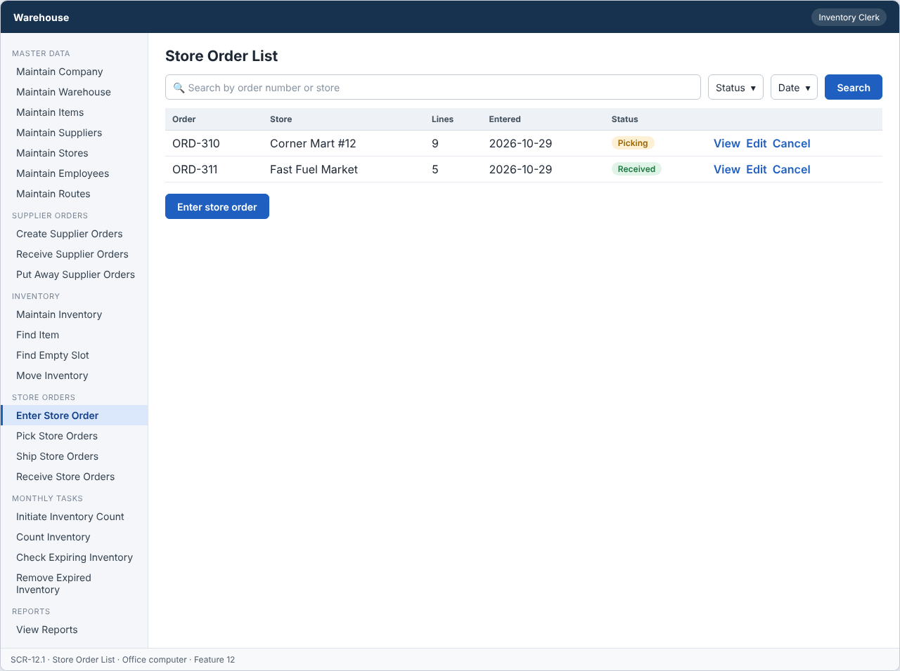
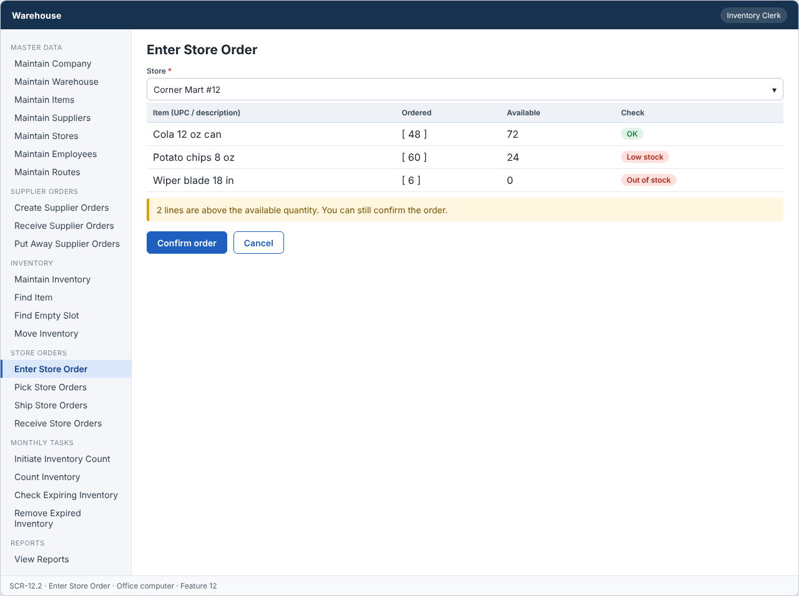
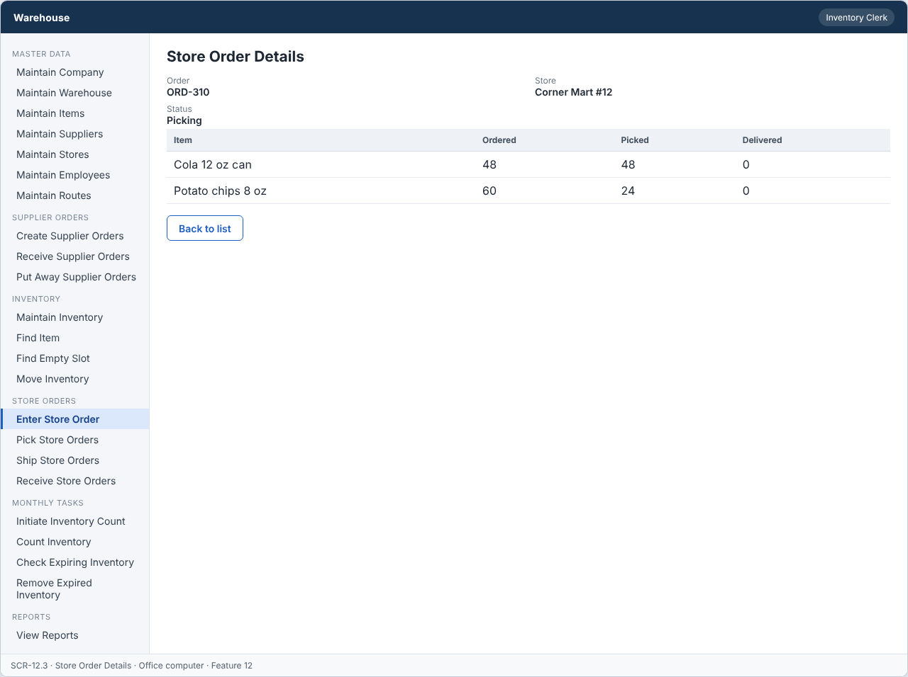

# Feature: Enter Store Order

**Feature ID:** 12
**Branch pattern:** `feature/12-enter-store-order`
**Status:** Draft
**Created:** 2026-09-28
**Input:** Enter store orders from the store order sheet and check item availability.
**Depends on:** [Feature 3 — Maintain Items](feature-3-maintain-items.md); [Feature 5 — Maintain Stores](feature-5-maintain-stores.md); [Feature 9 — Maintain Inventory](feature-9-maintain-inventory.md)

---

## User Stories

### US-12.1: Enter store order

**As an** inventory clerk
**I want to** enter a store order
**So that** the warehouse knows what the store requested.
**Priority:** P1
**Independent test:** Enter a store order and verify it is saved. 
**Acceptance Scenarios:** see ### US-12.1 under Gherkin AC

### US-12.2: Record ordered items

**As an** inventory clerk
**I want to** record the items and quantities ordered by UPC or description
**So that** the order can be picked correctly.
**Priority:** P1
**Independent test:** Add ordered items with quantities and verify they are saved. 
**Acceptance Scenarios:** see ### US-12.2 under Gherkin AC

### US-12.3: Check item availability

**As an** inventory clerk
**I want to** see if each item is in stock when I enter the order
**So that** I can warn the store about out-of-stock items.
**Priority:** P1
**Independent test:** Enter an order for more than the available quantity and verify a warning is shown. 
**Acceptance Scenarios:** see ### US-12.3 under Gherkin AC

### US-12.4: Confirm store order

**As an** inventory clerk
**I want to** confirm the store order
**So that** it can move to picking.
**Priority:** P1
**Independent test:** Confirm a complete store order and verify its status moves to Picking. 
**Acceptance Scenarios:** see ### US-12.4 under Gherkin AC

---

## Functional Requirements

- **FR-001:** The system MUST identify the store.
- **FR-002:** The system MUST identify each ordered item.
- **FR-003:** The system MUST maintain quantity ordered separately from quantity picked and quantity delivered.
- **FR-004:** Quantity ordered MUST be greater than zero.
- **FR-005:** The system MUST show available quantity for each ordered item.
- **FR-006:** The system MUST warn the user when quantity ordered is more than quantity available.
- **FR-007:** The system MUST allow a received store order to move to Picking after required information is complete.
- **FR-008:** The system MUST reject an order without a store.
- **FR-009:** The system MUST reject an order without ordered items.
- **FR-010:** The system MUST let an inventory clerk and a manager use this feature (main user: inventory clerk), and MUST NOT let other roles change its information.
- **FR-011:** The system MUST work on an office computer.

---

## Assumptions

- **A-1:** A store order is typed in by a clerk from the paper order sheet (or phone call). The store does not enter it.
- **A-2:** Order status: Received (entered and confirmed) → Picking → Picked → Shipped → Delivered. Feature 12 sets Received. Features 15, 17, and 18 move it forward.
- **A-3:** Quantity ordered, quantity picked, and quantity delivered are kept separately (FR-003).
- **A-4:** Available quantity = quantity on hand minus quantity reserved by open pick lists, for all active inventory of the item.
- **A-5:** A warning about availability does not stop the order. The store still orders what it wants (FR-006). Picking handles short quantities.
- **A-6:** "Confirm" saves the order as Received and makes it ready for picking (FR-007).
- **A-7:** An order cannot be changed after it moves to Picking. Changes before that are made by editing the Received order.
- **A-8:** Inventory clerks and managers use this feature on an office computer.

---

## Edge Cases

| ID | Situation | Expected behavior | Related |
|---|---|---|---|
| EC-1 | The clerk saves an order without a store. | The system rejects it (FR-008). | FR-008 |
| EC-2 | The clerk saves an order without lines. | The system rejects it (FR-009). | FR-009 |
| EC-3 | A quantity ordered is 0 or negative. | The system rejects it (FR-004). | FR-004 |
| EC-4 | A quantity ordered is more than the available quantity. | The system shows a warning with the available quantity, and still allows the order (FR-006). | FR-005, FR-006 |
| EC-5 | An item is out of stock (available 0). | The line shows "Out of stock" as a warning. The order can still be saved. | FR-005, FR-006 |
| EC-6 | The same item is entered on two lines. | The system merges them into one line. | FR-002 |
| EC-7 | The store is deleted or inactive. | The store is not in the list. A direct request returns 409 STORE_INACTIVE. | FR-001, FR-008 |
| EC-8 | The clerk edits an order after picking started. | The system rejects the change (WRONG_STATUS). A manager can cancel the pick list and edit. | FR-007 |
| EC-9 | Two clerks enter an order for the same store at the same time. | Both orders are saved as separate orders. There is no merging. | FR-001 |

---

## Success Criteria

- **SC-1:** A clerk enters an order with 15 lines in under 3 minutes.
- **SC-2:** Availability warnings show for 100% of lines with quantity above available.
- **SC-3:** No order is saved without a store or without lines (0 cases in testing).
- **SC-4:** Quantity ordered never changes after the order moves to Picking (0 cases in testing).
- **SC-5:** All 9 Gherkin scenarios in this file pass as automated tests, and each user story's independent test is shown to work in a demo.

---

## Key Entities

- **Store Order** — Order received from a store for products.
- **Store** — Retail store placing the order.
- **Item** — Product requested on the order.
- **Inventory** — Stock used to check availability.

---

## Initial Data Model

### Store Order

- store_order_id: String — Required, unique
- store_id: Store reference — Required
- order_date: Date — Required
- status: String/Enum — Received, Picking, Picked, Shipped, Delivered

### Store Order Item

- store_order_id: Store Order reference — Required
- item_id: Item reference — Required
- quantity_ordered: Integer — Required, greater than zero
- quantity_picked: Integer — Zero or greater
- quantity_delivered: Integer — Zero or greater
- unit_price: Decimal — Required, zero or greater

---

## Gherkin AC

### US-12.1 — Enter store order

#### Scenario: Enter order successfully

- **Given** a store and at least one item are identified
- **When** the clerk enters the store order
- **Then** the system saves the store order with status Received

#### Scenario: Missing store

- **Given** no store is selected
- **When** the clerk tries to enter the store order
- **Then** the system rejects the order

#### Scenario: Wrong role cannot change information

- **Given** a driver is signed in
- **When** the driver tries to change information in this feature
- **Then** the system rejects the change

### US-12.2 — Record ordered items

#### Scenario: Missing item

- **Given** no item is added to the order
- **When** the clerk tries to enter the store order
- **Then** the system rejects the order

#### Scenario: Invalid quantity

- **Given** the clerk enters a quantity ordered of zero or less
- **When** the clerk tries to save the store order
- **Then** the system rejects the invalid quantity

### US-12.3 — Check item availability

#### Scenario: Item is in stock

- **Given** item A has 20 on hand
- **When** the clerk orders 10 of item A
- **Then** the system shows the item as available

#### Scenario: Not enough stock

- **Given** item A has 3 on hand
- **When** the clerk orders 10 of item A
- **Then** the system warns that only 3 are available

### US-12.4 — Confirm store order

#### Scenario: Confirm complete order

- **Given** a store order has a store and valid ordered items
- **When** the clerk confirms the store order
- **Then** the system moves the store order to Picking

#### Scenario: Incomplete order cannot move to picking

- **Given** a store order is missing required information
- **When** the clerk tries to confirm the store order
- **Then** the system does not move the store order to Picking

---

## Data Ownership

| Data | Owner | This feature | Notes |
|---|---|---|---|
| Store Order | This feature (Feature 12) | Owns | Creates the order and keeps its status up to Received. Other features call `setStatus`. |
| Store Order Item | This feature (Feature 12) | Owns | Order lines (item, quantity ordered). |
| Store | [Feature 5 — Maintain Stores](feature-5-maintain-stores.md) | Reads | The store must be active. |
| Item | [Feature 3 — Maintain Items](feature-3-maintain-items.md) | Reads | The item must be active. |
| Inventory Record | [Feature 9 — Maintain Inventory](feature-9-maintain-inventory.md) | Reads | Available quantity per item. |
| Audit Log Entry | Platform (cross-cutting) | Updates (via owner) | Writes one entry for create, edit, and confirm. |

**Rule:** each piece of data has one owning feature. A feature that needs to change data it does not own must call the owner's service, and must never write the owner's tables directly (ADR-004).

---

## API Requirements

Base path: `/api/v1`. All endpoints follow [ADR-003](../docs/ADRs/ADR-003-rest-api-conventions.md) (JSON, problem+json errors, `version` field for optimistic locking). Roles are checked on the server for every call ([NFR-S2](../docs/NFR.md)).

| # | Method and path | Purpose | Allowed roles | Success | Errors | Supports |
|---|---|---|---|---|---|---|
| 1 | `GET /store-orders` | List store orders. Query: `status`, `storeId`, `from`, `to`. | Inventory Clerk, Manager | 200 | — | US-12.1 |
| 2 | `POST /store-orders` | Enter a store order with lines. The response includes availability warnings. | Inventory Clerk, Manager | 201 + Location | 400 VALIDATION_FAILED, 409 STORE_INACTIVE | US-12.1, US-12.2, US-12.3 |
| 3 | `GET /store-orders/{storeOrderId}` | Get one order with lines and availability. | Inventory Clerk, Manager | 200 | 404 NOT_FOUND | US-12.1, US-12.3 |
| 4 | `PUT /store-orders/{storeOrderId}` | Change an order with status Received. The body must include `version`. | Inventory Clerk, Manager | 200 | 400 VALIDATION_FAILED, 404 NOT_FOUND, 409 WRONG_STATUS, 409 VERSION_CONFLICT | US-12.2 |
| 5 | `DELETE /store-orders/{storeOrderId}` | Cancel an order with status Received. | Inventory Clerk, Manager | 204 | 404 NOT_FOUND, 409 WRONG_STATUS | US-12.4 |
| 6 | `GET /store-orders/availability` | Check available quantity. Query: `itemId` (repeatable). | Inventory Clerk, Manager | 200 | — | US-12.3 |

**Request and response notes**

- Body: `store_id`, `lines` = list of {`item_id`, `quantity_ordered`}.
- Response lines include `quantity_available` and `warning` (null, `LOW_STOCK`, or `OUT_OF_STOCK`).

**Calls to other features (internal service calls, not public endpoints)**

- Feature 5 — Maintain Stores: `isActive(storeId)`.
- Feature 9 — Maintain Inventory: `getAvailable(itemId)`.
- Features 15, 17, 18 call this feature's `setStatus(orderId, status)`.

---

## Screen Requirements

The screen images are in [docs/UI](../docs/UI/README.md). Each image is a wireframe: it shows layout and content, not final colors.

| Screen | Name | Device | Purpose | Image | Stories |
|---|---|---|---|---|---|
| SCR-12.1 | Store Order List | Office computer | See store orders and their status. | [image](../docs/UI/images/scr-12-1-store-order-list.png) | US-12.1 |
| SCR-12.2 | Enter Store Order | Office computer | Enter the lines from the order sheet and see availability. | [image](../docs/UI/images/scr-12-2-enter-store-order.png) | US-12.1, US-12.2, US-12.3, US-12.4 |
| SCR-12.3 | Store Order Details | Office computer | Show one order with ordered, picked, and delivered quantities. | [image](../docs/UI/images/scr-12-3-store-order-details.png) | US-12.1 |

### SCR-12.1 — Store Order List

**Device:** Office computer. **Purpose:** See store orders and their status.

- Search box (Search by order number or store) and filters (Status, Date).
- Table with columns: Order, Store, Lines, Entered, Status.
- Buttons: Enter store order.

### SCR-12.2 — Enter Store Order

**Device:** Office computer. **Purpose:** Enter the lines from the order sheet and see availability.

- Fields: Store (required).
- Table with columns: Item (UPC / description), Ordered, Available, Check.
- Message (warn): 2 lines are above the available quantity. You can still confirm the order.
- Buttons: Confirm order, Cancel.

### SCR-12.3 — Store Order Details

**Device:** Office computer. **Purpose:** Show one order with ordered, picked, and delivered quantities.

- Details shown: Order, Store, Status.
- Table with columns: Item, Ordered, Picked, Delivered.
- Buttons: Back to list.

---

## Definition of Done

This feature is done when all of these are true:

- [ ] All 4 user stories are built, and each story's independent test passes.
- [ ] All 11 functional requirements are built, and each one is covered by a Gherkin scenario, a unit test, or an NFR check.
- [ ] All 9 Gherkin scenarios are automated and pass in the build.
- [ ] The 6 API endpoints match the API Requirements table, are in the OpenAPI file, and have tests for success and for every listed error.
- [ ] The role rules are enforced on the server for every endpoint, with a test for a role that is not allowed.
- [ ] The screens (SCR-12.1, SCR-12.2, SCR-12.3) match the images in `docs/UI`, and were checked on: office computer.
- [ ] Validation messages show next to the field, and what the user typed stays on the screen after an error.
- [ ] Database changes (tables, keys, unique rules, not-null rules, checks) are in a migration script and match the Initial Data Model.
- [ ] Every create, edit, delete, and status change writes an audit log entry (who, when, what changed).
- [ ] A test shows that an availability warning never blocks saving.
- [ ] These non-functional checks pass (see [NFR](../docs/NFR.md)): NFR-U1, NFR-U9, NFR-P1, NFR-S1, NFR-S2, NFR-S4, NFR-D1, NFR-D2, NFR-D3, NFR-A1, NFR-M1.
- [ ] The code is reviewed in a pull request and merged into `main` with no open critical bugs.
- [ ] This feature file, the UI images, and the API table are updated if anything changed during the build.

---

## Out of Scope

- Store login or a store web portal for ordering.
- Prices, invoices, discounts, or credit checks.
- Back orders (an order waiting for stock to arrive).
- Scanning the paper order sheet automatically (OCR).
