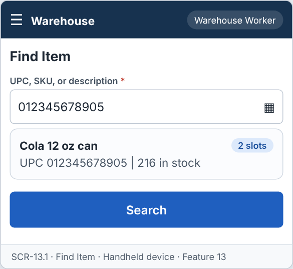
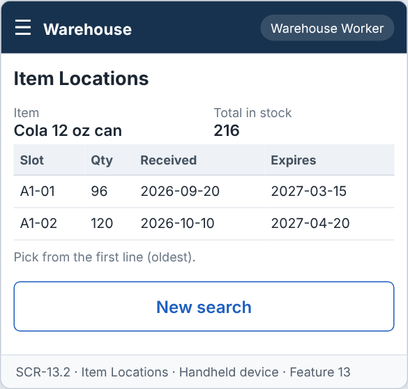
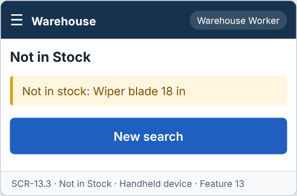

# Feature: Find Item

**Feature ID:** 13
**Branch pattern:** `feature/13-find-item`
**Status:** Draft
**Created:** 2026-09-28
**Input:** Find the slots that hold an item, using UPC or description.
**Depends on:** [Feature 3 — Maintain Items](feature-3-maintain-items.md); [Feature 9 — Maintain Inventory](feature-9-maintain-inventory.md)

---

## User Stories

### US-13.1: Search for an item

**As a** warehouse worker
**I want to** search for an item by UPC or description
**So that** I can find the product quickly.
**Priority:** P1
**Independent test:** Search for an item and verify matching items are shown. 
**Acceptance Scenarios:** see ### US-13.1 under Gherkin AC

### US-13.2: View item locations

**As a** warehouse worker
**I want to** see every slot that holds the item
**So that** I know where to get it.
**Priority:** P1
**Independent test:** Search for an item in stock and verify slots and quantities are shown. 
**Acceptance Scenarios:** see ### US-13.2 under Gherkin AC

---

## Functional Requirements

- **FR-001:** The system MUST allow searching items by UPC, SKU, or description.
- **FR-002:** The system MUST list each slot that holds the item with aisle, quantity, received date, and expiration date.
- **FR-003:** The system MUST sort slots by oldest received date first (FIFO).
- **FR-004:** The system MUST show Not in stock when no slot holds the item.
- **FR-005:** The system MUST let a warehouse worker and a manager use this feature (main user: warehouse worker), and MUST NOT let other roles change its information.
- **FR-006:** The system MUST be easy to use on the warehouse floor, on a handheld device or a tablet.
- **FR-007:** This feature is used every day, so each screen MUST need as few steps and clicks as possible.

---

## Assumptions

- **A-1:** The search looks in active items. UPC and SKU match exactly. Description matches any part of the text, without regard to letter case.
- **A-2:** A worker may scan the barcode with a handheld scanner. The scanner types the UPC like a keyboard (ADR-012).
- **A-3:** The result lists every active inventory record with quantity above 0, sorted by the oldest received date first (FIFO, FR-003). The first line is the one to pick from.
- **A-4:** Each line shows warehouse, aisle, shelf, bin, quantity, received date, and expiration date (FR-002).
- **A-5:** When a description matches several items, the worker first chooses the item, then sees the slots.
- **A-6:** The feature only reads data. It changes nothing.
- **A-7:** Warehouse workers and managers use it on a handheld or tablet, many times a day (FR-006, FR-007).

---

## Edge Cases

| ID | Situation | Expected behavior | Related |
|---|---|---|---|
| EC-1 | The UPC is not found. | The screen shows "No item found" and keeps the typed value. | FR-001 |
| EC-2 | The item exists but no slot holds it. | The screen shows "Not in stock" (FR-004). | FR-004 |
| EC-3 | The description matches 40 items. | The screen shows the first 20 and asks the worker to type more letters or scan the barcode. | FR-001 |
| EC-4 | Two slots hold the same item with the same received date. | They are sorted by aisle, shelf, bin, so the order is always the same. | FR-003 |
| EC-5 | A record has quantity 0. | It is not shown, because no stock is there. | FR-002 |
| EC-6 | An item is inactive. | It is not found. Inactive items are not searched. | FR-001 |
| EC-7 | The search text is only spaces. | The system treats it as empty and shows no result. | FR-001 |
| EC-8 | The scanner adds a line break at the end of the UPC. | The screen runs the search at once, without another tap. | FR-001 |

---

## Success Criteria

- **SC-1:** A worker finds the slot of an item in under 10 seconds from the home screen.
- **SC-2:** A search returns in under 1 second for 10,000 items and 20,000 inventory records (NFR-P2).
- **SC-3:** The oldest stock is always first in the list (100% of tests).
- **SC-4:** The feature changes no data (a test confirms that no table changes).
- **SC-5:** All 7 Gherkin scenarios in this file pass as automated tests, and each user story's independent test is shown to work in a demo.

---

## Key Entities

- **Item** — Product being searched for.
- **Inventory** — Quantity of the item in each slot.
- **Slot** — Storage location of the item.

---

## Initial Data Model

### Item Location Result (read only)

- item_id: Item reference — From Item
- slot_id: Slot reference — From Inventory
- aisle_number: Integer — From Slot
- quantity_on_hand: Integer — From Inventory
- received_date: Date — From Inventory
- expiration_date: Date — From Inventory

---

## Gherkin AC

### US-13.1 — Search for an item

#### Scenario: Item is found by UPC

- **Given** an item with a UPC exists
- **When** the worker searches by that UPC
- **Then** the system displays the item

#### Scenario: Item is found by description

- **Given** an item with a description exists
- **When** the worker searches by part of the description
- **Then** the system displays matching items

#### Scenario: No item matches

- **Given** no item matches the search
- **When** the worker searches
- **Then** the system displays No items found

#### Scenario: Wrong role cannot change information

- **Given** a driver is signed in
- **When** the driver tries to change information in this feature
- **Then** the system rejects the change

### US-13.2 — View item locations

#### Scenario: Item is in stock

- **Given** item A is stored in two slots
- **When** the worker views item A
- **Then** the system displays each slot with quantity, received date, and expiration date

#### Scenario: Oldest stock is listed first

- **Given** two slots hold item A with different received dates
- **When** the worker views item A
- **Then** the system lists the slot with the older received date first

#### Scenario: Item is not in stock

- **Given** item B has no inventory
- **When** the worker views item B
- **Then** the system displays Not in stock

---

## Data Ownership

| Data | Owner | This feature | Notes |
|---|---|---|---|
| Item | [Feature 3 — Maintain Items](feature-3-maintain-items.md) | Reads | Search by UPC, SKU, or description. |
| Inventory Record | [Feature 9 — Maintain Inventory](feature-9-maintain-inventory.md) | Reads | Slots, quantity, received date, expiration date. |
| Slot | [Feature 2 — Maintain Warehouse](feature-2-maintain-warehouse.md) | Reads | Warehouse, aisle, shelf, bin (through Feature 9). |

**Rule:** each piece of data has one owning feature. A feature that needs to change data it does not own must call the owner's service, and must never write the owner's tables directly (ADR-004).

---

## API Requirements

Base path: `/api/v1`. All endpoints follow [ADR-003](../docs/ADRs/ADR-003-rest-api-conventions.md) (JSON, problem+json errors, `version` field for optimistic locking). Roles are checked on the server for every call ([NFR-S2](../docs/NFR.md)).

| # | Method and path | Purpose | Allowed roles | Success | Errors | Supports |
|---|---|---|---|---|---|---|
| 1 | `GET /item-locations` | Find items and the slots that hold them. Query: `q` (UPC, SKU, or description), `warehouseId`. | Warehouse Worker, Manager | 200 | — | US-13.1, US-13.2 |
| 2 | `GET /item-locations/{itemId}` | List the slots that hold one item, oldest received date first. | Warehouse Worker, Manager | 200 | 404 NOT_FOUND | US-13.2 |

**Request and response notes**

- Response of `/item-locations/{itemId}`: `item_id`, `description`, `total_quantity`, and `slots` = list of {`warehouse`, `aisle_number`, `shelf`, `bin`, `quantity`, `received_date`, `expiration_date`}. An empty `slots` list means Not in stock.

**Calls to other features (internal service calls, not public endpoints)**

- Feature 3 and Feature 9: read-only queries.

---

## Screen Requirements

The screen images are in [docs/UI](../docs/UI/README.md). Each image is a wireframe: it shows layout and content, not final colors.

| Screen | Name | Device | Purpose | Image | Stories |
|---|---|---|---|---|---|
| SCR-13.1 | Find Item | Handheld device | Scan or type to find an item. | [image](../docs/UI/images/scr-13-1-find-item.png) | US-13.1 |
| SCR-13.2 | Item Locations | Handheld device | Show where the item is, oldest stock first. | [image](../docs/UI/images/scr-13-2-item-locations.png) | US-13.2 |
| SCR-13.3 | Not in Stock | Handheld device | Tell the worker the item is not in any slot. | [image](../docs/UI/images/scr-13-3-not-in-stock.png) | US-13.2 |

### SCR-13.1 — Find Item

**Device:** Handheld device. **Purpose:** Scan or type to find an item.

- Fields: UPC, SKU, or description (required).
- List of cards: Cola 12 oz can.
- Buttons: Search.

### SCR-13.2 — Item Locations

**Device:** Handheld device. **Purpose:** Show where the item is, oldest stock first.

- Details shown: Item, Total in stock.
- Table with columns: Slot, Qty, Received, Expires. Pick from the first line (oldest).
- Buttons: New search.

### SCR-13.3 — Not in Stock

**Device:** Handheld device. **Purpose:** Tell the worker the item is not in any slot.

- Message (warn): Not in stock: Wiper blade 18 in
- Buttons: New search.

---

## Definition of Done

This feature is done when all of these are true:

- [ ] All 2 user stories are built, and each story's independent test passes.
- [ ] All 7 functional requirements are built, and each one is covered by a Gherkin scenario, a unit test, or an NFR check.
- [ ] All 7 Gherkin scenarios are automated and pass in the build.
- [ ] The 2 API endpoints match the API Requirements table, are in the OpenAPI file, and have tests for success and for every listed error.
- [ ] The role rules are enforced on the server for every endpoint, with a test for a role that is not allowed.
- [ ] The screens (SCR-13.1, SCR-13.2, SCR-13.3) match the images in `docs/UI`, and were checked on: handheld device.
- [ ] Validation messages show next to the field, and what the user typed stays on the screen after an error.
- [ ] Database changes (tables, keys, unique rules, not-null rules, checks) are in a migration script and match the Initial Data Model.
- [ ] The feature changes no data: a test shows that no table is changed by any of its endpoints.
- [ ] The feature is checked with a real barcode scanner or a keyboard-wedge scanner simulator.
- [ ] These non-functional checks pass (see [NFR](../docs/NFR.md)): NFR-U2, NFR-U4, NFR-U9, NFR-P1, NFR-P2, NFR-S1, NFR-S2, NFR-S4, NFR-M1.
- [ ] The code is reviewed in a pull request and merged into `main` with no open critical bugs.
- [ ] This feature file, the UI images, and the API table are updated if anything changed during the build.

---

## Out of Scope

- Changing quantities or moving stock from this screen (see Features 9 and 16).
- Finding items by supplier, category, or price.
- Showing stock levels of stores or in-transit goods.
- Voice search or image search.
