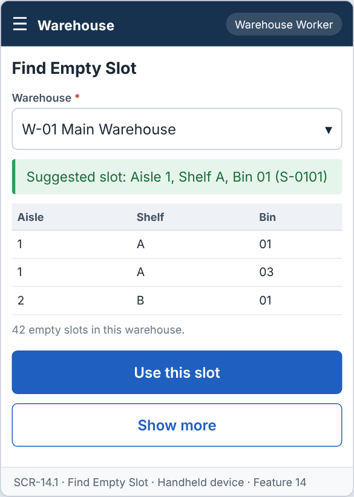
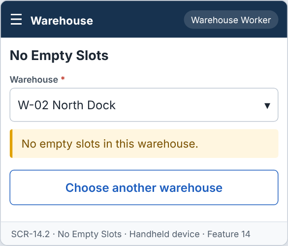

# Feature: Find Empty Slot

**Feature ID:** 14
**Branch pattern:** `feature/14-find-empty-slot`
**Status:** Draft
**Created:** 2026-09-28
**Input:** Find an empty storage slot for items that need to be put away.
**Depends on:** [Feature 2 — Maintain Warehouse](feature-2-maintain-warehouse.md)

---

## User Stories

### US-14.1: Find empty slot

**As a** warehouse worker
**I want to** find an empty slot in a warehouse
**So that** I can store received items.
**Priority:** P1
**Independent test:** Search for an empty slot and verify an Empty slot is suggested. 
**Acceptance Scenarios:** see ### US-14.1 under Gherkin AC

### US-14.2: No empty slot available

**As a** warehouse worker
**I want to** be told when no empty slot exists
**So that** I can ask the clerk for help.
**Priority:** P1
**Independent test:** Fill every slot and verify the system shows a message. 
**Acceptance Scenarios:** see ### US-14.2 under Gherkin AC

---

## Functional Requirements

- **FR-001:** The system MUST list slots with status Empty in a chosen warehouse.
- **FR-002:** The system MUST suggest the first empty slot in aisle order.
- **FR-003:** The system MUST NOT suggest a slot with status Occupied.
- **FR-004:** The system MUST show No empty slots when none exist.
- **FR-005:** The system MUST let a warehouse worker and a manager use this feature (main user: warehouse worker), and MUST NOT let other roles change its information.
- **FR-006:** The system MUST be easy to use on the warehouse floor, on a handheld device or a tablet.
- **FR-007:** This feature is used every day, so each screen MUST need as few steps and clicks as possible.

---

## Assumptions

- **A-1:** A slot is empty when its status is Empty (Feature 2). The status is set by Feature 9 and is the only source.
- **A-2:** "First empty slot in aisle order" means the lowest aisle number, then shelf, then bin (FR-002).
- **A-3:** The worker chooses the warehouse first (the last used warehouse is remembered). Slots of inactive warehouses are not shown.
- **A-4:** The list shows up to 20 empty slots, plus the total number of empty slots in the warehouse.
- **A-5:** A slot suggestion is not a reservation. Another worker may use the same slot before the put away is saved. Feature 10 checks the slot again when saving.
- **A-6:** The feature only reads data. Warehouse workers and managers use it on a handheld or tablet (FR-006, FR-007).

---

## Edge Cases

| ID | Situation | Expected behavior | Related |
|---|---|---|---|
| EC-1 | No slot is Empty in the warehouse. | The screen shows "No empty slots" (FR-004). | FR-004 |
| EC-2 | A slot is Occupied. | It is never suggested or listed (FR-003). | FR-003 |
| EC-3 | The warehouse has no slots yet. | The screen shows "No empty slots" and a hint to ask a clerk to add slots (Feature 2). | FR-004 |
| EC-4 | The warehouse is inactive or was deleted. | It is not in the warehouse list. | FR-001 |
| EC-5 | Another worker takes the suggested slot while this worker walks to it. | Feature 10 rejects the put away with SLOT_NOT_EMPTY and suggests the next slot. | FR-002 |
| EC-6 | Aisle numbers are 2, 10, and 1. | They are sorted as numbers (1, 2, 10), not as text. | FR-002 |
| EC-7 | The worker asks for a slot in a warehouse he or she cannot use (not signed in). | The server answers NOT_AUTHENTICATED. | FR-005 |

---

## Success Criteria

- **SC-1:** A worker sees the suggested slot in under 2 seconds after choosing the warehouse.
- **SC-2:** No Occupied slot is ever suggested (0 cases in testing).
- **SC-3:** Slots are sorted in aisle, shelf, bin order in 100% of tests.
- **SC-4:** The feature changes no data (a test confirms that no table changes).
- **SC-5:** All 4 Gherkin scenarios in this file pass as automated tests, and each user story's independent test is shown to work in a demo.

---

## Key Entities

- **Slot** — Storage location that can be Empty or Occupied.
- **Warehouse** — Warehouse that contains the slots.

---

## Initial Data Model

### Slot (read only)

- slot_id: String — From Slot
- warehouse_id: Warehouse reference — From Slot
- aisle_number: Integer — From Slot
- status: String/Enum — Empty, Occupied

---

## Gherkin AC

### US-14.1 — Find empty slot

#### Scenario: Empty slot is found

- **Given** a slot has status Empty
- **When** the worker searches for an empty slot
- **Then** the system suggests that slot

#### Scenario: Occupied slots are skipped

- **Given** the first slot is Occupied and the second slot is Empty
- **When** the worker searches for an empty slot
- **Then** the system suggests the second slot

#### Scenario: Wrong role cannot change information

- **Given** a driver is signed in
- **When** the driver tries to change information in this feature
- **Then** the system rejects the change

### US-14.2 — No empty slot available

#### Scenario: Warehouse is full

- **Given** every slot is Occupied
- **When** the worker searches for an empty slot
- **Then** the system displays No empty slots

---

## Data Ownership

| Data | Owner | This feature | Notes |
|---|---|---|---|
| Slot | [Feature 2 — Maintain Warehouse](feature-2-maintain-warehouse.md) | Reads | Slots with status Empty, in aisle order. |
| Warehouse | [Feature 2 — Maintain Warehouse](feature-2-maintain-warehouse.md) | Reads | The warehouse list and the active check. |

**Rule:** each piece of data has one owning feature. A feature that needs to change data it does not own must call the owner's service, and must never write the owner's tables directly (ADR-004).

---

## API Requirements

Base path: `/api/v1`. All endpoints follow [ADR-003](../docs/ADRs/ADR-003-rest-api-conventions.md) (JSON, problem+json errors, `version` field for optimistic locking). Roles are checked on the server for every call ([NFR-S2](../docs/NFR.md)).

| # | Method and path | Purpose | Allowed roles | Success | Errors | Supports |
|---|---|---|---|---|---|---|
| 1 | `GET /warehouses/{warehouseId}/empty-slots` | List empty slots, first in aisle order. Query: `limit` (default 20). | Warehouse Worker, Manager | 200 | 404 NOT_FOUND | US-14.1 |
| 2 | `GET /warehouses/{warehouseId}/empty-slots/suggestion` | Get the first empty slot in aisle order. | Warehouse Worker, Manager | 200 | 404 NOT_FOUND (warehouse), 404 NO_EMPTY_SLOT | US-14.1, US-14.2 |

**Request and response notes**

- Response: `slots` = list of {`slot_id`, `aisle_number`, `shelf`, `bin`} and `total_empty`.

**Calls to other features (internal service calls, not public endpoints)**

- Feature 2 — Maintain Warehouse: `listSlots(warehouseId, Empty)`. Feature 10 calls `suggestSlot(warehouseId)` of this feature.

---

## Screen Requirements

The screen images are in [docs/UI](../docs/UI/README.md). Each image is a wireframe: it shows layout and content, not final colors.

| Screen | Name | Device | Purpose | Image | Stories |
|---|---|---|---|---|---|
| SCR-14.1 | Find Empty Slot | Handheld device | Choose a warehouse and see the suggested empty slot. | [image](../docs/UI/images/scr-14-1-find-empty-slot.png) | US-14.1 |
| SCR-14.2 | No Empty Slots | Handheld device | Tell the worker that the warehouse is full. | [image](../docs/UI/images/scr-14-2-no-empty-slots.png) | US-14.2 |

### SCR-14.1 — Find Empty Slot

**Device:** Handheld device. **Purpose:** Choose a warehouse and see the suggested empty slot.

- Fields: Warehouse (required).
- Message (ok): Suggested slot: Aisle 1, Shelf A, Bin 01  (S-0101)
- Table with columns: Aisle, Shelf, Bin. 42 empty slots in this warehouse.
- Buttons: Use this slot, Show more.

### SCR-14.2 — No Empty Slots

**Device:** Handheld device. **Purpose:** Tell the worker that the warehouse is full.

- Fields: Warehouse (required).
- Message (warn): No empty slots in this warehouse.
- Buttons: Choose another warehouse.

---

## Definition of Done

This feature is done when all of these are true:

- [ ] All 2 user stories are built, and each story's independent test passes.
- [ ] All 7 functional requirements are built, and each one is covered by a Gherkin scenario, a unit test, or an NFR check.
- [ ] All 4 Gherkin scenarios are automated and pass in the build.
- [ ] The 2 API endpoints match the API Requirements table, are in the OpenAPI file, and have tests for success and for every listed error.
- [ ] The role rules are enforced on the server for every endpoint, with a test for a role that is not allowed.
- [ ] The screens (SCR-14.1, SCR-14.2) match the images in `docs/UI`, and were checked on: handheld device.
- [ ] Validation messages show next to the field, and what the user typed stays on the screen after an error.
- [ ] Database changes (tables, keys, unique rules, not-null rules, checks) are in a migration script and match the Initial Data Model.
- [ ] The feature changes no data: a test shows that no table is changed by any of its endpoints.
- [ ] A test shows that aisle numbers are sorted as numbers (1, 2, 10) and not as text.
- [ ] These non-functional checks pass (see [NFR](../docs/NFR.md)): NFR-U2, NFR-U4, NFR-U9, NFR-P1, NFR-P2, NFR-S1, NFR-S2, NFR-S4, NFR-M1.
- [ ] The code is reviewed in a pull request and merged into `main` with no open critical bugs.
- [ ] This feature file, the UI images, and the API table are updated if anything changed during the build.

---

## Out of Scope

- Reserving a slot for later.
- Choosing a slot by item size, weight, or temperature zone.
- Slot capacity or number of pallets.
- A floor plan or map of the warehouse.
