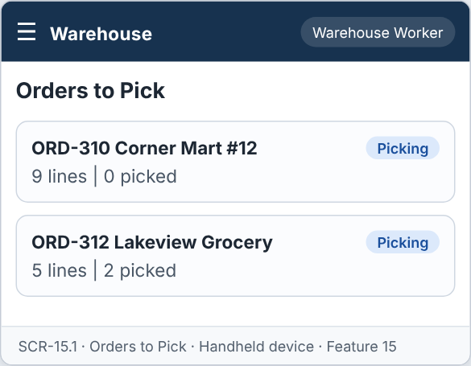
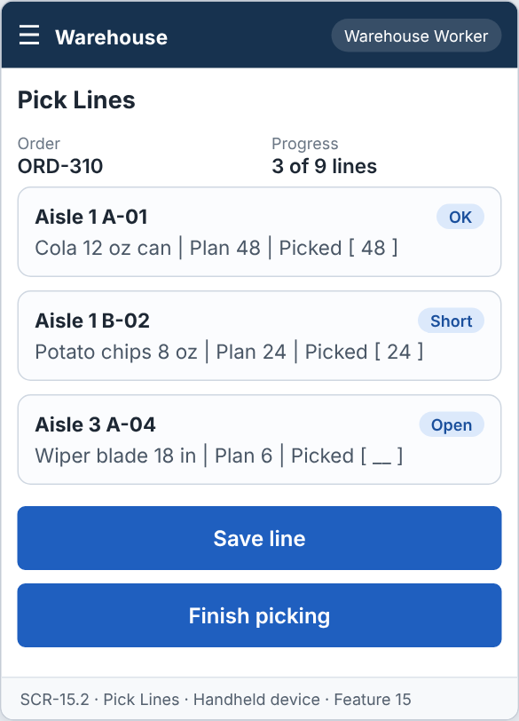
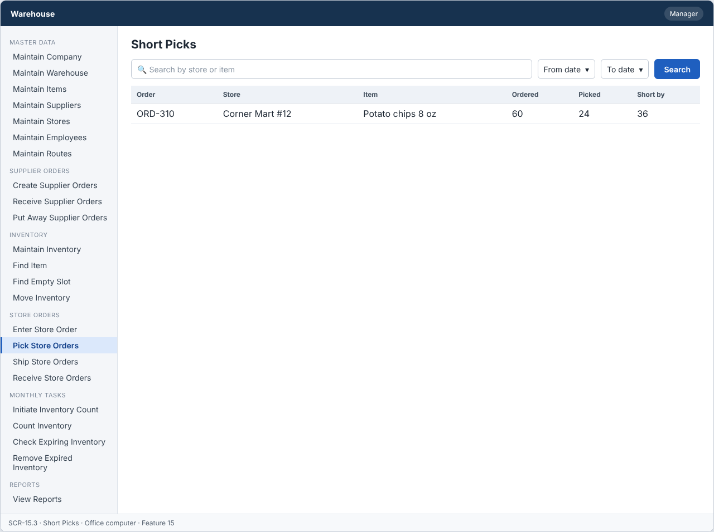

# Feature: Pick Store Orders

**Feature ID:** 15
**Branch pattern:** `feature/15-pick-store-orders`
**Status:** Draft
**Created:** 2026-09-28
**Input:** Pick the items on a store order and take them to the shipping cart.
**Depends on:** [Feature 12 — Enter Store Order](feature-12-enter-store-order.md); [Feature 9 — Maintain Inventory](feature-9-maintain-inventory.md)

---

## User Stories

### US-15.1: Create pick list

**As a** warehouse worker
**I want to** get a pick list for a store order
**So that** I know what to collect.
**Priority:** P1
**Independent test:** Confirm an order and verify a pick list is created. 
**Acceptance Scenarios:** see ### US-15.1 under Gherkin AC

### US-15.2: Record quantity picked

**As a** warehouse worker
**I want to** record the quantity I picked for each line
**So that** the order is correct.
**Priority:** P1
**Independent test:** Enter quantities picked and verify they are saved. 
**Acceptance Scenarios:** see ### US-15.2 under Gherkin AC

### US-15.3: Identify short pick

**As a** manager
**I want to** see lines that could not be picked in full
**So that** I can fix stock problems.
**Priority:** P1
**Independent test:** Pick less than ordered and verify a short pick is flagged. 
**Acceptance Scenarios:** see ### US-15.3 under Gherkin AC

---

## Functional Requirements

- **FR-001:** The system MUST create a pick list for a store order with status Picking.
- **FR-002:** The system MUST sort pick lines by aisle number.
- **FR-003:** The system MUST choose the oldest stock first (FIFO).
- **FR-004:** The system MUST NOT pick expired stock.
- **FR-005:** The system MUST record quantity picked for each line.
- **FR-006:** Quantity picked MUST NOT be negative.
- **FR-007:** The system MUST flag a short pick when quantity picked is less than quantity ordered.
- **FR-008:** The system MUST set the order to Picked when all lines are picked.
- **FR-009:** The system MUST let a warehouse worker and a manager use this feature (main user: warehouse worker), and MUST NOT let other roles change its information.
- **FR-010:** The system MUST be easy to use on the warehouse floor, on a handheld device or a tablet.
- **FR-011:** This feature is used every day, so each screen MUST need as few steps and clicks as possible.

---

## Assumptions

- **A-1:** A pick list is created for one store order with status Picking. Creating the list reserves the stock. It does not reduce quantity on hand (shipping does, Feature 17).
- **A-2:** For each order line the system chooses inventory records with the oldest received date first (FIFO). Expired records are never chosen (FR-003, FR-004). One order line can use several records, so one line can become several pick lines.
- **A-3:** Pick lines are sorted by aisle number, then shelf and bin, so the worker walks the warehouse once (FR-002).
- **A-4:** The worker scans or confirms the slot, then enters the quantity picked. Quantity picked is 0 or more and cannot be more than the quantity on the pick line.
- **A-5:** A short pick is a line where quantity picked is less than quantity ordered (FR-007). The order still moves on. The manager sees short picks in the list.
- **A-6:** When every pick line has a quantity (even 0), the order becomes Picked (FR-008). The unpicked reserved stock is released.
- **A-7:** If the stock is not enough when the list is created, the pick list shows a short line from the start (planned quantity is lower than ordered).
- **A-8:** Warehouse workers pick, managers view the short picks. They use a handheld device or a tablet (FR-010).

---

## Edge Cases

| ID | Situation | Expected behavior | Related |
|---|---|---|---|
| EC-1 | The oldest record is expired. | The system skips it and takes the next record that is not expired (FR-004). Expired stock is left for Features 21 and 22. | FR-003, FR-004 |
| EC-2 | The total non-expired stock is lower than the ordered quantity. | The pick list is created with the available quantity, and the line is marked Short from the start. | FR-003, FR-007 |
| EC-3 | There is no stock at all for one order line. | The line has planned quantity 0 and is marked Short. The rest of the order is still picked. | FR-007 |
| EC-4 | The worker enters a negative quantity or a quantity above the planned quantity. | The system rejects the value (FR-006). | FR-005, FR-006 |
| EC-5 | The worker finds less stock in the slot than the system says. | The worker enters the smaller quantity. The line is Short. A manager can start an inventory correction in Feature 9. | FR-005, FR-007 |
| EC-6 | A pick list already exists for the order. | The system does not create another one. It opens the existing list. | FR-001 |
| EC-7 | Two workers pick the same order. | Each pick line can be saved once. The second worker sees the line as already picked. | FR-005 |
| EC-8 | Stock was moved (Feature 16) after the pick list was created. | The pick line follows the inventory record, so it shows the new slot. The sort order is updated. | FR-002 |
| EC-9 | An order has 100 lines. | The list is shown in pages of 25 lines. Progress (picked / total) stays visible. | FR-002, FR-008 |

---

## Success Criteria

- **SC-1:** A pick list is created in under 3 seconds for an order of 50 lines.
- **SC-2:** No expired inventory is ever put on a pick list (0 cases in 100 test runs).
- **SC-3:** The oldest non-expired record is chosen first in 100% of tests.
- **SC-4:** 100% of lines where picked is below ordered are marked Short and appear for the manager.
- **SC-5:** All 8 Gherkin scenarios in this file pass as automated tests, and each user story's independent test is shown to work in a demo.

---

## Key Entities

- **Store Order** — Order being picked.
- **Pick Line** — One item and slot to pick from.
- **Inventory** — Stock the items are taken from.

---

## Initial Data Model

### Pick Line

- pick_line_id: String — Required, unique
- store_order_id: Store Order reference — Required
- item_id: Item reference — Required
- inventory_id: Inventory reference — Required
- quantity_to_pick: Integer — Required, greater than zero
- quantity_picked: Integer — Zero or greater
- short_pick: Boolean — True when picked is less than ordered
- picked_by: Employee reference — Required when picked

---

## Gherkin AC

### US-15.1 — Create pick list

#### Scenario: Pick list is created

- **Given** a store order has status Picking
- **When** the worker opens the order
- **Then** the system creates a pick list

#### Scenario: Pick list is sorted by aisle

- **Given** an order has items in aisles 9, 2, and 5
- **When** the pick list is created
- **Then** the system lists the lines as aisle 2, aisle 5, then aisle 9

#### Scenario: Oldest stock is picked first

- **Given** two slots hold the item with different received dates
- **When** the pick list is created
- **Then** the system uses the slot with the older received date

#### Scenario: Expired stock is not picked

- **Given** a slot holds expired stock
- **When** the pick list is created
- **Then** the system does not use that slot

#### Scenario: Wrong role cannot change information

- **Given** a driver is signed in
- **When** the driver tries to change information in this feature
- **Then** the system rejects the change

### US-15.2 — Record quantity picked

#### Scenario: Full order is picked

- **Given** an order for 5 units and stock is available
- **When** the worker confirms 5 units picked
- **Then** the system moves the order to Picked

#### Scenario: Negative quantity

- **Given** the worker enters a negative quantity picked
- **When** the worker tries to save
- **Then** the system rejects the quantity

### US-15.3 — Identify short pick

#### Scenario: Short pick is flagged

- **Given** an order for 5 units but only 3 are in stock
- **When** the worker confirms 3 units picked
- **Then** the system flags the line as a short pick

---

## Data Ownership

| Data | Owner | This feature | Notes |
|---|---|---|---|
| Pick Line | This feature (Feature 15) | Owns | Creates pick lines (record, slot, planned quantity) and saves quantity picked. |
| Store Order | [Feature 12 — Enter Store Order](feature-12-enter-store-order.md) | Updates (via owner) | Calls Feature 12's `setStatus(orderId, Picked)` when all lines are picked. |
| Store Order Item | [Feature 12 — Enter Store Order](feature-12-enter-store-order.md) | Reads | Quantity ordered per item. |
| Inventory Record | [Feature 9 — Maintain Inventory](feature-9-maintain-inventory.md) | Reads | Chooses records (FIFO, not expired). Reserved quantity is the sum of open pick lines. |
| Audit Log Entry | Platform (cross-cutting) | Updates (via owner) | Writes one entry for list creation and for each picked line. |

**Rule:** each piece of data has one owning feature. A feature that needs to change data it does not own must call the owner's service, and must never write the owner's tables directly (ADR-004).

---

## API Requirements

Base path: `/api/v1`. All endpoints follow [ADR-003](../docs/ADRs/ADR-003-rest-api-conventions.md) (JSON, problem+json errors, `version` field for optimistic locking). Roles are checked on the server for every call ([NFR-S2](../docs/NFR.md)).

| # | Method and path | Purpose | Allowed roles | Success | Errors | Supports |
|---|---|---|---|---|---|---|
| 1 | `GET /pick-lists` | List store orders to pick (status Picking) and their progress. | Warehouse Worker, Manager | 200 | — | US-15.1 |
| 2 | `POST /pick-lists` | Create the pick list of a store order (reserves stock). | Warehouse Worker, Manager | 201 + Location | 404 NOT_FOUND, 409 WRONG_STATUS (not Picking) | US-15.1 |
| 3 | `GET /pick-lists/{storeOrderId}` | Get the pick lines of an order, sorted by aisle, shelf, bin. | Warehouse Worker, Manager | 200 | 404 NOT_FOUND | US-15.1, US-15.2 |
| 4 | `PUT /pick-lines/{pickLineId}` | Record quantity picked for one line. The body must include `version`. | Warehouse Worker, Manager | 200 | 400 VALIDATION_FAILED, 404 NOT_FOUND, 409 VERSION_CONFLICT | US-15.2 |
| 5 | `POST /pick-lists/{storeOrderId}/complete` | Finish picking when every line has a quantity. Sets the order to Picked. | Warehouse Worker, Manager | 200 | 409 LINES_NOT_PICKED, 409 WRONG_STATUS | US-15.2 |
| 6 | `GET /pick-lines/short` | List short picks. Query: `from`, `to`, `storeId`. | Manager | 200 | — | US-15.3 |

**Request and response notes**

- Pick line: `pick_line_id`, `store_order_id`, `item_id`, `inventory_record_id`, `slot` (aisle, shelf, bin), `quantity_planned`, `quantity_picked`, `short` (true or false).
- PUT body: `quantity_picked`, `version`.

**Calls to other features (internal service calls, not public endpoints)**

- Feature 12 — Enter Store Order: `getOrder(orderId)`, and `setStatus(orderId, Picked)`.
- Feature 9 — Maintain Inventory: `findPickableRecords(itemId)` (oldest first, not expired) and `sumReserved(recordId)`.

---

## Screen Requirements

The screen images are in [docs/UI](../docs/UI/README.md). Each image is a wireframe: it shows layout and content, not final colors.

| Screen | Name | Device | Purpose | Image | Stories |
|---|---|---|---|---|---|
| SCR-15.1 | Orders to Pick | Handheld device | Choose a store order to pick. | [image](../docs/UI/images/scr-15-1-orders-to-pick.png) | US-15.1 |
| SCR-15.2 | Pick Lines | Handheld device | Walk the aisles in order and record each quantity. | [image](../docs/UI/images/scr-15-2-pick-lines.png) | US-15.2 |
| SCR-15.3 | Short Picks | Office computer | Show lines where less was picked than ordered. | [image](../docs/UI/images/scr-15-3-short-picks.png) | US-15.3 |

### SCR-15.1 — Orders to Pick

**Device:** Handheld device. **Purpose:** Choose a store order to pick.

- List of cards: ORD-310  Corner Mart #12; ORD-312  Lakeview Grocery.

### SCR-15.2 — Pick Lines

**Device:** Handheld device. **Purpose:** Walk the aisles in order and record each quantity.

- Details shown: Order, Progress.
- List of cards: Aisle 1  A-01; Aisle 1  B-02; Aisle 3  A-04.
- Buttons: Save line, Finish picking.
- Finish picking is enabled when every line has a quantity.

### SCR-15.3 — Short Picks

**Device:** Office computer. **Purpose:** Show lines where less was picked than ordered.

- Search box (Search by store or item) and filters (From date, To date).
- Table with columns: Order, Store, Item, Ordered, Picked, Short by.

---

## Definition of Done

This feature is done when all of these are true:

- [ ] All 3 user stories are built, and each story's independent test passes.
- [ ] All 11 functional requirements are built, and each one is covered by a Gherkin scenario, a unit test, or an NFR check.
- [ ] All 8 Gherkin scenarios are automated and pass in the build.
- [ ] The 6 API endpoints match the API Requirements table, are in the OpenAPI file, and have tests for success and for every listed error.
- [ ] The role rules are enforced on the server for every endpoint, with a test for a role that is not allowed.
- [ ] The screens (SCR-15.1, SCR-15.2, SCR-15.3) match the images in `docs/UI`, and were checked on: handheld device, office computer.
- [ ] Validation messages show next to the field, and what the user typed stays on the screen after an error.
- [ ] Database changes (tables, keys, unique rules, not-null rules, checks) are in a migration script and match the Initial Data Model.
- [ ] Every create, edit, delete, and status change writes an audit log entry (who, when, what changed).
- [ ] A test shows that expired stock is never chosen, and that creating a pick list does not change quantity on hand.
- [ ] These non-functional checks pass (see [NFR](../docs/NFR.md)): NFR-U2, NFR-U4, NFR-U9, NFR-P1, NFR-S1, NFR-S2, NFR-S4, NFR-D1, NFR-D2, NFR-D3, NFR-A1, NFR-A2, NFR-M1.
- [ ] The code is reviewed in a pull request and merged into `main` with no open critical bugs.
- [ ] This feature file, the UI images, and the API table are updated if anything changed during the build.

---

## Out of Scope

- Picking several store orders in one trip (batch picking).
- Printing pick lists on paper (the screen is the pick list).
- Back orders for short picks.
- Pick routes inside aisles, or robots and conveyor belts.
