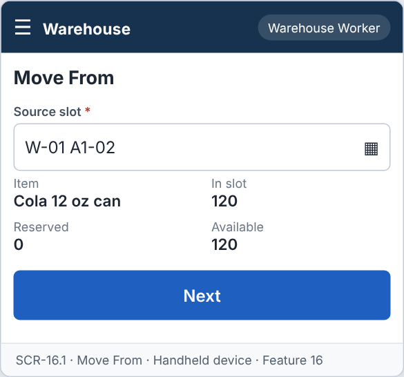
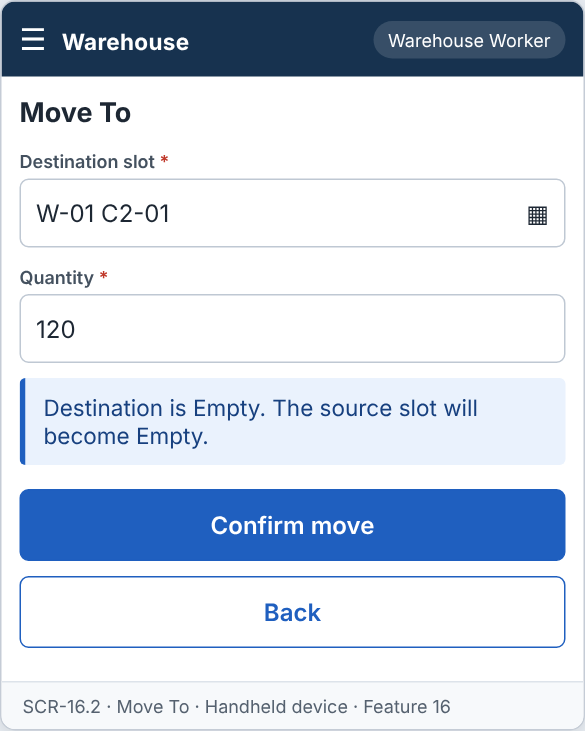
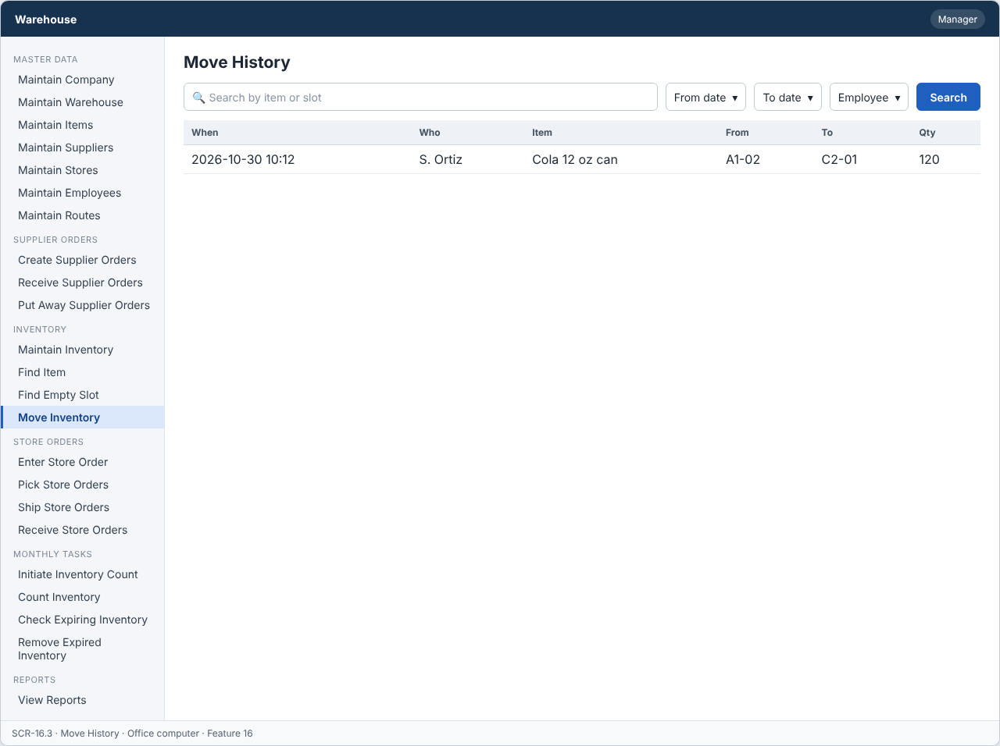

# Feature: Move Inventory

**Feature ID:** 16
**Branch pattern:** `feature/16-move-inventory`
**Status:** Draft
**Created:** 2026-09-28
**Input:** Move inventory from one storage slot to another.
**Depends on:** [Feature 14 — Find Empty Slot](feature-14-find-empty-slot.md); [Feature 9 — Maintain Inventory](feature-9-maintain-inventory.md)

---

## User Stories

### US-16.1: Move inventory

**As a** warehouse worker
**I want to** move items from one slot to another
**So that** stock is placed where it is needed.
**Priority:** P1
**Independent test:** Move items and verify both slots are updated. 
**Acceptance Scenarios:** see ### US-16.1 under Gherkin AC

### US-16.2: Record the move

**As a** manager
**I want to** see a record of every move
**So that** inventory changes can be traced.
**Priority:** P1
**Independent test:** Move items and verify a move record is saved. 
**Acceptance Scenarios:** see ### US-16.2 under Gherkin AC

---

## Functional Requirements

- **FR-001:** The system MUST allow the user to choose a source slot and a destination slot.
- **FR-002:** The system MUST NOT move more than the quantity in the source slot.
- **FR-003:** The destination slot MUST be Empty or hold the same item.
- **FR-004:** The system MUST update the quantity and status of both slots.
- **FR-005:** The system MUST record each move.
- **FR-006:** The system MUST let a warehouse worker and a manager use this feature (main user: warehouse worker), and MUST NOT let other roles change its information.
- **FR-007:** The system MUST be easy to use on the warehouse floor, on a handheld device or a tablet.
- **FR-008:** This feature is used every day, so each screen MUST need as few steps and clicks as possible.

---

## Assumptions

- **A-1:** A move takes some or all of the quantity of one inventory record from a source slot to a destination slot in the same warehouse.
- **A-2:** The destination slot must be Empty, or hold the same item (FR-003). If it holds the same item, the quantity is added to the existing record with the same received date. If the received date is different, a new record with the original received date is created, so FIFO stays correct.
- **A-3:** A full move leaves the source slot Empty. A partial move keeps the rest in the source slot.
- **A-4:** Quantity moved is a whole number above 0 and not more than the quantity in the source slot (FR-002).
- **A-5:** A move cannot take stock that is reserved by an open pick list. Only available quantity can be moved.
- **A-6:** Every move is recorded with who, when, source, destination, and quantity (FR-005). Moves cannot be changed afterwards.
- **A-7:** Warehouse workers move stock, and managers view the move history (the story "Record the move"). Both use a handheld or tablet.

---

## Edge Cases

| ID | Situation | Expected behavior | Related |
|---|---|---|---|
| EC-1 | The quantity is more than the source slot holds. | The system rejects the move (FR-002). | FR-002 |
| EC-2 | The quantity is more than the available (not reserved) quantity. | The system rejects the move (RESERVED_STOCK) and shows the available quantity. | FR-002 |
| EC-3 | The destination slot holds a different item. | The system rejects the move (FR-003). | FR-003 |
| EC-4 | The destination is the same slot as the source. | The system rejects the move. | FR-001 |
| EC-5 | The destination slot is in another warehouse. | The system rejects the move. Moves between warehouses are out of scope. | FR-001 |
| EC-6 | The destination was Empty a moment ago, but another worker used it. | The move is rejected with SLOT_NOT_EMPTY, and the worker can choose another slot. | FR-003 |
| EC-7 | The move succeeds for the destination but fails for the source (database error). | Both changes are rolled back. Quantity and slot status stay as before (FR-004). | FR-004 |
| EC-8 | A full move of the last unit. | The source slot becomes Empty and the destination becomes Occupied in one transaction. | FR-004 |
| EC-9 | The worker makes the same move twice by double tap. | The second request is rejected because the source no longer holds the quantity. | FR-002, FR-005 |

---

## Success Criteria

- **SC-1:** A worker finishes a move in under 30 seconds, with 5 taps or fewer after scanning the two slots.
- **SC-2:** 100% of moves are recorded with who, when, source, destination, and quantity.
- **SC-3:** Total quantity before and after a move is the same in 100% of tests (nothing is lost or created).
- **SC-4:** A slot never holds two different items after a move (0 cases in testing).
- **SC-5:** All 6 Gherkin scenarios in this file pass as automated tests, and each user story's independent test is shown to work in a demo.

---

## Key Entities

- **Move Record** — Record of items moved between slots.
- **Inventory** — Stock being moved.
- **Slot** — Source and destination location.

---

## Initial Data Model

### Move Record

- move_id: String — Required, unique
- item_id: Item reference — Required
- from_slot_id: Slot reference — Required
- to_slot_id: Slot reference — Required, different from from_slot_id
- quantity: Integer — Required, greater than zero
- moved_by: Employee reference — Required
- move_date: Date/Time — Required

---

## Gherkin AC

### US-16.1 — Move inventory

#### Scenario: Move all items to an empty slot

- **Given** slot A holds 10 units and slot B is Empty
- **When** the worker moves 10 units to slot B
- **Then** slot B holds 10 units
- **And** slot A is Empty

#### Scenario: Move part of the items

- **Given** slot A holds 10 units and slot B is Empty
- **When** the worker moves 4 units to slot B
- **Then** slot A holds 6 units
- **And** slot B holds 4 units

#### Scenario: Move too many

- **Given** slot A holds 10 units
- **When** the worker tries to move 12 units
- **Then** the system rejects the move

#### Scenario: Destination holds another item

- **Given** the destination slot holds a different item
- **When** the worker moves an item there
- **Then** the system rejects the move

#### Scenario: Wrong role cannot change information

- **Given** a driver is signed in
- **When** the driver tries to change information in this feature
- **Then** the system rejects the change

### US-16.2 — Record the move

#### Scenario: Move record is saved

- **Given** a move is completed
- **When** the system saves the move
- **Then** the system stores the item, both slots, quantity, worker, and date

---

## Data Ownership

| Data | Owner | This feature | Notes |
|---|---|---|---|
| Move Record | This feature (Feature 16) | Owns | Creates one record for each move (history is never changed). |
| Inventory Record | [Feature 9 — Maintain Inventory](feature-9-maintain-inventory.md) | Updates (via owner) | Calls Feature 9's `adjust(...)` for source and destination in one transaction. |
| Slot | [Feature 2 — Maintain Warehouse](feature-2-maintain-warehouse.md) | Reads | Source and destination slot status, through Feature 14 and Feature 9. |
| Audit Log Entry | Platform (cross-cutting) | Updates (via owner) | Writes one entry for each move. |

**Rule:** each piece of data has one owning feature. A feature that needs to change data it does not own must call the owner's service, and must never write the owner's tables directly (ADR-004).

---

## API Requirements

Base path: `/api/v1`. All endpoints follow [ADR-003](../docs/ADRs/ADR-003-rest-api-conventions.md) (JSON, problem+json errors, `version` field for optimistic locking). Roles are checked on the server for every call ([NFR-S2](../docs/NFR.md)).

| # | Method and path | Purpose | Allowed roles | Success | Errors | Supports |
|---|---|---|---|---|---|---|
| 1 | `GET /moves/source` | Find the stock in a source slot. Query: `slotId` or scanned slot code. | Warehouse Worker, Manager | 200 | 404 NOT_FOUND | US-16.1 |
| 2 | `POST /moves` | Move a quantity from a source slot to a destination slot. | Warehouse Worker, Manager | 201 + Location | 400 VALIDATION_FAILED, 409 QUANTITY_EXCEEDS_AVAILABLE, 409 SLOT_NOT_EMPTY, 409 SLOT_HOLDS_OTHER_ITEM | US-16.1, US-16.2 |
| 3 | `GET /moves` | List the move history. Query: `from`, `to`, `itemId`, `employeeId`. | Manager | 200 | — | US-16.2 |

**Request and response notes**

- POST body: `source_slot_id`, `destination_slot_id`, `item_id`, `quantity`. Response includes the record IDs after the move.

**Calls to other features (internal service calls, not public endpoints)**

- Feature 14 — Find Empty Slot: `suggestSlot(warehouseId)` (optional help for the destination).
- Feature 9 — Maintain Inventory: `adjust(...)` for source and destination.

---

## Screen Requirements

The screen images are in [docs/UI](../docs/UI/README.md). Each image is a wireframe: it shows layout and content, not final colors.

| Screen | Name | Device | Purpose | Image | Stories |
|---|---|---|---|---|---|
| SCR-16.1 | Move From | Handheld device | Scan the source slot and see its stock. | [image](../docs/UI/images/scr-16-1-move-from.png) | US-16.1 |
| SCR-16.2 | Move To | Handheld device | Choose the destination slot and quantity. | [image](../docs/UI/images/scr-16-2-move-to.png) | US-16.1, US-16.2 |
| SCR-16.3 | Move History | Office computer | Show past moves. | [image](../docs/UI/images/scr-16-3-move-history.png) | US-16.2 |

### SCR-16.1 — Move From

**Device:** Handheld device. **Purpose:** Scan the source slot and see its stock.

- Fields: Source slot (required).
- Details shown: Item, In slot, Reserved, Available.
- Buttons: Next.

### SCR-16.2 — Move To

**Device:** Handheld device. **Purpose:** Choose the destination slot and quantity.

- Fields: Destination slot (required), Quantity (required).
- Message (info): Destination is Empty. The source slot will become Empty.
- Buttons: Confirm move, Back.

### SCR-16.3 — Move History

**Device:** Office computer. **Purpose:** Show past moves.

- Search box (Search by item or slot) and filters (From date, To date, Employee).
- Table with columns: When, Who, Item, From, To, Qty.

---

## Definition of Done

This feature is done when all of these are true:

- [ ] All 2 user stories are built, and each story's independent test passes.
- [ ] All 8 functional requirements are built, and each one is covered by a Gherkin scenario, a unit test, or an NFR check.
- [ ] All 6 Gherkin scenarios are automated and pass in the build.
- [ ] The 3 API endpoints match the API Requirements table, are in the OpenAPI file, and have tests for success and for every listed error.
- [ ] The role rules are enforced on the server for every endpoint, with a test for a role that is not allowed.
- [ ] The screens (SCR-16.1, SCR-16.2, SCR-16.3) match the images in `docs/UI`, and were checked on: handheld device, office computer.
- [ ] Validation messages show next to the field, and what the user typed stays on the screen after an error.
- [ ] Database changes (tables, keys, unique rules, not-null rules, checks) are in a migration script and match the Initial Data Model.
- [ ] Every create, edit, delete, and status change writes an audit log entry (who, when, what changed).
- [ ] A failure test shows that when the destination change fails, the source quantity does not change.
- [ ] These non-functional checks pass (see [NFR](../docs/NFR.md)): NFR-U2, NFR-U4, NFR-U9, NFR-P1, NFR-S1, NFR-S2, NFR-S4, NFR-D1, NFR-D2, NFR-A1, NFR-A2, NFR-M1.
- [ ] The code is reviewed in a pull request and merged into `main` with no open critical bugs.
- [ ] This feature file, the UI images, and the API table are updated if anything changed during the build.

---

## Out of Scope

- Moves between warehouses.
- Planning or suggesting moves to make the warehouse tidy.
- Undoing a move (make a new move back).
- Moving stock that is reserved by a pick list.
