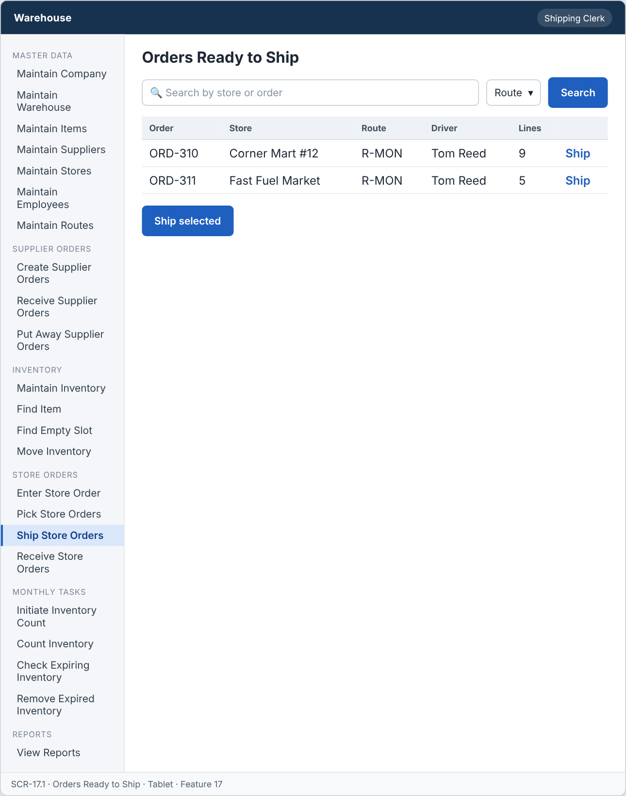
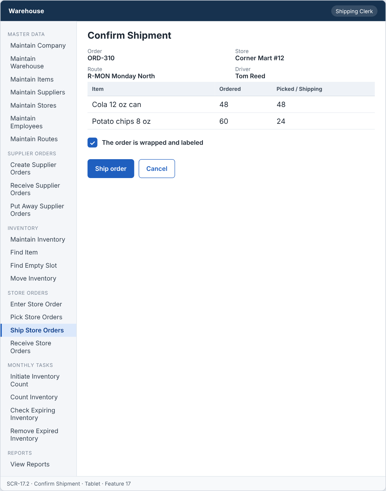
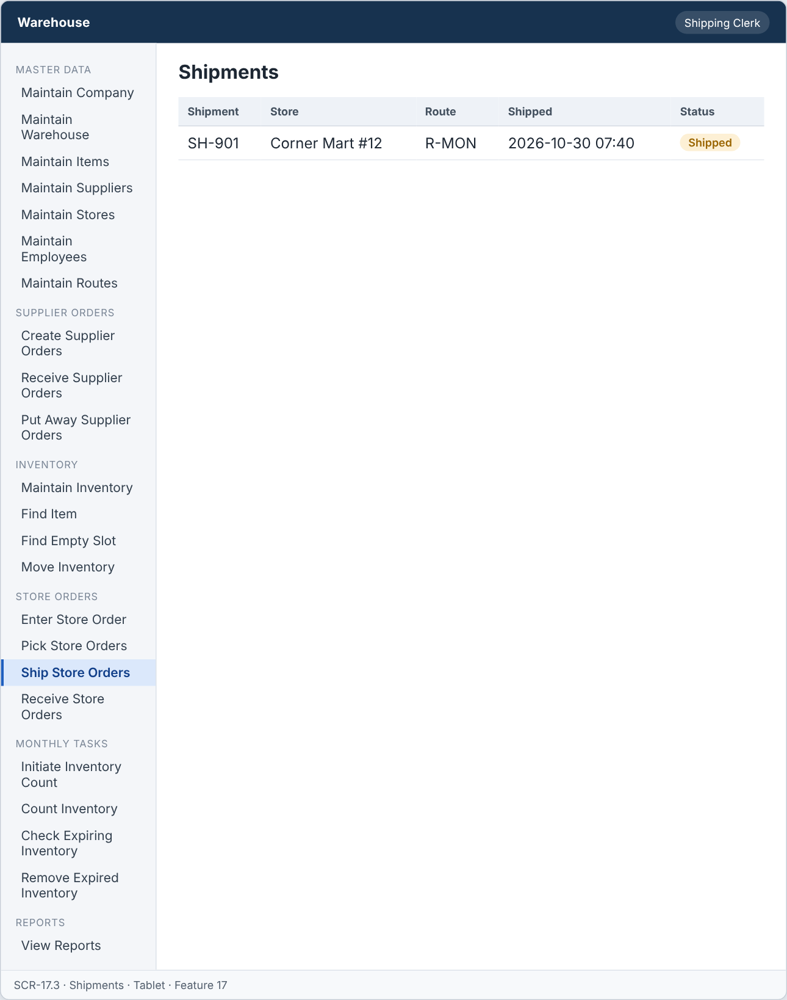

# Feature: Ship Store Orders

**Feature ID:** 17
**Branch pattern:** `feature/17-ship-store-orders`
**Status:** Draft
**Created:** 2026-09-28
**Input:** Wrap, label, and ship picked store orders on the store's route.
**Depends on:** [Feature 15 — Pick Store Orders](feature-15-pick-store-orders.md); [Feature 7 — Maintain Routes](feature-7-maintain-routes.md)

---

## User Stories

### US-17.1: Ship picked order

**As a** shipping clerk
**I want to** ship a picked store order
**So that** the store receives the products.
**Priority:** P1
**Independent test:** Ship a picked order and verify its status changes to Shipped. 
**Acceptance Scenarios:** see ### US-17.1 under Gherkin AC

### US-17.2: Confirm order is wrapped

**As a** shipping clerk
**I want to** confirm that the order is wrapped and labeled
**So that** the order is not lost.
**Priority:** P1
**Independent test:** Ship an order that is not wrapped and verify it is rejected.
**Acceptance Scenarios:** see ### US-17.2 under Gherkin AC

### US-17.3: Assign order to route

**As a** shipping clerk
**I want to** put the order on the route of its store
**So that** the driver delivers it.
**Priority:** P1
**Independent test:** Ship an order and verify the route and driver are saved.
**Acceptance Scenarios:** see ### US-17.3 under Gherkin AC

---

## Functional Requirements

- **FR-001:** The system MUST list store orders with status Picked.
- **FR-002:** The system MUST NOT ship an order that is not Picked.
- **FR-003:** The system MUST require confirmation that the order is wrapped and labeled.
- **FR-004:** The system MUST assign the shipment to the route and driver of the store.
- **FR-005:** The system MUST reduce inventory by the quantity shipped.
- **FR-006:** The system MUST set the order to Shipped and record the ship date.
- **FR-007:** The system MUST let a shipping clerk and a manager use this feature (main user: shipping clerk), and MUST NOT let other roles change its information.
- **FR-008:** The system MUST be easy to use on the warehouse floor, on a handheld device or a tablet.
- **FR-009:** This feature is used every day, so each screen MUST need as few steps and clicks as possible.

---

## Assumptions

- **A-1:** Only store orders with status Picked can be shipped (FR-001, FR-002).
- **A-2:** The shipping clerk confirms that the order is wrapped and labeled with a check box. Ship is disabled until it is checked (FR-003).
- **A-3:** Shipping creates a shipment that uses the route and driver of the store (FR-004). The system fills them in. The clerk cannot choose another route.
- **A-4:** Quantity shipped is the quantity picked. Shipping reduces inventory by that quantity and releases the reservation (FR-005). Short picks ship with the smaller quantity.
- **A-5:** Shipping sets the order to Shipped and saves the ship date and time (FR-006).
- **A-6:** The clerk can ship several orders in one step. Each order becomes its own shipment.
- **A-7:** A shipment is not changed after shipping. If the driver cannot deliver, Feature 18 records an exception.
- **A-8:** Shipping clerks and managers use this feature on a handheld or tablet.

---

## Edge Cases

| ID | Situation | Expected behavior | Related |
|---|---|---|---|
| EC-1 | The order is not Picked (still Picking or already Shipped). | The system rejects the shipment with WRONG_STATUS (FR-002). | FR-002 |
| EC-2 | The clerk tries to ship without the wrapped-and-labeled check. | The system rejects the request (FR-003). | FR-003 |
| EC-3 | The store has no active route (the route was deleted). | The system rejects the shipment with a message. The route must be fixed in Features 5 and 7. | FR-004 |
| EC-4 | The store's route has no active driver. | The system rejects the shipment with a message. | FR-004 |
| EC-5 | An order with all lines picked as 0. | The system rejects the shipment (nothing to ship) and shows the order to a manager. | FR-005 |
| EC-6 | The inventory reduction fails for one record. | The whole shipment is rolled back. The order stays Picked, and no inventory changes. | FR-005, FR-006 |
| EC-7 | Two clerks ship the same order at the same time. | The first shipment is saved. The second gets WRONG_STATUS (already Shipped). | FR-002, FR-006 |
| EC-8 | The clerk ships 30 orders in one step and one of them fails. | The 29 good orders are shipped. The failed order is listed with the reason. | FR-001, FR-006 |

---

## Success Criteria

- **SC-1:** A clerk ships one order in under 20 seconds on a tablet.
- **SC-2:** No order that is not Picked is ever shipped (0 cases in testing).
- **SC-3:** 100% of shipments have the route and the driver of the store, and a ship date.
- **SC-4:** Inventory reduction equals quantity picked in 100% of shipments.
- **SC-5:** All 7 Gherkin scenarios in this file pass as automated tests, and each user story's independent test is shown to work in a demo.

---

## Key Entities

- **Shipment** — Record that an order left the warehouse.
- **Store Order** — Order being shipped.
- **Route** — Route the order travels on.

---

## Initial Data Model

### Shipment

- shipment_id: String — Required, unique
- store_order_id: Store Order reference — Required
- route_id: Route reference — Required
- driver_id: Employee reference — Required, role is Driver
- wrapped: Boolean — Required, must be true to ship
- ship_date: Date — Required
- shipped_by: Employee reference — Required

---

## Gherkin AC

### US-17.1 — Ship picked order

#### Scenario: Order is shipped

- **Given** a store order has status Picked
- **When** the clerk ships the order
- **Then** the system sets the order to Shipped
- **And** the system reduces inventory by the quantity shipped

#### Scenario: Order is not picked

- **Given** a store order has status Received or Picking
- **When** the clerk tries to ship the order
- **Then** the system rejects the shipment

#### Scenario: Wrong role cannot change information

- **Given** a driver is signed in
- **When** the driver tries to change information in this feature
- **Then** the system rejects the change

### US-17.2 — Confirm order is wrapped

#### Scenario: Order is wrapped

- **Given** a picked order is wrapped and labeled with its order number
- **When** the clerk ships the order
- **Then** the system saves the shipment

#### Scenario: Order is not wrapped

- **Given** a picked order is not wrapped
- **When** the clerk tries to ship the order
- **Then** the system rejects the shipment

### US-17.3 — Assign order to route

#### Scenario: Route and driver are assigned

- **Given** a store belongs to a route with a driver
- **When** the clerk ships the store order
- **Then** the system saves the route and driver on the shipment

#### Scenario: Store has no route

- **Given** a store has no route
- **When** the clerk tries to ship the order
- **Then** the system rejects the shipment

---

## Data Ownership

| Data | Owner | This feature | Notes |
|---|---|---|---|
| Shipment | This feature (Feature 17) | Owns | Creates the shipment (order, route, driver, ship date and time, shipped by). |
| Store Order | [Feature 12 — Enter Store Order](feature-12-enter-store-order.md) | Updates (via owner) | Calls Feature 12's `setStatus(orderId, Shipped)`. |
| Pick Line | [Feature 15 — Pick Store Orders](feature-15-pick-store-orders.md) | Reads | Quantity picked per record. |
| Inventory Record | [Feature 9 — Maintain Inventory](feature-9-maintain-inventory.md) | Updates (via owner) | Calls Feature 9's `adjust(...)` to reduce quantity. |
| Store | [Feature 5 — Maintain Stores](feature-5-maintain-stores.md) | Reads | The route of the store. |
| Route | [Feature 7 — Maintain Routes](feature-7-maintain-routes.md) | Reads | The active route and its driver. |
| Audit Log Entry | Platform (cross-cutting) | Updates (via owner) | Writes one entry for each shipment. |

**Rule:** each piece of data has one owning feature. A feature that needs to change data it does not own must call the owner's service, and must never write the owner's tables directly (ADR-004).

---

## API Requirements

Base path: `/api/v1`. All endpoints follow [ADR-003](../docs/ADRs/ADR-003-rest-api-conventions.md) (JSON, problem+json errors, `version` field for optimistic locking). Roles are checked on the server for every call ([NFR-S2](../docs/NFR.md)).

| # | Method and path | Purpose | Allowed roles | Success | Errors | Supports |
|---|---|---|---|---|---|---|
| 1 | `GET /shipments/ready` | List store orders with status Picked, with store and route. Query: `routeId`. | Shipping Clerk, Manager | 200 | — | US-17.1 |
| 2 | `POST /shipments` | Ship one picked order (needs `wrapped_and_labeled` = true). | Shipping Clerk, Manager | 201 + Location | 400 VALIDATION_FAILED (not confirmed), 409 WRONG_STATUS, 409 NO_ACTIVE_ROUTE_OR_DRIVER | US-17.1, US-17.2, US-17.3 |
| 3 | `POST /shipments/batch` | Ship several picked orders. Returns a result per order. | Shipping Clerk, Manager | 207 | 400 VALIDATION_FAILED | US-17.1 |
| 4 | `GET /shipments` | List shipments. Query: `status`, `routeId`, `from`, `to`. | Shipping Clerk, Manager | 200 | — | US-17.3 |
| 5 | `GET /shipments/{shipmentId}` | Get one shipment with its lines. | Shipping Clerk, Manager | 200 | 404 NOT_FOUND | US-17.3 |

**Request and response notes**

- POST body: `store_order_id`, `wrapped_and_labeled`. The server sets `route_id`, `driver_id`, `shipped_by`, and `shipped_at`.

**Calls to other features (internal service calls, not public endpoints)**

- Feature 12: `setStatus(orderId, Shipped)`.
- Feature 9: `adjust(recordId, -quantity, reason, source)` for each pick line.
- Feature 5 and Feature 7: the route and the driver of the store.

---

## Screen Requirements

The screen images are in [docs/UI](../docs/UI/README.md). Each image is a wireframe: it shows layout and content, not final colors.

| Screen | Name | Device | Purpose | Image | Stories |
|---|---|---|---|---|---|
| SCR-17.1 | Orders Ready to Ship | Tablet | Choose picked orders to ship. | [image](../docs/UI/images/scr-17-1-orders-ready-to-ship.png) | US-17.1 |
| SCR-17.2 | Confirm Shipment | Tablet | Confirm the order is wrapped and labeled, then ship. | [image](../docs/UI/images/scr-17-2-confirm-shipment.png) | US-17.2, US-17.3 |
| SCR-17.3 | Shipments | Tablet | Show shipped orders and their status. | [image](../docs/UI/images/scr-17-3-shipments.png) | US-17.3 |

### SCR-17.1 — Orders Ready to Ship

**Device:** Tablet. **Purpose:** Choose picked orders to ship.

- Search box (Search by store or order) and filters (Route).
- Table with columns: Order, Store, Route, Driver, Lines.
- Buttons: Ship selected.

### SCR-17.2 — Confirm Shipment

**Device:** Tablet. **Purpose:** Confirm the order is wrapped and labeled, then ship.

- Details shown: Order, Store, Route, Driver.
- Table with columns: Item, Ordered, Picked / Shipping.
- Fields: The order is wrapped and labeled (required).
- Buttons: Ship order, Cancel.

### SCR-17.3 — Shipments

**Device:** Tablet. **Purpose:** Show shipped orders and their status.

- Table with columns: Shipment, Store, Route, Shipped, Status.

---

## Definition of Done

This feature is done when all of these are true:

- [ ] All 3 user stories are built, and each story's independent test passes.
- [ ] All 9 functional requirements are built, and each one is covered by a Gherkin scenario, a unit test, or an NFR check.
- [ ] All 7 Gherkin scenarios are automated and pass in the build.
- [ ] The 5 API endpoints match the API Requirements table, are in the OpenAPI file, and have tests for success and for every listed error.
- [ ] The role rules are enforced on the server for every endpoint, with a test for a role that is not allowed.
- [ ] The screens (SCR-17.1, SCR-17.2, SCR-17.3) match the images in `docs/UI`, and were checked on: tablet.
- [ ] Validation messages show next to the field, and what the user typed stays on the screen after an error.
- [ ] Database changes (tables, keys, unique rules, not-null rules, checks) are in a migration script and match the Initial Data Model.
- [ ] Every create, edit, delete, and status change writes an audit log entry (who, when, what changed).
- [ ] A failure test shows that when inventory cannot be reduced, the order stays Picked and no shipment is saved.
- [ ] These non-functional checks pass (see [NFR](../docs/NFR.md)): NFR-U2, NFR-U4, NFR-U9, NFR-P1, NFR-S1, NFR-S2, NFR-S4, NFR-D1, NFR-D2, NFR-A1, NFR-A2, NFR-M1.
- [ ] The code is reviewed in a pull request and merged into `main` with no open critical bugs.
- [ ] This feature file, the UI images, and the API table are updated if anything changed during the build.

---

## Out of Scope

- Printing labels, packing slips, or invoices (the clerk labels the boxes by hand).
- Choosing a different route for one shipment.
- Truck load planning, weight, or number of pallets.
- Tracking the truck by GPS.
