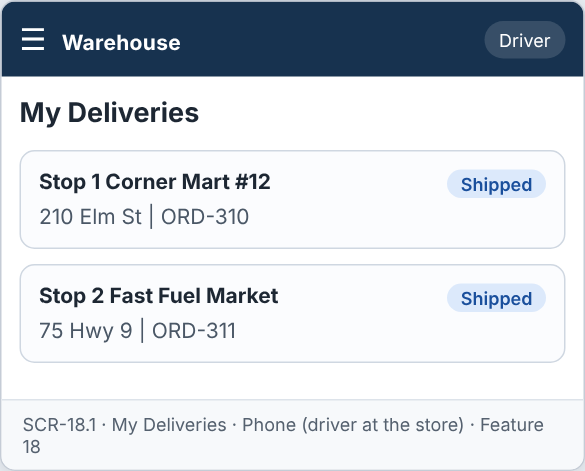
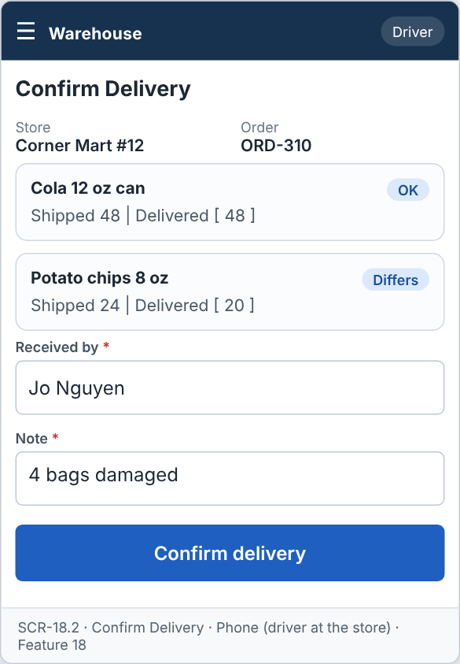
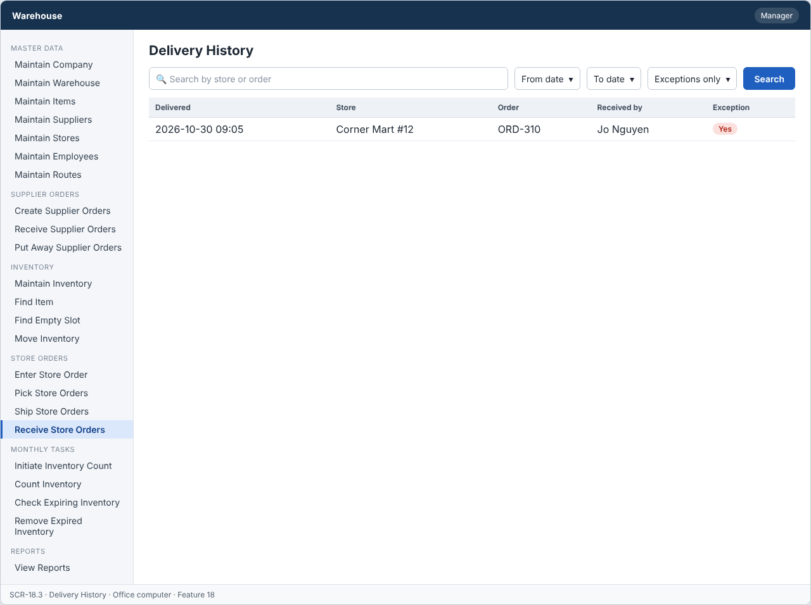

# Feature: Receive Store Orders

**Feature ID:** 18
**Branch pattern:** `feature/18-receive-store-orders`
**Status:** Draft
**Created:** 2026-09-28
**Input:** Deliver shipped orders to stores and confirm that the store received them.
**Depends on:** [Feature 17 — Ship Store Orders](feature-17-ship-store-orders.md)

---

## User Stories

### US-18.1: Receive store order at the store

**As a** driver
**I want to** see and deliver the orders on my route
**So that** stores receive their products.
**Priority:** P1
**Independent test:** Deliver an order and verify its status changes to Delivered. 
**Acceptance Scenarios:** see ### US-18.1 under Gherkin AC

### US-18.2: Confirm receipt by store

**As a** driver
**I want to** record who received the order at the store
**So that** there is proof of delivery.
**Priority:** P1
**Independent test:** Deliver an order and verify the receiver name and time are saved. 
**Acceptance Scenarios:** see ### US-18.2 under Gherkin AC

### US-18.3: Record delivery exception

**As a** driver
**I want to** record damaged or missing items
**So that** the difference is known.
**Priority:** P1
**Independent test:** Deliver fewer items than ordered and verify an exception is saved. 
**Acceptance Scenarios:** see ### US-18.3 under Gherkin AC

---

## Functional Requirements

- **FR-001:** The system MUST list shipped orders for the driver's route.
- **FR-002:** The system MUST record quantity delivered for each item.
- **FR-003:** The system MUST record the name of the person who received the order.
- **FR-004:** The system MUST record the delivery date and time.
- **FR-005:** The system MUST set the order to Delivered when delivery is confirmed.
- **FR-006:** The system MUST NOT deliver an order that is not Shipped.
- **FR-007:** The system MUST record a note for damaged or missing items.
- **FR-008:** The system MUST let a driver and a manager use this feature (main user: driver), and MUST NOT let other roles change its information.
- **FR-009:** The system MUST be usable on a mobile device at the store.
- **FR-010:** This feature is used every day, so each screen MUST need as few steps and clicks as possible.

---

## Assumptions

- **A-1:** The driver sees only shipments on the driver's own route (FR-001). A manager sees all.
- **A-2:** At the store the driver enters the quantity delivered for each item, the name of the person who received the order, and (if needed) a note (FR-002, FR-003, FR-007).
- **A-3:** The delivery date and time are saved by the system when the driver confirms (FR-004).
- **A-4:** Confirming sets the order to Delivered (FR-005). A delivery with different quantities is still Delivered. It is also an exception.
- **A-5:** A delivery exception is a line where quantity delivered differs from the quantity shipped. A note is required when any line is different (FR-007).
- **A-6:** Quantity delivered can be higher than shipped only by mistake, so it is not allowed. Maximum is the quantity shipped.
- **A-7:** Items that were damaged or missing are not put back into inventory in this version. They are only recorded in the note.
- **A-8:** Drivers use a phone or small tablet at the store, and the screen works with large buttons (FR-009).

---

## Edge Cases

| ID | Situation | Expected behavior | Related |
|---|---|---|---|
| EC-1 | The order is not Shipped (for example, already Delivered). | The system rejects the delivery with WRONG_STATUS (FR-006). | FR-006 |
| EC-2 | The driver opens an order of another route. | The system answers FORBIDDEN_ROLE and shows nothing. | FR-001, FR-008 |
| EC-3 | The received-by name is empty. | The system rejects the confirmation (FR-003). | FR-003 |
| EC-4 | A quantity delivered is less than shipped and the note is empty. | The system rejects the confirmation. The driver must write what happened (FR-007). | FR-007 |
| EC-5 | A quantity delivered is more than shipped. | The system rejects the value. | FR-002 |
| EC-6 | The phone has no signal at the store. | The driver can keep the screen open and press Confirm again when the signal returns. The system does not save anything until it receives the request. Nothing is lost silently. | FR-005, FR-009 |
| EC-7 | The driver presses Confirm twice. | The second request is rejected as already Delivered. The result of the first stays. | FR-005, FR-006 |
| EC-8 | The store is closed and nobody can receive the order. | The driver records quantity 0 for all lines with a note. The order stays Shipped (not Delivered) and a manager sees it in the open list. | FR-002, FR-007 |

---

## Success Criteria

- **SC-1:** A driver confirms a delivery of 10 lines in under 2 minutes on a phone.
- **SC-2:** 100% of deliveries have the quantity delivered, the received-by name, and the date and time.
- **SC-3:** No order that is not Shipped is ever set to Delivered (0 cases in testing).
- **SC-4:** 100% of deliveries with a different quantity have a note.
- **SC-5:** All 7 Gherkin scenarios in this file pass as automated tests, and each user story's independent test is shown to work in a demo.

---

## Key Entities

- **Delivery** — Record of an order delivered to a store.
- **Shipment** — Shipment being delivered.
- **Store Order** — Order being delivered.

---

## Initial Data Model

### Delivery

- delivery_id: String — Required, unique
- shipment_id: Shipment reference — Required
- received_by_name: String — Required
- delivered_at: Date/Time — Required
- exception: Boolean — True when quantity delivered differs
- note: String — Optional

---

## Gherkin AC

### US-18.1 — Receive store order at the store

#### Scenario: Orders are listed by route

- **Given** shipped orders exist on a route
- **When** the driver opens the route
- **Then** the system lists the orders by stop

#### Scenario: Order is delivered

- **Given** a store order has status Shipped
- **When** the driver confirms the delivery
- **Then** the system sets the order to Delivered

#### Scenario: Wrong role cannot change information

- **Given** a shipping clerk is signed in
- **When** the shipping clerk tries to change information in this feature
- **Then** the system rejects the change

### US-18.2 — Confirm receipt by store

#### Scenario: Receipt is confirmed

- **Given** the driver is at the store
- **When** the store confirms the order and gives a name
- **Then** the system saves the receiver name, date, and time

#### Scenario: Missing receiver name

- **Given** the store confirms the order
- **When** no receiver name is entered
- **Then** the system does not complete the delivery

### US-18.3 — Record delivery exception

#### Scenario: Damaged item

- **Given** the store reports a damaged item
- **When** the driver records the damage
- **Then** the system saves the note on the delivery

#### Scenario: Quantity delivered differs

- **Given** quantity shipped is 10
- **And** quantity delivered is 8
- **When** the driver saves the delivery
- **Then** the system marks a delivery exception

---

## Data Ownership

| Data | Owner | This feature | Notes |
|---|---|---|---|
| Delivery | This feature (Feature 18) | Owns | Creates the delivery (quantity delivered per line, received by, date and time, note). |
| Shipment | [Feature 17 — Ship Store Orders](feature-17-ship-store-orders.md) | Updates (via owner) | Calls Feature 17's `setStatus(shipmentId, Delivered)`. |
| Store Order | [Feature 12 — Enter Store Order](feature-12-enter-store-order.md) | Updates (via owner) | Calls Feature 12's `setStatus(orderId, Delivered)`. |
| Route | [Feature 7 — Maintain Routes](feature-7-maintain-routes.md) | Reads | Which route belongs to the driver. |
| Audit Log Entry | Platform (cross-cutting) | Updates (via owner) | Writes one entry for each delivery. |

**Rule:** each piece of data has one owning feature. A feature that needs to change data it does not own must call the owner's service, and must never write the owner's tables directly (ADR-004).

---

## API Requirements

Base path: `/api/v1`. All endpoints follow [ADR-003](../docs/ADRs/ADR-003-rest-api-conventions.md) (JSON, problem+json errors, `version` field for optimistic locking). Roles are checked on the server for every call ([NFR-S2](../docs/NFR.md)).

| # | Method and path | Purpose | Allowed roles | Success | Errors | Supports |
|---|---|---|---|---|---|---|
| 1 | `GET /deliveries/open` | List shipped orders for the signed-in driver's routes. A manager can add `routeId`. | Driver, Manager | 200 | — | US-18.1 |
| 2 | `GET /deliveries/open/{shipmentId}` | Get the lines of one shipped order. | Driver, Manager | 200 | 403 FORBIDDEN_ROLE (not own route), 404 NOT_FOUND | US-18.1 |
| 3 | `POST /deliveries` | Confirm delivery with quantities, received-by name, and note. | Driver, Manager | 201 + Location | 400 VALIDATION_FAILED, 403 FORBIDDEN_ROLE, 409 WRONG_STATUS | US-18.2, US-18.3 |
| 4 | `GET /deliveries` | List delivery history. Query: `from`, `to`, `storeId`, `hasException`. | Manager | 200 | — | US-18.3 |

**Request and response notes**

- POST body: `shipment_id`, `received_by`, `note`, `lines` = list of {`item_id`, `quantity_delivered`}. The server sets `delivered_at` and `delivered_by`.

**Calls to other features (internal service calls, not public endpoints)**

- Feature 17 — Ship Store Orders: `getShipment(shipmentId)`, `setStatus(shipmentId, Delivered)`.
- Feature 12: `setStatus(orderId, Delivered)`.

---

## Screen Requirements

The screen images are in [docs/UI](../docs/UI/README.md). Each image is a wireframe: it shows layout and content, not final colors.

| Screen | Name | Device | Purpose | Image | Stories |
|---|---|---|---|---|---|
| SCR-18.1 | My Deliveries | Phone (driver at the store) | Show shipped orders on the driver's route, in stop order. | [image](../docs/UI/images/scr-18-1-my-deliveries.png) | US-18.1 |
| SCR-18.2 | Confirm Delivery | Phone (driver at the store) | Enter delivered quantities and who received the order. | [image](../docs/UI/images/scr-18-2-confirm-delivery.png) | US-18.2, US-18.3 |
| SCR-18.3 | Delivery History | Office computer | Show past deliveries and exceptions. | [image](../docs/UI/images/scr-18-3-delivery-history.png) | US-18.3 |

### SCR-18.1 — My Deliveries

**Device:** Phone (driver at the store). **Purpose:** Show shipped orders on the driver's route, in stop order.

- List of cards: Stop 1  Corner Mart #12; Stop 2  Fast Fuel Market.

### SCR-18.2 — Confirm Delivery

**Device:** Phone (driver at the store). **Purpose:** Enter delivered quantities and who received the order.

- Details shown: Store, Order.
- List of cards: Cola 12 oz can; Potato chips 8 oz.
- Fields: Received by (required), Note (required).
- Buttons: Confirm delivery.

### SCR-18.3 — Delivery History

**Device:** Office computer. **Purpose:** Show past deliveries and exceptions.

- Search box (Search by store or order) and filters (From date, To date, Exceptions only).
- Table with columns: Delivered, Store, Order, Received by, Exception.

---

## Definition of Done

This feature is done when all of these are true:

- [ ] All 3 user stories are built, and each story's independent test passes.
- [ ] All 10 functional requirements are built, and each one is covered by a Gherkin scenario, a unit test, or an NFR check.
- [ ] All 7 Gherkin scenarios are automated and pass in the build.
- [ ] The 4 API endpoints match the API Requirements table, are in the OpenAPI file, and have tests for success and for every listed error.
- [ ] The role rules are enforced on the server for every endpoint, with a test for a role that is not allowed.
- [ ] The screens (SCR-18.1, SCR-18.2, SCR-18.3) match the images in `docs/UI`, and were checked on: office computer, phone (driver at the store).
- [ ] Validation messages show next to the field, and what the user typed stays on the screen after an error.
- [ ] Database changes (tables, keys, unique rules, not-null rules, checks) are in a migration script and match the Initial Data Model.
- [ ] Every create, edit, delete, and status change writes an audit log entry (who, when, what changed).
- [ ] Screens were checked on a phone-size screen (390 px wide) with large tap targets.
- [ ] These non-functional checks pass (see [NFR](../docs/NFR.md)): NFR-U3, NFR-U4, NFR-U9, NFR-P1, NFR-S1, NFR-S2, NFR-S4, NFR-D1, NFR-D2, NFR-A1, NFR-M1.
- [ ] The code is reviewed in a pull request and merged into `main` with no open critical bugs.
- [ ] This feature file, the UI images, and the API table are updated if anything changed during the build.

---

## Out of Scope

- A signature or photo of the delivery.
- Returning damaged goods to inventory or to the supplier.
- Taking payment or creating an invoice at the store.
- Working offline and syncing later.
