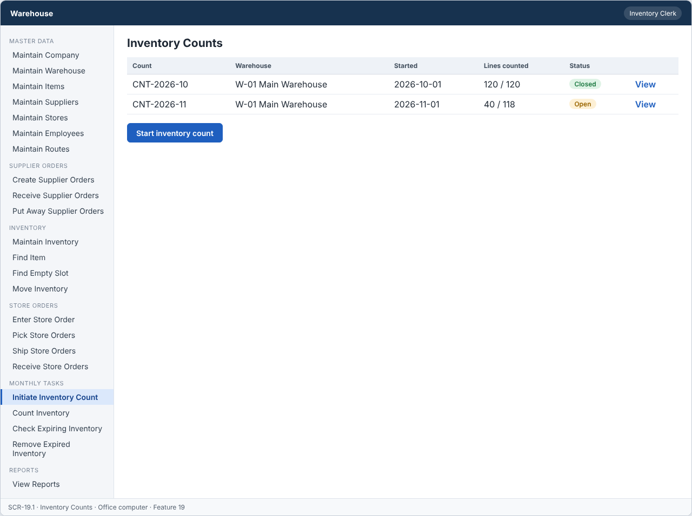
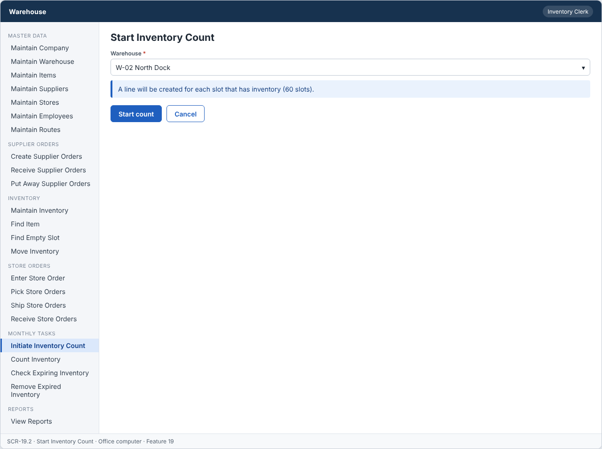
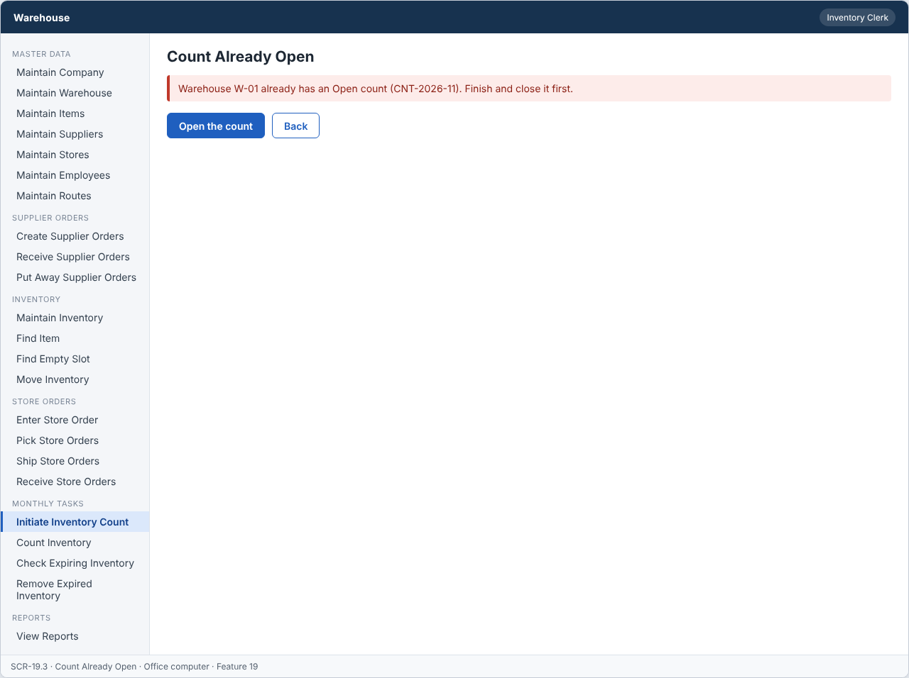

# Feature: Initiate Inventory Count

**Feature ID:** 19
**Branch pattern:** `feature/19-initiate-inventory-count`
**Status:** Draft
**Created:** 2026-09-28
**Input:** Start a monthly inventory count for a warehouse.
**Depends on:** [Feature 2 — Maintain Warehouse](feature-2-maintain-warehouse.md); [Feature 9 — Maintain Inventory](feature-9-maintain-inventory.md)

---

## User Stories

### US-19.1: Start inventory count

**As an** inventory clerk
**I want to** start an inventory count for a warehouse
**So that** workers know which slots to count.
**Priority:** P3
**Independent test:** Start a count and verify count lines are created. 
**Acceptance Scenarios:** see ### US-19.1 under Gherkin AC

### US-19.2: Prevent duplicate count

**As an** inventory clerk
**I want to** be stopped from starting a second count
**So that** counts do not overlap.
**Priority:** P3
**Independent test:** Start a second count and verify it is rejected. 
**Acceptance Scenarios:** see ### US-19.2 under Gherkin AC

---

## Functional Requirements

- **FR-001:** The system MUST create an inventory count for one warehouse.
- **FR-002:** The system MUST create a count line for each slot that has inventory.
- **FR-003:** The system MUST store the expected quantity on each count line.
- **FR-004:** A new count MUST have status Open.
- **FR-005:** The system MUST NOT allow two open counts for the same warehouse.
- **FR-006:** The system MUST let an inventory clerk and a manager use this feature (main user: inventory clerk), and MUST NOT let other roles change its information.
- **FR-007:** The system MUST work on an office computer.
- **FR-008:** This task is done every month, so the system MUST show it as a task to do when it is due or open.

---

## Assumptions

- **A-1:** A count is made for one warehouse at a time. Its status is Open (created) → Counted (all lines entered, Feature 20) → Closed (inventory updated, Feature 20).
- **A-2:** A warehouse has at most one count that is Open or Counted. A new count can start only after the earlier count is Closed (FR-005).
- **A-3:** The count lines are made from active inventory records with quantity above 0, one line per slot (FR-002). The expected quantity is the quantity on hand at the start (FR-003).
- **A-4:** The monthly task shows as due on the first day of each month if the warehouse has no count that started in that month. It stays shown while a count is Open or Counted (FR-008, ADR-009).
- **A-5:** A count that was started by mistake can be cancelled by the manager while it is still Open and no line is counted.
- **A-6:** Inventory clerks and managers use this feature on an office computer.

---

## Edge Cases

| ID | Situation | Expected behavior | Related |
|---|---|---|---|
| EC-1 | The warehouse already has an Open count. | The system rejects the new count (FR-005) and opens the existing count. | FR-005 |
| EC-2 | The warehouse already has a Counted (not closed) count. | The system also rejects a new count, because the earlier count is not Closed. | FR-005 |
| EC-3 | The warehouse has no inventory. | The system rejects the count with a message "No inventory to count". | FR-002 |
| EC-4 | The warehouse is inactive. | The system rejects the count. | FR-001 |
| EC-5 | Inventory changes (put away, ship) after the count starts. | The expected quantity stays the one saved at the start. Feature 20 shows the difference as variance. | FR-003 |
| EC-6 | Two clerks start a count for the same warehouse at the same time. | The first count is created. The second gets 409 COUNT_ALREADY_OPEN. | FR-005 |
| EC-7 | The count is cancelled after the first line is counted. | The system rejects the cancel. The count must be finished and closed. | FR-004 |
| EC-8 | It is the 1st of the month and the count was already started on the 31st. | The task is not shown as due, because the open count already exists. | FR-008 |

---

## Success Criteria

- **SC-1:** A clerk starts a count for a warehouse in under 30 seconds, and the lines are ready in under 5 seconds for 5,000 slots.
- **SC-2:** A warehouse never has two counts that are Open or Counted (0 cases in testing, and a database unique rule exists).
- **SC-3:** 100% of count lines show the expected quantity of the start time.
- **SC-4:** The monthly task appears on the home screen on the first day of the month for every warehouse without a count (100% of tests).
- **SC-5:** All 5 Gherkin scenarios in this file pass as automated tests, and each user story's independent test is shown to work in a demo.

---

## Key Entities

- **Inventory Count** — A count of all inventory in one warehouse.
- **Count Line** — Expected and counted quantity for one slot.

---

## Initial Data Model

### Inventory Count

- count_id: String — Required, unique
- warehouse_id: Warehouse reference — Required
- start_date: Date — Required
- started_by: Employee reference — Required
- status: String/Enum — Open, Counted, Closed

### Count Line

- count_line_id: String — Required, unique
- count_id: Inventory Count reference — Required
- slot_id: Slot reference — Required
- item_id: Item reference — Required
- expected_quantity: Integer — Required, zero or greater
- counted_quantity: Integer — Empty until counted, zero or greater
- variance: Integer — Counted minus expected

---

## Gherkin AC

### US-19.1 — Start inventory count

#### Scenario: Count is started

- **Given** a warehouse has slots with inventory
- **When** the clerk initiates a count
- **Then** the system creates a count with status Open
- **And** the system creates a count line for each slot with inventory

#### Scenario: Expected quantity is saved

- **Given** a slot holds 10 units
- **When** the clerk initiates a count
- **Then** the count line shows an expected quantity of 10

#### Scenario: Wrong role cannot change information

- **Given** a driver is signed in
- **When** the driver tries to change information in this feature
- **Then** the system rejects the change

#### Scenario: Monthly task is shown when due

- **Given** the monthly task is due or open
- **When** the user opens the system
- **Then** the system shows the task to do

### US-19.2 — Prevent duplicate count

#### Scenario: Count already open

- **Given** an open count exists for the warehouse
- **When** the clerk tries to initiate another count
- **Then** the system rejects the request

---

## Data Ownership

| Data | Owner | This feature | Notes |
|---|---|---|---|
| Inventory Count | This feature (Feature 19) | Owns | Creates counts, keeps the status, and provides `setStatus` and `recordCount` for Feature 20. |
| Count Line | This feature (Feature 19) | Owns | Creates one line per slot with inventory (expected quantity). |
| Warehouse | [Feature 2 — Maintain Warehouse](feature-2-maintain-warehouse.md) | Reads | The warehouse must be active. |
| Inventory Record | [Feature 9 — Maintain Inventory](feature-9-maintain-inventory.md) | Reads | Expected quantity per slot. |
| Audit Log Entry | Platform (cross-cutting) | Updates (via owner) | Writes one entry when a count is started or cancelled. |

**Rule:** each piece of data has one owning feature. A feature that needs to change data it does not own must call the owner's service, and must never write the owner's tables directly (ADR-004).

---

## API Requirements

Base path: `/api/v1`. All endpoints follow [ADR-003](../docs/ADRs/ADR-003-rest-api-conventions.md) (JSON, problem+json errors, `version` field for optimistic locking). Roles are checked on the server for every call ([NFR-S2](../docs/NFR.md)).

| # | Method and path | Purpose | Allowed roles | Success | Errors | Supports |
|---|---|---|---|---|---|---|
| 1 | `GET /inventory-counts` | List counts. Query: `warehouseId`, `status`. | Inventory Clerk, Warehouse Worker, Manager | 200 | — | US-19.1 |
| 2 | `POST /inventory-counts` | Start a count for a warehouse and create its lines. | Inventory Clerk, Manager | 201 + Location | 404 NOT_FOUND (warehouse), 409 COUNT_ALREADY_OPEN, 409 NO_INVENTORY | US-19.1, US-19.2 |
| 3 | `GET /inventory-counts/{countId}` | Get one count with its status and line totals. | Inventory Clerk, Warehouse Worker, Manager | 200 | 404 NOT_FOUND | US-19.1 |
| 4 | `DELETE /inventory-counts/{countId}` | Cancel a count that is Open and has no counted line. | Inventory Clerk, Manager | 204 | 404 NOT_FOUND, 409 WRONG_STATUS | US-19.1 |
| 5 | `GET /monthly-tasks` | List tasks that are due or open for the signed-in user (counts, expiration checks, removals). | Inventory Clerk, Warehouse Worker, Manager | 200 | — | US-19.1 |

**Request and response notes**

- POST body: `warehouse_id`. Count response: `count_id`, `warehouse_id`, `start_date`, `status`, `lines_total`, `lines_counted`.
- `/monthly-tasks` is computed when it is read. Nothing is scheduled or stored (ADR-009).

**Calls to other features (internal service calls, not public endpoints)**

- Feature 2: `isActive(warehouseId)`.
- Feature 9: `listActiveRecordsByWarehouse(warehouseId)`.
- Feature 20 calls this feature's `recordCount(...)` and `setStatus(...)`.

---

## Screen Requirements

The screen images are in [docs/UI](../docs/UI/README.md). Each image is a wireframe: it shows layout and content, not final colors.

| Screen | Name | Device | Purpose | Image | Stories |
|---|---|---|---|---|---|
| SCR-19.1 | Inventory Counts | Office computer | See counts and start a new one. | [image](../docs/UI/images/scr-19-1-inventory-counts.png) | US-19.1 |
| SCR-19.2 | Start Inventory Count | Office computer | Choose the warehouse and start. | [image](../docs/UI/images/scr-19-2-start-inventory-count.png) | US-19.1, US-19.2 |
| SCR-19.3 | Count Already Open | Office computer | Stop a second count for the same warehouse. | [image](../docs/UI/images/scr-19-3-count-already-open.png) | US-19.2 |

### SCR-19.1 — Inventory Counts

**Device:** Office computer. **Purpose:** See counts and start a new one.

- Table with columns: Count, Warehouse, Started, Lines counted, Status.
- Buttons: Start inventory count.

### SCR-19.2 — Start Inventory Count

**Device:** Office computer. **Purpose:** Choose the warehouse and start.

- Fields: Warehouse (required).
- Message (info): A line will be created for each slot that has inventory (60 slots).
- Buttons: Start count, Cancel.

### SCR-19.3 — Count Already Open

**Device:** Office computer. **Purpose:** Stop a second count for the same warehouse.

- Message (error): Warehouse W-01 already has an Open count (CNT-2026-11). Finish and close it first.
- Buttons: Open the count, Back.

---

## Definition of Done

This feature is done when all of these are true:

- [ ] All 2 user stories are built, and each story's independent test passes.
- [ ] All 8 functional requirements are built, and each one is covered by a Gherkin scenario, a unit test, or an NFR check.
- [ ] All 5 Gherkin scenarios are automated and pass in the build.
- [ ] The 5 API endpoints match the API Requirements table, are in the OpenAPI file, and have tests for success and for every listed error.
- [ ] The role rules are enforced on the server for every endpoint, with a test for a role that is not allowed.
- [ ] The screens (SCR-19.1, SCR-19.2, SCR-19.3) match the images in `docs/UI`, and were checked on: office computer.
- [ ] Validation messages show next to the field, and what the user typed stays on the screen after an error.
- [ ] Database changes (tables, keys, unique rules, not-null rules, checks) are in a migration script and match the Initial Data Model.
- [ ] Every create, edit, delete, and status change writes an audit log entry (who, when, what changed).
- [ ] A database unique rule blocks a second Open or Counted count for the same warehouse, and a concurrency test checks it.
- [ ] These non-functional checks pass (see [NFR](../docs/NFR.md)): NFR-U1, NFR-U7, NFR-U9, NFR-P1, NFR-S1, NFR-S2, NFR-S4, NFR-D1, NFR-A1, NFR-M1.
- [ ] The code is reviewed in a pull request and merged into `main` with no open critical bugs.
- [ ] This feature file, the UI images, and the API table are updated if anything changed during the build.

---

## Out of Scope

- Counting only some aisles or one item (cycle counts).
- Blind counting rules (hiding the expected quantity) beyond what Feature 20 shows.
- Automatic scheduling or e-mail reminders (the task shows on the home screen, ADR-009).
- Counting several warehouses in one count.
