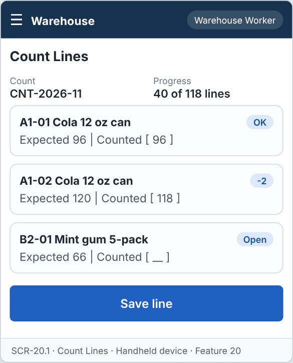
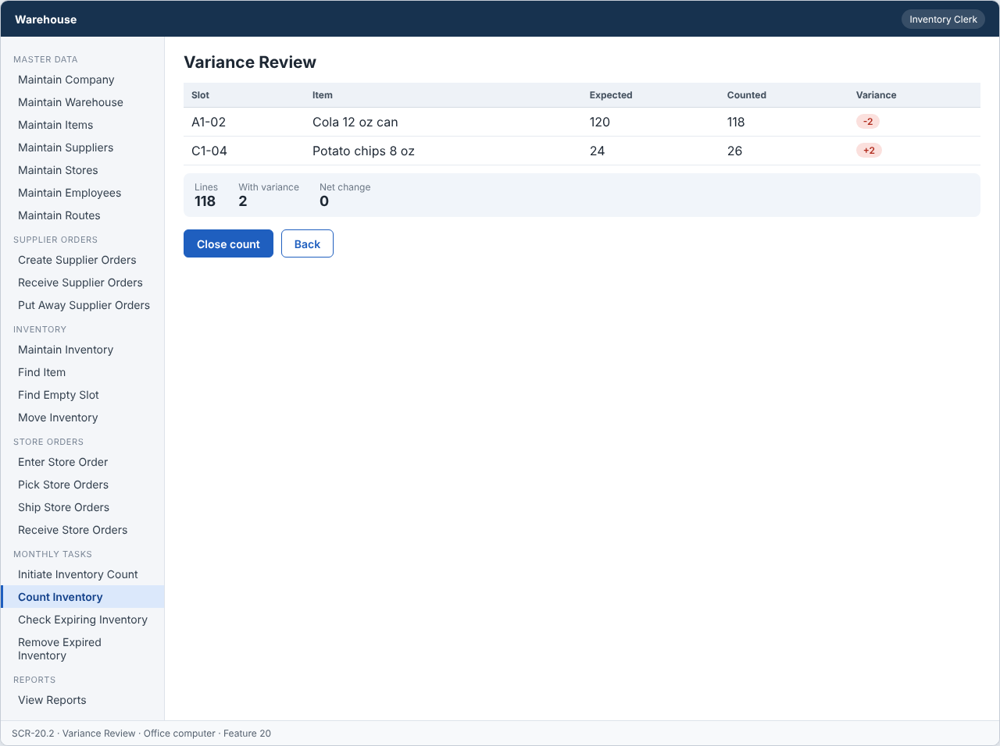
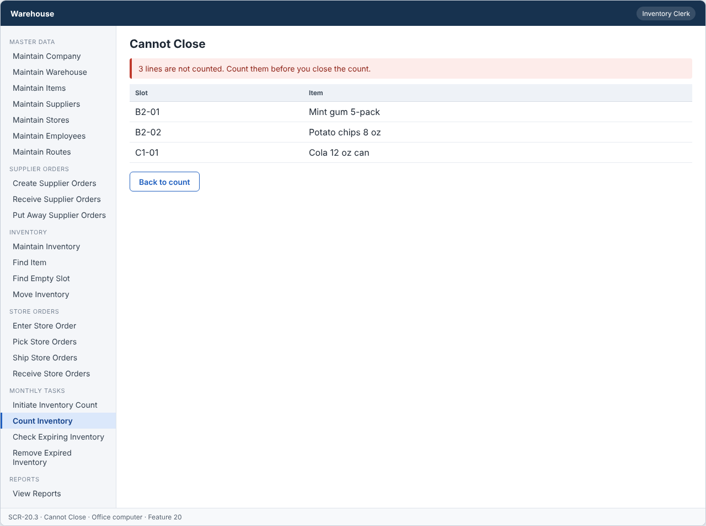

# Feature: Count Inventory

**Feature ID:** 20
**Branch pattern:** `feature/20-count-inventory`
**Status:** Draft
**Created:** 2026-09-28
**Input:** Count inventory in each slot, find differences, and update inventory.
**Depends on:** [Feature 19 — Initiate Inventory Count](feature-19-initiate-inventory-count.md)

---

## User Stories

### US-20.1: Enter counted quantity

**As a** warehouse worker
**I want to** enter the quantity I counted in each slot
**So that** the real stock is recorded.
**Priority:** P3
**Independent test:** Enter counted quantities and verify they are saved.
**Acceptance Scenarios:** see ### US-20.1 under Gherkin AC

### US-20.2: Calculate variance

**As an** inventory clerk
**I want to** see the difference between counted and expected quantity
**So that** I can find stock problems.
**Priority:** P3
**Independent test:** Enter counts and verify variance is calculated. 
**Acceptance Scenarios:** see ### US-20.2 under Gherkin AC

### US-20.3: Close count

**As an** inventory clerk
**I want to** close the count
**So that** inventory matches what was counted.
**Priority:** P3
**Independent test:** Close a counted count and verify inventory is updated.
**Acceptance Scenarios:** see ### US-20.3 under Gherkin AC

---

## Functional Requirements

- **FR-001:** The system MUST list the count lines of an open count.
- **FR-002:** The system MUST allow a counted quantity of zero or greater.
- **FR-003:** The system MUST calculate variance as counted quantity minus expected quantity.
- **FR-004:** The system MUST set the count to Counted when all lines are entered.
- **FR-005:** The system MUST update inventory to the counted quantities when the count is closed.
- **FR-006:** The system MUST NOT close a count that has uncounted lines.
- **FR-007:** The system MUST let a warehouse worker, an inventory clerk, and a manager use this feature (main user: warehouse worker), and MUST NOT let other roles change its information.
- **FR-008:** The system MUST be easy to use on the warehouse floor, on a handheld device or a tablet.
- **FR-009:** This task is done every month, so the system MUST show it as a task to do when it is due or open.

---

## Assumptions

- **A-1:** Warehouse workers enter the counted quantity of each line. Inventory clerks and managers can enter counts and close the count.
- **A-2:** Counted quantity is a whole number of 0 or more (FR-002). Variance = counted − expected (FR-003).
- **A-3:** The count becomes Counted when every line has a counted quantity (FR-004). A line can be changed until the count is closed.
- **A-4:** Closing a count is done by an inventory clerk or a manager (assumption: the person who checks the variances is not the one who counted). Closing updates inventory to the counted quantities (FR-005) and sets the count to Closed.
- **A-5:** A slot with counted quantity 0 becomes Empty. A line with a variance of 0 changes nothing.
- **A-6:** Each inventory change from a close writes a change entry with the reason "Inventory count" and the count number (ADR-005).
- **A-7:** Warehouse workers use a handheld or a tablet, and the clerk uses an office computer.

---

## Edge Cases

| ID | Situation | Expected behavior | Related |
|---|---|---|---|
| EC-1 | The worker enters a negative number or a decimal. | The system rejects the value (FR-002). | FR-002 |
| EC-2 | The worker enters a counted quantity of 0. | The system accepts it. The variance is the negative of the expected quantity. | FR-002, FR-003 |
| EC-3 | The clerk tries to close a count with an uncounted line. | The system rejects the close and lists the lines that are not counted (FR-006). | FR-006 |
| EC-4 | The count is Closed and a worker tries to change a line. | The system rejects the change (WRONG_STATUS). | FR-001 |
| EC-5 | Stock moved between slots after the count started. | The expected quantity stays as at the start. The variance shows both slots, and the clerk decides when closing. | FR-003, FR-005 |
| EC-6 | Two workers count the same line. | The last saved value wins. The first value is kept in the audit log. Each save needs the current version. | FR-002 |
| EC-7 | A closing update fails for one record. | The whole close is rolled back. The count stays Counted, and no inventory changes. | FR-005 |
| EC-8 | A worker closes the count (not allowed). | The server answers FORBIDDEN_ROLE. | FR-007 |
| EC-9 | All variances are 0. | The count can still be closed. Inventory does not change. | FR-005 |

---

## Success Criteria

- **SC-1:** A worker enters a counted quantity in under 15 seconds per line.
- **SC-2:** Variance equals counted minus expected in 100% of lines.
- **SC-3:** A count with an uncounted line is never closed (0 cases in testing).
- **SC-4:** After closing, quantity on hand equals counted quantity for 100% of lines.
- **SC-5:** All 9 Gherkin scenarios in this file pass as automated tests, and each user story's independent test is shown to work in a demo.

---

## Key Entities

- **Inventory Count** — Count being worked.
- **Count Line** — Slot being counted.
- **Inventory** — Stock updated when the count is closed.

---

## Initial Data Model

### Inventory Count

- count_id: String — Required, unique
- warehouse_id: Warehouse reference — Required
- start_date: Date — Required
- status: String/Enum — Open, Counted, Closed

### Count Line

- count_line_id: String — Required, unique
- count_id: Inventory Count reference — Required
- slot_id: Slot reference — Required
- item_id: Item reference — Required
- expected_quantity: Integer — Required, zero or greater
- counted_quantity: Integer — Required to close, zero or greater
- variance: Integer — Counted minus expected
- counted_by: Employee reference — Required when counted

---

## Gherkin AC

### US-20.1 — Enter counted quantity

#### Scenario: Quantity is saved

- **Given** an open count has a count line
- **When** the worker enters a counted quantity
- **Then** the system saves the counted quantity

#### Scenario: Negative quantity

- **Given** the worker enters a negative counted quantity
- **When** the worker tries to save
- **Then** the system rejects the quantity

#### Scenario: Wrong role cannot change information

- **Given** a driver is signed in
- **When** the driver tries to change information in this feature
- **Then** the system rejects the change

#### Scenario: Monthly task is shown when due

- **Given** the monthly task is due or open
- **When** the user opens the system
- **Then** the system shows the task to do

### US-20.2 — Calculate variance

#### Scenario: Count matches

- **Given** a count line expects 10 units
- **When** the worker enters 10
- **Then** the variance is 0

#### Scenario: Count is lower

- **Given** a count line expects 10 units
- **When** the worker enters 8
- **Then** the variance is -2

#### Scenario: All lines counted

- **Given** every count line has a counted quantity
- **When** the last line is saved
- **Then** the system sets the count to Counted

### US-20.3 — Close count

#### Scenario: Count is closed

- **Given** a count has status Counted
- **When** the clerk closes the count
- **Then** the system updates inventory to the counted quantities
- **And** the system sets the count to Closed

#### Scenario: Count is not finished

- **Given** a count line has no counted quantity
- **When** the clerk tries to close the count
- **Then** the system rejects the request

---

## Data Ownership

| Data | Owner | This feature | Notes |
|---|---|---|---|
| Count Line | [Feature 19 — Initiate Inventory Count](feature-19-initiate-inventory-count.md) | Updates (via owner) | Calls Feature 19's `recordCount(lineId, counted, version)`. |
| Inventory Count | [Feature 19 — Initiate Inventory Count](feature-19-initiate-inventory-count.md) | Updates (via owner) | Calls Feature 19's `setStatus(countId, Counted \| Closed)`. |
| Inventory Record | [Feature 9 — Maintain Inventory](feature-9-maintain-inventory.md) | Updates (via owner) | Calls Feature 9's `adjust(...)` when the count is closed. |
| Audit Log Entry | Platform (cross-cutting) | Updates (via owner) | Writes one entry for each counted line and for the close. |

**Rule:** each piece of data has one owning feature. A feature that needs to change data it does not own must call the owner's service, and must never write the owner's tables directly (ADR-004).

Feature 20 owns no data table. It is the working screen and rules for counts that Feature 19 owns.

---

## API Requirements

Base path: `/api/v1`. All endpoints follow [ADR-003](../docs/ADRs/ADR-003-rest-api-conventions.md) (JSON, problem+json errors, `version` field for optimistic locking). Roles are checked on the server for every call ([NFR-S2](../docs/NFR.md)).

| # | Method and path | Purpose | Allowed roles | Success | Errors | Supports |
|---|---|---|---|---|---|---|
| 1 | `GET /inventory-counts/{countId}/lines` | List count lines. Query: `onlyUncounted`, `onlyVariance`. | Inventory Clerk, Warehouse Worker, Manager | 200 | 404 NOT_FOUND | US-20.1 |
| 2 | `PUT /count-lines/{countLineId}` | Enter the counted quantity of a line. The body must include `version`. | Inventory Clerk, Warehouse Worker, Manager | 200 | 400 VALIDATION_FAILED, 404 NOT_FOUND, 409 VERSION_CONFLICT, 409 WRONG_STATUS | US-20.1, US-20.2 |
| 3 | `GET /inventory-counts/{countId}/variances` | List lines with a variance, with totals. | Inventory Clerk, Warehouse Worker, Manager | 200 | 404 NOT_FOUND | US-20.2 |
| 4 | `POST /inventory-counts/{countId}/close` | Close the count and update inventory to the counted quantities. | Inventory Clerk, Manager | 200 | 404 NOT_FOUND, 409 LINES_NOT_COUNTED, 409 WRONG_STATUS | US-20.3 |

**Request and response notes**

- PUT body: `counted_quantity`, `version`. The server sets `variance` and `counted_by`.

**Calls to other features (internal service calls, not public endpoints)**

- Feature 19: `recordCount(...)`, `setStatus(...)`.
- Feature 9: `adjust(...)` for each line with a variance.

---

## Screen Requirements

The screen images are in [docs/UI](../docs/UI/README.md). Each image is a wireframe: it shows layout and content, not final colors.

| Screen | Name | Device | Purpose | Image | Stories |
|---|---|---|---|---|---|
| SCR-20.1 | Count Lines | Handheld device | Walk through the slots and enter what you count. | [image](../docs/UI/images/scr-20-1-count-lines.png) | US-20.1 |
| SCR-20.2 | Variance Review | Office computer | Review differences before closing. | [image](../docs/UI/images/scr-20-2-variance-review.png) | US-20.2, US-20.3 |
| SCR-20.3 | Cannot Close | Office computer | Stop closing when lines are not counted. | [image](../docs/UI/images/scr-20-3-cannot-close.png) | US-20.3 |

### SCR-20.1 — Count Lines

**Device:** Handheld device. **Purpose:** Walk through the slots and enter what you count.

- Details shown: Count, Progress.
- List of cards: A1-01  Cola 12 oz can; A1-02  Cola 12 oz can; B2-01  Mint gum 5-pack.
- Buttons: Save line.

### SCR-20.2 — Variance Review

**Device:** Office computer. **Purpose:** Review differences before closing.

- Table with columns: Slot, Item, Expected, Counted, Variance.
- Totals: Lines, With variance, Net change.
- Buttons: Close count, Back.

### SCR-20.3 — Cannot Close

**Device:** Office computer. **Purpose:** Stop closing when lines are not counted.

- Message (error): 3 lines are not counted. Count them before you close the count.
- Table with columns: Slot, Item.
- Buttons: Back to count.

---

## Definition of Done

This feature is done when all of these are true:

- [ ] All 3 user stories are built, and each story's independent test passes.
- [ ] All 9 functional requirements are built, and each one is covered by a Gherkin scenario, a unit test, or an NFR check.
- [ ] All 9 Gherkin scenarios are automated and pass in the build.
- [ ] The 4 API endpoints match the API Requirements table, are in the OpenAPI file, and have tests for success and for every listed error.
- [ ] The role rules are enforced on the server for every endpoint, with a test for a role that is not allowed.
- [ ] The screens (SCR-20.1, SCR-20.2, SCR-20.3) match the images in `docs/UI`, and were checked on: handheld device, office computer.
- [ ] Validation messages show next to the field, and what the user typed stays on the screen after an error.
- [ ] Database changes (tables, keys, unique rules, not-null rules, checks) are in a migration script and match the Initial Data Model.
- [ ] Every create, edit, delete, and status change writes an audit log entry (who, when, what changed).
- [ ] A failure test shows that when one adjustment fails during close, the count stays Counted and no inventory changes.
- [ ] These non-functional checks pass (see [NFR](../docs/NFR.md)): NFR-U2, NFR-U7, NFR-U9, NFR-P1, NFR-S1, NFR-S2, NFR-S4, NFR-D1, NFR-D2, NFR-D3, NFR-A1, NFR-A2, NFR-M1.
- [ ] The code is reviewed in a pull request and merged into `main` with no open critical bugs.
- [ ] This feature file, the UI images, and the API table are updated if anything changed during the build.

---

## Out of Scope

- Recounts with a second counter, or approval levels for large variances.
- Cost value of variances.
- Printing count sheets on paper.
- Counting items that are not in a slot (for example items on the dock).
