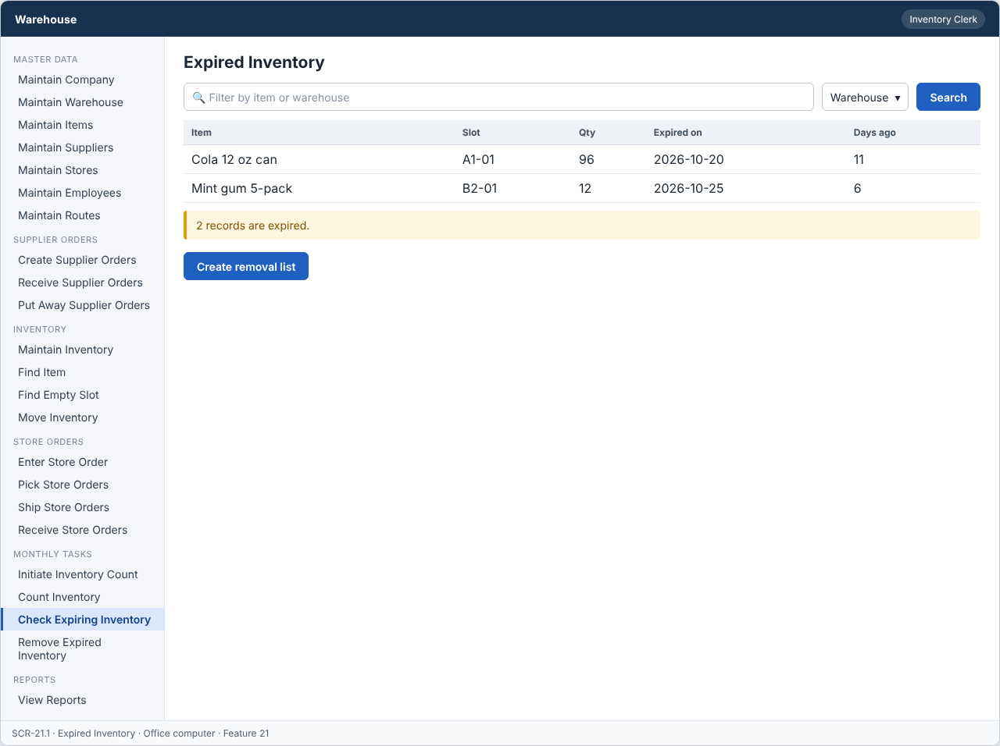
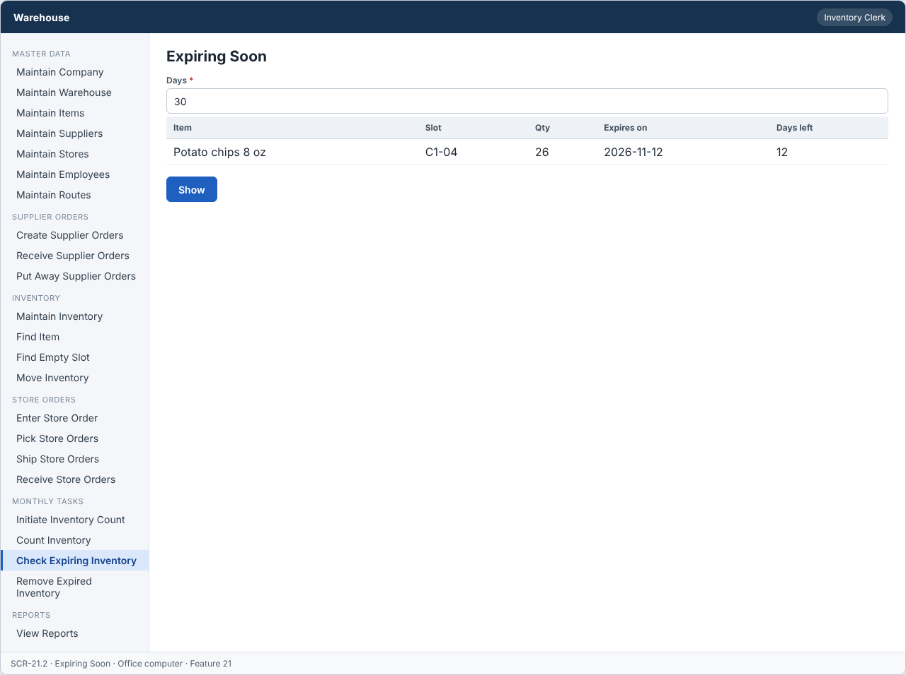
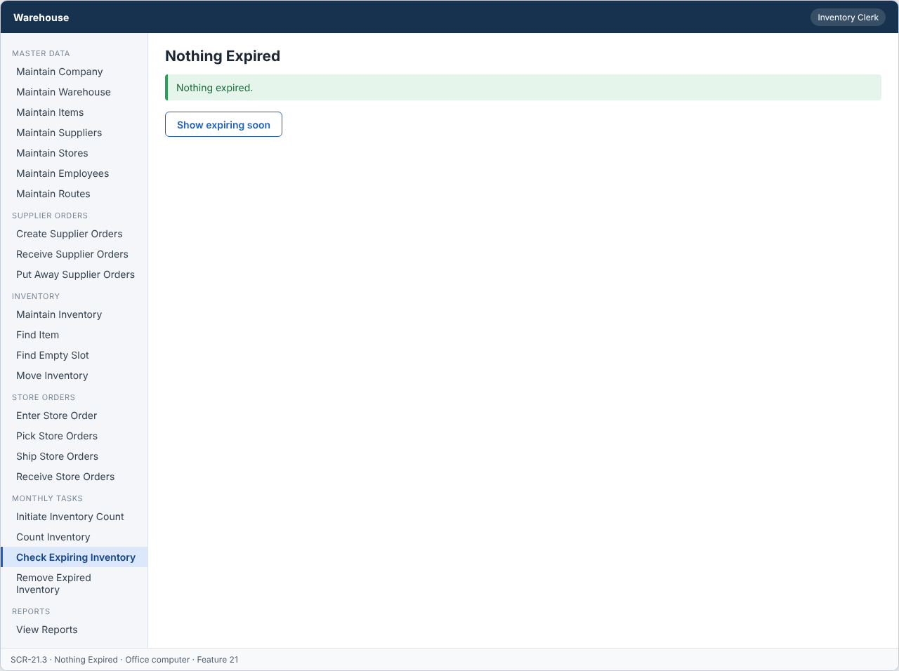

# Feature: Initial Check for Exp Inventory

**Feature ID:** 21
**Branch pattern:** `feature/21-initial-check-for-exp-inventory`
**Status:** Draft
**Created:** 2026-09-28
**Input:** Check inventory for expired and soon-to-expire items and create a removal list.
**Depends on:** [Feature 9 — Maintain Inventory](feature-9-maintain-inventory.md)

---

## User Stories

### US-21.1: Find expired inventory

**As an** inventory clerk
**I want to** find inventory that is already expired
**So that** it can be removed.
**Priority:** P3
**Independent test:** Run the check and verify expired inventory is listed. 
**Acceptance Scenarios:** see ### US-21.1 under Gherkin AC

### US-21.2: Find inventory expiring soon

**As an** inventory clerk
**I want to** find inventory that expires soon
**So that** we can sell it first.
**Priority:** P3
**Independent test:** Run the check with a 30 day window and verify soon-to-expire items are listed.
**Acceptance Scenarios:** see ### US-21.2 under Gherkin AC

### US-21.3: Create removal list

**As an** inventory clerk
**I want to** create a removal list of expired inventory
**So that** warehouse workers know what to remove.
**Priority:** P3
**Independent test:** Create a removal list and verify it contains the expired inventory. 
**Acceptance Scenarios:** see ### US-21.3 under Gherkin AC

---

## Functional Requirements

- **FR-001:** The system MUST find inventory with an expiration date before today.
- **FR-002:** The system MUST find inventory expiring within a set number of days (default 30).
- **FR-003:** The system MUST show item, slot, quantity, and expiration date.
- **FR-004:** The system MUST create a removal list of expired inventory.
- **FR-005:** The system MUST show Nothing expired when no inventory is expired.
- **FR-006:** The system MUST let an inventory clerk and a manager use this feature (main user: inventory clerk), and MUST NOT let other roles change its information.
- **FR-007:** The system MUST work on an office computer.
- **FR-008:** This task is done every month, so the system MUST show it as a task to do when it is due or open.

---

## Assumptions

- **A-1:** An inventory record is expired when its `expiration_date` is before today. It is expiring soon when the date is today or later, and within the set number of days (default 30, FR-002).
- **A-2:** The number of days is set on the screen by the clerk (1 to 365). The system remembers the last value for the user.
- **A-3:** Records with quantity 0, inactive records, and records without an expiration date are ignored.
- **A-4:** The list shows item, slot, quantity, and expiration date (FR-003), sorted by the oldest expiration date first.
- **A-5:** A removal list contains the expired records only (FR-004). Records that are expiring soon are shown for planning and are not added.
- **A-6:** A record can be on only one open removal list. The check can be repeated: it adds new expired records to a new list only if there are some that are not on an open list.
- **A-7:** The monthly task shows as due on the first day of the month if no removal list was created in that month (FR-008, ADR-009).
- **A-8:** Inventory clerks and managers use this feature on an office computer.

---

## Edge Cases

| ID | Situation | Expected behavior | Related |
|---|---|---|---|
| EC-1 | No inventory is expired. | The screen shows "Nothing expired" (FR-005), and no removal list is created. | FR-005 |
| EC-2 | A record expires today. | It counts as expiring soon (today or later), not as expired. It is expired from tomorrow. | FR-001, FR-002 |
| EC-3 | A record has no expiration date. | It is not listed. | FR-001, FR-002 |
| EC-4 | The days value is 0, negative, or above 365. | The system rejects the value and keeps the last valid one. | FR-002 |
| EC-5 | All expired records are already on an open removal list. | The system does not create another list and shows the existing list. | FR-004 |
| EC-6 | An expired record is on a Picked order's reservation. | The reservation is kept, but the pick line is flagged. The manager sees it. Expired stock is never shipped without a decision (the clerk cancels the pick line and picks again). | FR-001 |
| EC-7 | Two clerks press Create removal list at the same time. | Only one list is created. The second request gets the existing list. | FR-004 |
| EC-8 | A clerk (not clerk or manager) calls the endpoint. | The server answers FORBIDDEN_ROLE. | FR-006 |

---

## Success Criteria

- **SC-1:** The expired and expiring lists open in under 2 seconds for 20,000 inventory records.
- **SC-2:** 100% of records with an expiration date before today are in the expired list, and none that are not expired (tested with 100 sample records).
- **SC-3:** A removal list is created in 2 clicks from the expired list.
- **SC-4:** No record is on two open removal lists (0 cases in testing).
- **SC-5:** All 6 Gherkin scenarios in this file pass as automated tests, and each user story's independent test is shown to work in a demo.

---

## Key Entities

- **Inventory** — Stock with an expiration date.
- **Removal List** — List of expired inventory to be removed.
- **Removal Line** — One inventory record to remove.

---

## Initial Data Model

### Removal List

- removal_id: String — Required, unique
- created_date: Date — Required
- created_by: Employee reference — Required
- status: String/Enum — Open, Completed

### Removal Line

- removal_line_id: String — Required, unique
- removal_id: Removal List reference — Required
- inventory_id: Inventory reference — Required
- quantity: Integer — Required, greater than zero
- quantity_removed: Integer — Zero or greater

---

## Gherkin AC

### US-21.1 — Find expired inventory

#### Scenario: Expired inventory is found

- **Given** a slot holds an item that expired yesterday
- **When** the clerk runs the expiration check
- **Then** the system lists the item with slot, quantity, and expiration date

#### Scenario: Nothing is expired

- **Given** no inventory is expired
- **When** the clerk runs the expiration check
- **Then** the system displays Nothing expired

#### Scenario: Wrong role cannot change information

- **Given** a driver is signed in
- **When** the driver tries to change information in this feature
- **Then** the system rejects the change

#### Scenario: Monthly task is shown when due

- **Given** the monthly task is due or open
- **When** the user opens the system
- **Then** the system shows the task to do

### US-21.2 — Find inventory expiring soon

#### Scenario: Expiring soon is found

- **Given** an item expires in 10 days
- **When** the clerk runs the check with a 30 day window
- **Then** the system shows the item as Expiring soon

### US-21.3 — Create removal list

#### Scenario: Removal list is created

- **Given** expired inventory exists
- **When** the clerk creates the removal list
- **Then** the system saves a removal list with status Open
- **And** the list contains each expired inventory record

---

## Data Ownership

| Data | Owner | This feature | Notes |
|---|---|---|---|
| Removal List | This feature (Feature 21) | Owns | Creates the removal list and keeps its status (Open, Completed). |
| Removal Line | This feature (Feature 21) | Owns | One line per expired inventory record (quantity to remove). |
| Inventory Record | [Feature 9 — Maintain Inventory](feature-9-maintain-inventory.md) | Reads | Expiration date, slot, quantity. |
| Audit Log Entry | Platform (cross-cutting) | Updates (via owner) | Writes one entry when a removal list is created. |

**Rule:** each piece of data has one owning feature. A feature that needs to change data it does not own must call the owner's service, and must never write the owner's tables directly (ADR-004).

---

## API Requirements

Base path: `/api/v1`. All endpoints follow [ADR-003](../docs/ADRs/ADR-003-rest-api-conventions.md) (JSON, problem+json errors, `version` field for optimistic locking). Roles are checked on the server for every call ([NFR-S2](../docs/NFR.md)).

| # | Method and path | Purpose | Allowed roles | Success | Errors | Supports |
|---|---|---|---|---|---|---|
| 1 | `GET /expiring-inventory/expired` | List expired inventory. Query: `warehouseId`. | Inventory Clerk, Manager | 200 | — | US-21.1 |
| 2 | `GET /expiring-inventory/soon` | List inventory that expires within `days` (default 30). Query: `days`, `warehouseId`. | Inventory Clerk, Manager | 200 | 400 VALIDATION_FAILED (days) | US-21.2 |
| 3 | `POST /removal-lists` | Create a removal list from expired inventory not already on an open list. | Inventory Clerk, Manager | 201 + Location | 409 NOTHING_EXPIRED | US-21.3 |
| 4 | `GET /removal-lists` | List removal lists. Query: `status`. | Inventory Clerk, Warehouse Worker, Manager | 200 | — | US-21.3 |
| 5 | `GET /removal-lists/{removalListId}` | Get one removal list with its lines. | Inventory Clerk, Warehouse Worker, Manager | 200 | 404 NOT_FOUND | US-21.3 |

**Request and response notes**

- Inventory rows: `inventory_record_id`, `item`, `slot`, `quantity_on_hand`, `expiration_date`, `days_to_expiry` (negative when expired).

**Calls to other features (internal service calls, not public endpoints)**

- Feature 9: `findByExpiration(before, within)`.
- Feature 22 calls this feature's `recordRemoval(...)` and `setStatus(...)`.

---

## Screen Requirements

The screen images are in [docs/UI](../docs/UI/README.md). Each image is a wireframe: it shows layout and content, not final colors.

| Screen | Name | Device | Purpose | Image | Stories |
|---|---|---|---|---|---|
| SCR-21.1 | Expired Inventory | Office computer | Find expired stock and create a removal list. | [image](../docs/UI/images/scr-21-1-expired-inventory.png) | US-21.1, US-21.3 |
| SCR-21.2 | Expiring Soon | Office computer | Plan for stock that expires within a number of days. | [image](../docs/UI/images/scr-21-2-expiring-soon.png) | US-21.2 |
| SCR-21.3 | Nothing Expired | Office computer | Tell the clerk that no inventory is expired. | [image](../docs/UI/images/scr-21-3-nothing-expired.png) | US-21.1 |

### SCR-21.1 — Expired Inventory

**Device:** Office computer. **Purpose:** Find expired stock and create a removal list.

- Search box (Filter by item or warehouse) and filters (Warehouse).
- Table with columns: Item, Slot, Qty, Expired on, Days ago.
- Message (warn): 2 records are expired.
- Buttons: Create removal list.

### SCR-21.2 — Expiring Soon

**Device:** Office computer. **Purpose:** Plan for stock that expires within a number of days.

- Fields: Days (required).
- Table with columns: Item, Slot, Qty, Expires on, Days left.
- Buttons: Show.

### SCR-21.3 — Nothing Expired

**Device:** Office computer. **Purpose:** Tell the clerk that no inventory is expired.

- Message (ok): Nothing expired.
- Buttons: Show expiring soon.

---

## Definition of Done

This feature is done when all of these are true:

- [ ] All 3 user stories are built, and each story's independent test passes.
- [ ] All 8 functional requirements are built, and each one is covered by a Gherkin scenario, a unit test, or an NFR check.
- [ ] All 6 Gherkin scenarios are automated and pass in the build.
- [ ] The 5 API endpoints match the API Requirements table, are in the OpenAPI file, and have tests for success and for every listed error.
- [ ] The role rules are enforced on the server for every endpoint, with a test for a role that is not allowed.
- [ ] The screens (SCR-21.1, SCR-21.2, SCR-21.3) match the images in `docs/UI`, and were checked on: office computer.
- [ ] Validation messages show next to the field, and what the user typed stays on the screen after an error.
- [ ] Database changes (tables, keys, unique rules, not-null rules, checks) are in a migration script and match the Initial Data Model.
- [ ] Every create, edit, delete, and status change writes an audit log entry (who, when, what changed).
- [ ] A date-boundary test covers: expires yesterday, today, tomorrow, 30 days from now, and 31 days from now.
- [ ] These non-functional checks pass (see [NFR](../docs/NFR.md)): NFR-U1, NFR-U7, NFR-U9, NFR-P1, NFR-S1, NFR-S2, NFR-S4, NFR-D1, NFR-A1, NFR-M1.
- [ ] The code is reviewed in a pull request and merged into `main` with no open critical bugs.
- [ ] This feature file, the UI images, and the API table are updated if anything changed during the build.

---

## Out of Scope

- Selling expiring stock at a discount or sending it back to the supplier.
- E-mail alerts when stock is about to expire.
- Expiration dates for items without a shelf life.
- Removing the stock itself (Feature 22).
