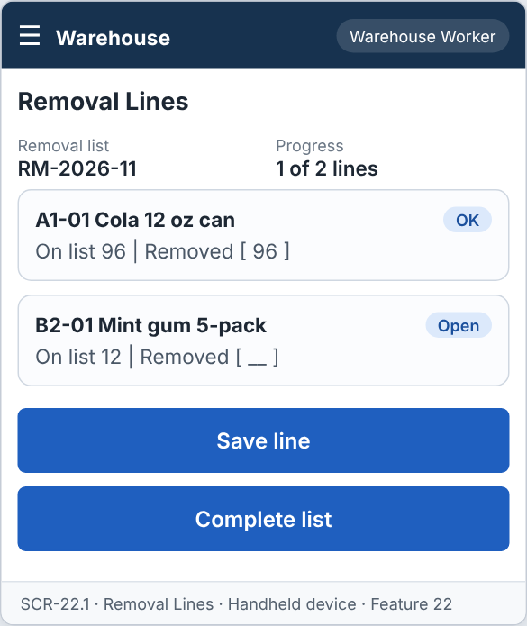
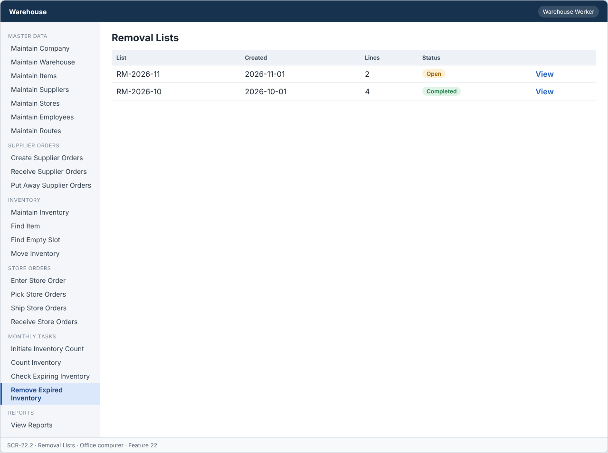
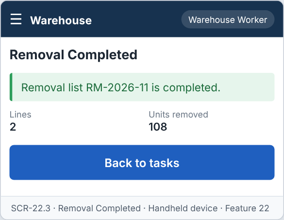

# Feature: Remove Expired Inventory

**Feature ID:** 22
**Branch pattern:** `feature/22-remove-expired-inventory`
**Status:** Draft
**Created:** 2026-09-28
**Input:** Remove expired inventory from the warehouse and update inventory.
**Depends on:** [Feature 21 — Initial Check for Exp Inventory](feature-21-initial-check-for-exp-inventory.md)

---

## User Stories

### US-22.1: Remove expired items

**As a** warehouse worker
**I want to** remove expired items from their slots
**So that** expired products are not shipped.
**Priority:** P3
**Independent test:** Remove expired items and verify inventory is reduced. 
**Acceptance Scenarios:** see ### US-22.1 under Gherkin AC

### US-22.2: Complete removal list

**As an** inventory clerk
**I want to** see when every expired item is removed
**So that** the list can be closed.
**Priority:** P3
**Independent test:** Remove all lines and verify the list is Completed. 
**Acceptance Scenarios:** see ### US-22.2 under Gherkin AC

---

## Functional Requirements

- **FR-001:** The system MUST list the lines of an open removal list.
- **FR-002:** The system MUST record the quantity removed for each line.
- **FR-003:** The system MUST NOT allow quantity removed to be more than the quantity on the list.
- **FR-004:** The system MUST reduce inventory by the quantity removed.
- **FR-005:** The system MUST set a slot to Empty when its quantity reaches zero.
- **FR-006:** The system MUST set the removal list to Completed when all lines are removed.
- **FR-007:** The system MUST let a warehouse worker, an inventory clerk, and a manager use this feature (main user: warehouse worker), and MUST NOT let other roles change its information.
- **FR-008:** The system MUST be easy to use on the warehouse floor, on a handheld device or a tablet.
- **FR-009:** This task is done every month, so the system MUST show it as a task to do when it is due or open.

---

## Assumptions

- **A-1:** A removal list is created by Feature 21. Its status is Open → Completed.
- **A-2:** The worker takes the stock out of the slot, then enters the quantity removed for each line (FR-002). The quantity cannot be more than the quantity on the list (FR-003). A smaller quantity is allowed (the rest was not found or is not expired).
- **A-3:** Removing reduces the inventory record by the quantity removed (FR-004). The slot becomes Empty when the quantity reaches 0 (FR-005).
- **A-4:** The list becomes Completed when every line has a quantity removed (FR-006). A line with 0 removed counts as handled, and needs a note.
- **A-5:** Each reduction writes an inventory change entry with the reason "Expired, removal list <number>" (ADR-005).
- **A-6:** Warehouse workers, inventory clerks, and managers use this feature on a handheld, tablet, or office computer.

---

## Edge Cases

| ID | Situation | Expected behavior | Related |
|---|---|---|---|
| EC-1 | The quantity removed is more than the quantity on the list. | The system rejects it (FR-003). | FR-003 |
| EC-2 | The quantity removed is 0 and there is no note. | The system rejects it. A note is required for a line that is not removed. | FR-002 |
| EC-3 | The inventory record changed after the list was made (a pick, a move, or a count). | The system checks against the current quantity. If it is lower than the list quantity, the maximum is the current quantity. | FR-003, FR-004 |
| EC-4 | The worker saves the same line twice. | The second save is rejected because the line is already handled. | FR-002 |
| EC-5 | The reduction fails in the database. | Nothing is saved for that line, and the worker sees an error. Other lines are not affected. | FR-004 |
| EC-6 | The slot reaches 0 on removal. | The slot becomes Empty in the same transaction (FR-005). | FR-005 |
| EC-7 | The list is Completed and a worker tries to change a line. | The system rejects the change (WRONG_STATUS). | FR-006 |
| EC-8 | All lines are removed. | The list is set to Completed at once, and disappears from the monthly tasks. | FR-006, FR-009 |

---

## Success Criteria

- **SC-1:** A worker records a removal in under 20 seconds per line.
- **SC-2:** Inventory is reduced by exactly the quantity removed in 100% of lines.
- **SC-3:** No quantity above the list quantity is ever saved (0 cases in testing).
- **SC-4:** A list with all lines handled is Completed in 100% of tests.
- **SC-5:** All 6 Gherkin scenarios in this file pass as automated tests, and each user story's independent test is shown to work in a demo.

---

## Key Entities

- **Removal List** — List being worked.
- **Removal Line** — Inventory record being removed.
- **Inventory** — Stock reduced by the removal.
- **Slot** — Location that may become Empty.

---

## Initial Data Model

### Removal List

- removal_id: String — Required, unique
- created_date: Date — Required
- status: String/Enum — Open, Completed

### Removal Line

- removal_line_id: String — Required, unique
- removal_id: Removal List reference — Required
- inventory_id: Inventory reference — Required
- quantity: Integer — Required, greater than zero
- quantity_removed: Integer — Zero or greater, not more than quantity
- removed_by: Employee reference — Required when removed
- removed_date: Date — Required when removed

---

## Gherkin AC

### US-22.1 — Remove expired items

#### Scenario: Expired items are removed

- **Given** a slot holds 5 expired units on the removal list
- **When** the worker confirms 5 units removed
- **Then** the system reduces inventory to 0
- **And** the slot status is Empty

#### Scenario: Partial removal

- **Given** 5 expired units are on the list
- **When** the worker confirms 3 units removed
- **Then** 2 units stay on the removal list

#### Scenario: Wrong role cannot change information

- **Given** a driver is signed in
- **When** the driver tries to change information in this feature
- **Then** the system rejects the change

#### Scenario: Monthly task is shown when due

- **Given** the monthly task is due or open
- **When** the user opens the system
- **Then** the system shows the task to do

### US-22.2 — Complete removal list

#### Scenario: List is completed

- **Given** all removal lines are removed
- **When** the last line is confirmed
- **Then** the system sets the removal list to Completed

#### Scenario: Too many removed

- **Given** 5 units are on the list
- **When** the worker enters 6 removed
- **Then** the system rejects the quantity

---

## Data Ownership

| Data | Owner | This feature | Notes |
|---|---|---|---|
| Removal Line | [Feature 21 — Initial Check for Exp Inventory](feature-21-initial-check-for-exp-inventory.md) | Updates (via owner) | Calls Feature 21's `recordRemoval(lineId, quantity, note)`. |
| Removal List | [Feature 21 — Initial Check for Exp Inventory](feature-21-initial-check-for-exp-inventory.md) | Updates (via owner) | Calls Feature 21's `setStatus(listId, Completed)`. |
| Inventory Record | [Feature 9 — Maintain Inventory](feature-9-maintain-inventory.md) | Updates (via owner) | Calls Feature 9's `adjust(...)` to reduce quantity and update the slot. |
| Audit Log Entry | Platform (cross-cutting) | Updates (via owner) | Writes one entry for each removed line. |

**Rule:** each piece of data has one owning feature. A feature that needs to change data it does not own must call the owner's service, and must never write the owner's tables directly (ADR-004).

Feature 22 owns no data table. It is the working screen and rules for the removal lists that Feature 21 owns.

---

## API Requirements

Base path: `/api/v1`. All endpoints follow [ADR-003](../docs/ADRs/ADR-003-rest-api-conventions.md) (JSON, problem+json errors, `version` field for optimistic locking). Roles are checked on the server for every call ([NFR-S2](../docs/NFR.md)).

| # | Method and path | Purpose | Allowed roles | Success | Errors | Supports |
|---|---|---|---|---|---|---|
| 1 | `GET /removal-lists/{removalListId}/lines` | List the lines of an open removal list, sorted by aisle. | Inventory Clerk, Warehouse Worker, Manager | 200 | 404 NOT_FOUND | US-22.1 |
| 2 | `PUT /removal-lines/{removalLineId}` | Record the quantity removed (and a note when 0). The body must include `version`. | Inventory Clerk, Warehouse Worker, Manager | 200 | 400 VALIDATION_FAILED, 404 NOT_FOUND, 409 QUANTITY_EXCEEDS_LIST, 409 VERSION_CONFLICT, 409 WRONG_STATUS | US-22.1 |
| 3 | `POST /removal-lists/{removalListId}/complete` | Complete the list when every line is handled. | Inventory Clerk, Warehouse Worker, Manager | 200 | 409 LINES_NOT_HANDLED, 409 WRONG_STATUS | US-22.2 |

**Request and response notes**

- PUT body: `quantity_removed`, `note`, `version`.

**Calls to other features (internal service calls, not public endpoints)**

- Feature 21: `recordRemoval(...)`, `setStatus(...)`.
- Feature 9: `adjust(recordId, -quantity, reason, source)`.

---

## Screen Requirements

The screen images are in [docs/UI](../docs/UI/README.md). Each image is a wireframe: it shows layout and content, not final colors.

| Screen | Name | Device | Purpose | Image | Stories |
|---|---|---|---|---|---|
| SCR-22.1 | Removal Lines | Handheld device | Take the expired stock out and record the quantity. | [image](../docs/UI/images/scr-22-1-removal-lines.png) | US-22.1 |
| SCR-22.2 | Removal Lists | Office computer | See open and completed lists. | [image](../docs/UI/images/scr-22-2-removal-lists.png) | US-22.2 |
| SCR-22.3 | Removal Completed | Handheld device | Confirm that the list is done. | [image](../docs/UI/images/scr-22-3-removal-completed.png) | US-22.2 |

### SCR-22.1 — Removal Lines

**Device:** Handheld device. **Purpose:** Take the expired stock out and record the quantity.

- Details shown: Removal list, Progress.
- List of cards: A1-01  Cola 12 oz can; B2-01  Mint gum 5-pack.
- Buttons: Save line, Complete list.
- Complete list is enabled when every line is handled.

### SCR-22.2 — Removal Lists

**Device:** Office computer. **Purpose:** See open and completed lists.

- Table with columns: List, Created, Lines, Status.

### SCR-22.3 — Removal Completed

**Device:** Handheld device. **Purpose:** Confirm that the list is done.

- Message (ok): Removal list RM-2026-11 is completed.
- Details shown: Lines, Units removed.
- Buttons: Back to tasks.

---

## Definition of Done

This feature is done when all of these are true:

- [ ] All 2 user stories are built, and each story's independent test passes.
- [ ] All 9 functional requirements are built, and each one is covered by a Gherkin scenario, a unit test, or an NFR check.
- [ ] All 6 Gherkin scenarios are automated and pass in the build.
- [ ] The 3 API endpoints match the API Requirements table, are in the OpenAPI file, and have tests for success and for every listed error.
- [ ] The role rules are enforced on the server for every endpoint, with a test for a role that is not allowed.
- [ ] The screens (SCR-22.1, SCR-22.2, SCR-22.3) match the images in `docs/UI`, and were checked on: handheld device, office computer.
- [ ] Validation messages show next to the field, and what the user typed stays on the screen after an error.
- [ ] Database changes (tables, keys, unique rules, not-null rules, checks) are in a migration script and match the Initial Data Model.
- [ ] Every create, edit, delete, and status change writes an audit log entry (who, when, what changed).
- [ ] A test shows that removing the last unit of a record sets the slot to Empty in the same transaction.
- [ ] These non-functional checks pass (see [NFR](../docs/NFR.md)): NFR-U2, NFR-U7, NFR-U9, NFR-P1, NFR-S1, NFR-S2, NFR-S4, NFR-D1, NFR-D2, NFR-D3, NFR-A1, NFR-A2, NFR-M1.
- [ ] The code is reviewed in a pull request and merged into `main` with no open critical bugs.
- [ ] This feature file, the UI images, and the API table are updated if anything changed during the build.

---

## Out of Scope

- Disposal records, waste weight, or disposal company paperwork.
- Returning expired goods to the supplier.
- Financial write-off values.
- Photos of the removed goods.
