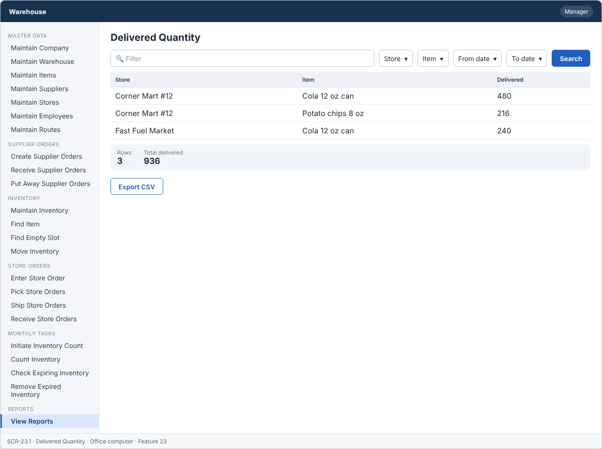
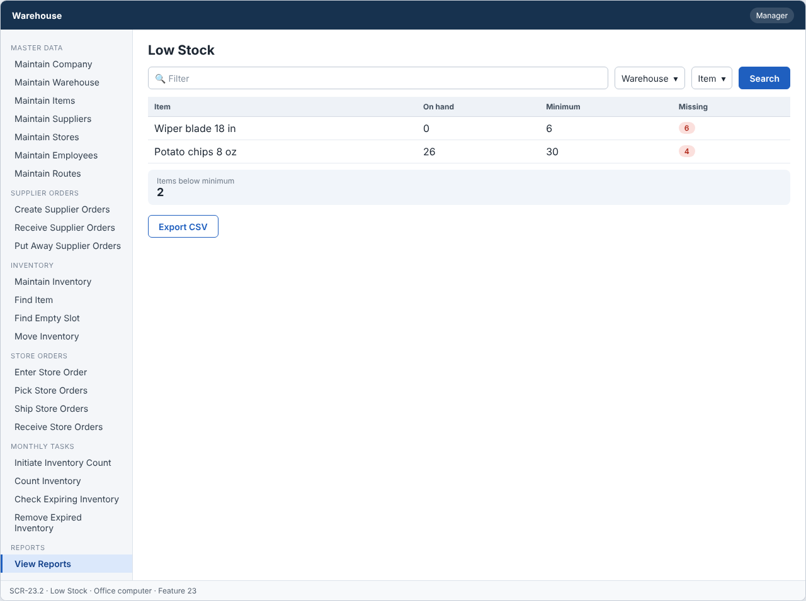
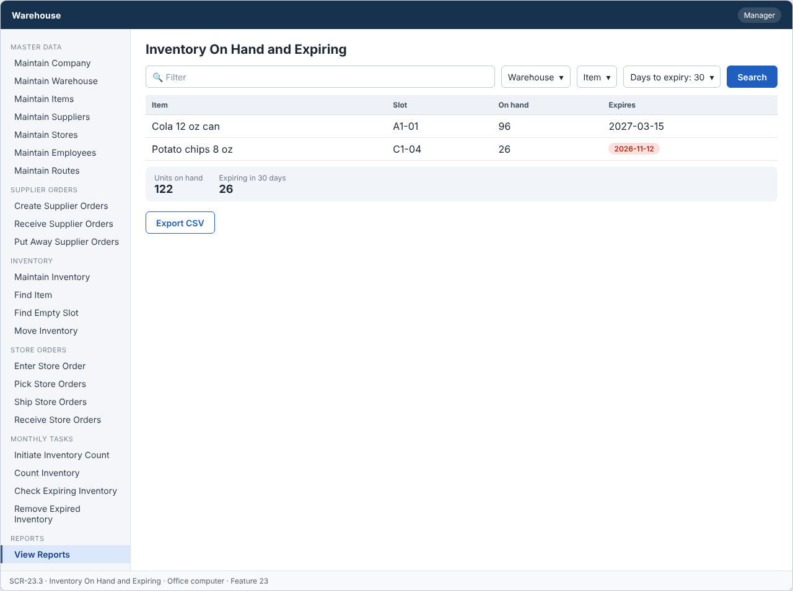
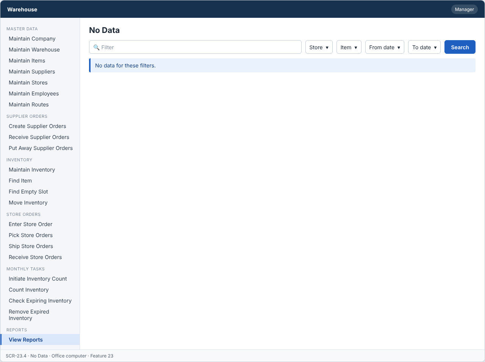

# Feature: View Reports

**Feature ID:** 23
**Branch pattern:** `feature/23-view-reports`
**Status:** Final
**Created:** 2026-09-28
**Input:** View management reports, including delivered quantity and low stock.
**Depends on:** [Feature 12 — Enter Store Order](feature-12-enter-store-order.md); [Feature 18 — Receive Store Orders](feature-18-receive-store-orders.md); [Feature 9 — Maintain Inventory](feature-9-maintain-inventory.md)

---

## User Stories

### US-23.1: View delivered quantity

**As a** manager
**I want to** see the quantity delivered by store and item
**So that** I know what we sold.
**Priority:** P1
**Independent test:** Run the delivered quantity report and verify totals are shown. 
**Acceptance Scenarios:** see ### US-23.1 under Gherkin AC

### US-23.2: View low stock

**As a** manager
**I want to** see items with on hand quantity below the minimum
**So that** I can fix stock problems before stores order.
**Priority:** P1
**Independent test:** Run the low stock report and verify low items are shown. 
**Acceptance Scenarios:** see ### US-23.2 under Gherkin AC

### US-23.3: View inventory and expiring items

**As a** manager
**I want to** see inventory on hand and expiring inventory
**So that** I know what we have.
**Priority:** P1
**Independent test:** Run the inventory reports and verify they match inventory. 
**Acceptance Scenarios:** see ### US-23.3 under Gherkin AC

---

## Functional Requirements

- **FR-001:** The system MUST provide these reports: Delivered Quantity, Low Stock, Inventory On Hand, and Expiring Inventory.
- **FR-002:** The system MUST allow filtering by warehouse, store, item, and date range.
- **FR-003:** The system MUST show totals for each report.
- **FR-004:** The Low Stock report MUST list items where quantity on hand is below minimum quantity.
- **FR-005:** Reports MUST be read only.
- **FR-006:** The system MUST show No data when a report is empty.
- **FR-007:** The system MUST let a manager use this feature (main user: manager), and MUST NOT let other roles change its information.
- **FR-008:** The system MUST work on an office computer.
- **FR-009:** This feature is used every day or every week, so reports MUST open quickly and keep the last filters used.

---

## Assumptions

- **A-1:** Only managers use this feature (FR-007). Reports are read only (FR-005). They never change data.
- **A-2:** There are four reports: Delivered Quantity, Low Stock, Inventory On Hand, and Expiring Inventory (FR-001).
- **A-3:** Filters are warehouse, store, item, and date range (FR-002). A filter that does not apply to a report is hidden: Low Stock and Inventory On Hand use warehouse and item. Delivered Quantity uses store, item, and dates. Expiring Inventory uses warehouse, item, and days.
- **A-4:** Delivered Quantity counts quantity delivered on Delivered orders in the date range, grouped by store and item.
- **A-5:** Low Stock lists items where total quantity on hand is below the minimum quantity (FR-004), and shows how much is missing.
- **A-6:** Every report shows totals (FR-003) and "No data" when it is empty (FR-006).
- **A-7:** The last filters used are remembered in the manager's browser for each report (FR-009). They are not saved on the server, so the feature writes no data.
- **A-8:** Reports read live data. There is no separate reporting database in this version.
- **A-9:** A report can be exported as CSV. The export has the same filters and rows as the screen.

---

## Edge Cases

| ID | Situation | Expected behavior | Related |
|---|---|---|---|
| EC-1 | A report has no rows. | The screen shows "No data" with the filters used (FR-006). | FR-006 |
| EC-2 | The start date is after the end date. | The system rejects the filters with a message. | FR-002 |
| EC-3 | A filter value is for a deleted store or item. | The report still works for history. Deleted names are shown with a "deleted" label. | FR-002 |
| EC-4 | The date range is very large (5 years). | The system limits the range to 366 days and tells the manager. | FR-002 |
| EC-5 | The manager opens the same report again. | The last filters are filled in automatically (FR-009). | FR-009 |
| EC-6 | Inventory changes while the manager reads the report. | The report shows the data at the time it was loaded and shows the loaded time. A refresh button reloads it. | FR-005 |
| EC-7 | A non-manager calls a report endpoint. | The server answers FORBIDDEN_ROLE. | FR-007 |
| EC-8 | An item has no inventory record. | Low Stock shows it with on hand 0 (if minimum is above 0). | FR-004 |

---

## Success Criteria

- **SC-1:** Each report opens in under 3 seconds with 10,000 items and 20,000 inventory records (NFR-P3).
- **SC-2:** Totals on screen equal the sum of the rows in 100% of tests.
- **SC-3:** The Low Stock report lists exactly the items with on hand below minimum (100% of 50 test cases).
- **SC-4:** The last filters are restored in 100% of repeat visits.
- **SC-5:** No report changes any data (a test confirms that no table changes).
- **SC-6:** All 7 Gherkin scenarios in this file pass as automated tests, and each user story's independent test is shown to work in a demo.

---

## Key Entities

- **Report** — A read-only view of warehouse data.
- **Delivery** — Source of delivered quantity.
- **Inventory** — Source of on hand and expiring quantity.
- **Item** — Source of minimum quantity.

---

## Initial Data Model

### Report Request (parameters)

- report_type: String/Enum — Required, Delivered Quantity, Low Stock, Inventory On Hand, Expiring Inventory
- warehouse_id: Warehouse reference — Optional
- store_id: Store reference — Optional
- item_id: Item reference — Optional
- start_date: Date — Optional
- end_date: Date — Optional

---

## Gherkin AC

### US-23.1 — View delivered quantity

#### Scenario: Delivered quantity is shown

- **Given** orders were delivered this week
- **When** the manager runs Delivered Quantity for this week
- **Then** the system shows each item with the total quantity delivered

#### Scenario: Filter by store

- **Given** orders were delivered to several stores
- **When** the manager filters by one store
- **Then** the system shows only that store's deliveries

#### Scenario: Wrong role cannot change information

- **Given** a driver is signed in
- **When** the driver tries to change information in this feature
- **Then** the system rejects the change

### US-23.2 — View low stock

#### Scenario: Low stock is listed

- **Given** an item has 10 on hand and a minimum of 15
- **When** the manager runs Low Stock
- **Then** the system lists the item

#### Scenario: Item above minimum

- **Given** an item has 30 on hand and a minimum of 15
- **When** the manager runs Low Stock
- **Then** the system does not list the item

### US-23.3 — View inventory and expiring items

#### Scenario: Inventory on hand is shown

- **Given** inventory exists in two warehouses
- **When** the manager runs Inventory On Hand
- **Then** the system shows each item with its total quantity

#### Scenario: Empty report

- **Given** no data exists for the date range
- **When** the manager runs a report
- **Then** the system displays No data

---

## Data Ownership

| Data | Owner | This feature | Notes |
|---|---|---|---|
| Delivery | [Feature 18 — Receive Store Orders](feature-18-receive-store-orders.md) | Reads | Source of delivered quantity. |
| Inventory Record | [Feature 9 — Maintain Inventory](feature-9-maintain-inventory.md) | Reads | Quantity on hand and expiring stock. |
| Item | [Feature 3 — Maintain Items](feature-3-maintain-items.md) | Reads | Minimum quantity. |
| Store Order | [Feature 12 — Enter Store Order](feature-12-enter-store-order.md) | Reads | Store and order context for deliveries. |

**Rule:** each piece of data has one owning feature. A feature that needs to change data it does not own must call the owner's service, and must never write the owner's tables directly (ADR-004).

---

## API Requirements

Base path: `/api/v1`. All endpoints follow [ADR-003](../docs/ADRs/ADR-003-rest-api-conventions.md) (JSON, problem+json errors, `version` field for optimistic locking). Roles are checked on the server for every call ([NFR-S2](../docs/NFR.md)).

| # | Method and path | Purpose | Allowed roles | Success | Errors | Supports |
|---|---|---|---|---|---|---|
| 1 | `GET /reports/delivered-quantity` | Delivered quantity by store and item. Query: `storeId`, `itemId`, `from`, `to`. | Manager | 200 | 400 VALIDATION_FAILED (dates) | US-23.1 |
| 2 | `GET /reports/low-stock` | Items below minimum quantity. Query: `warehouseId`, `itemId`. | Manager | 200 | — | US-23.2 |
| 3 | `GET /reports/inventory-on-hand` | Quantity on hand by item and slot. Query: `warehouseId`, `itemId`. | Manager | 200 | — | US-23.3 |
| 4 | `GET /reports/expiring-inventory` | Expired and expiring stock. Query: `warehouseId`, `itemId`, `days`. | Manager | 200 | 400 VALIDATION_FAILED (days) | US-23.3 |
| 5 | `GET /reports/{reportName}/export` | Download the same report as CSV with the same filters. | Manager | 200 | 400 VALIDATION_FAILED, 404 NOT_FOUND | US-23.1, US-23.2, US-23.3 |

**Request and response notes**

- Every report response has `rows`, `totals`, `loaded_at`, and the `filters` used. An empty report has `rows` = [] and the screen shows No data.

**Calls to other features (internal service calls, not public endpoints)**

- Feature 18: delivery data. Feature 9: inventory data. Feature 3: minimum quantity. Reports use read-only queries only (ADR-010).

---

## Screen Requirements

The screen images are in [docs/UI](../docs/UI/README.md). Each image is a wireframe: it shows layout and content, not final colors.

| Screen | Name | Device | Purpose | Image | Stories |
|---|---|---|---|---|---|
| SCR-23.1 | Delivered Quantity | Office computer | Show how much was delivered to each store. | [image](../docs/UI/images/scr-23-1-delivered-quantity.png) | US-23.1 |
| SCR-23.2 | Low Stock | Office computer | Show items below the minimum quantity. | [image](../docs/UI/images/scr-23-2-low-stock.png) | US-23.2 |
| SCR-23.3 | Inventory On Hand and Expiring | Office computer | Show stock levels and stock that expires soon. | [image](../docs/UI/images/scr-23-3-inventory-on-hand-and-expiring.png) | US-23.3 |
| SCR-23.4 | No Data | Office computer | Show an empty report. | [image](../docs/UI/images/scr-23-4-no-data.png) | US-23.1 |

### SCR-23.1 — Delivered Quantity

**Device:** Office computer. **Purpose:** Show how much was delivered to each store.

- Search box (Filter) and filters (Store, Item, From date, To date).
- Table with columns: Store, Item, Delivered.
- Totals: Rows, Total delivered.
- Buttons: Export CSV.

### SCR-23.2 — Low Stock

**Device:** Office computer. **Purpose:** Show items below the minimum quantity.

- Search box (Filter) and filters (Warehouse, Item).
- Table with columns: Item, On hand, Minimum, Missing.
- Totals: Items below minimum.
- Buttons: Export CSV.

### SCR-23.3 — Inventory On Hand and Expiring

**Device:** Office computer. **Purpose:** Show stock levels and stock that expires soon.

- Search box (Filter) and filters (Warehouse, Item, Days to expiry: 30).
- Table with columns: Item, Slot, On hand, Expires.
- Totals: Units on hand, Expiring in 30 days.
- Buttons: Export CSV.

### SCR-23.4 — No Data

**Device:** Office computer. **Purpose:** Show an empty report.

- Search box (Filter) and filters (Store, Item, From date, To date).
- Message (info): No data for these filters.

---

## Definition of Done

This feature is done when all of these are true:

- [ ] All 3 user stories are built, and each story's independent test passes.
- [ ] All 9 functional requirements are built, and each one is covered by a Gherkin scenario, a unit test, or an NFR check.
- [ ] All 7 Gherkin scenarios are automated and pass in the build.
- [ ] The 5 API endpoints match the API Requirements table, are in the OpenAPI file, and have tests for success and for every listed error.
- [ ] The role rules are enforced on the server for every endpoint, with a test for a role that is not allowed.
- [ ] The screens (SCR-23.1, SCR-23.2, SCR-23.3, SCR-23.4) match the images in `docs/UI`, and were checked on: office computer.
- [ ] Validation messages show next to the field, and what the user typed stays on the screen after an error.
- [ ] Database changes (tables, keys, unique rules, not-null rules, checks) are in a migration script and match the Initial Data Model.
- [ ] The feature changes no data: a test shows that no table is changed by any of its endpoints.
- [ ] A test confirms that report endpoints run only read-only queries (database role without write rights for report queries).
- [ ] These non-functional checks pass (see [NFR](../docs/NFR.md)): NFR-U1, NFR-U8, NFR-U9, NFR-P1, NFR-P2, NFR-P3, NFR-S1, NFR-S2, NFR-S4, NFR-M1.
- [ ] The code is reviewed in a pull request and merged into `main` with no open critical bugs.
- [ ] This feature file, the UI images, and the API table are updated if anything changed during the build.

---

## Out of Scope

- Charts, dashboards, or scheduled reports sent by e-mail.
- Financial reports (sales, profit, cost).
- A separate data warehouse for reporting.
- Reports for roles other than a manager.
